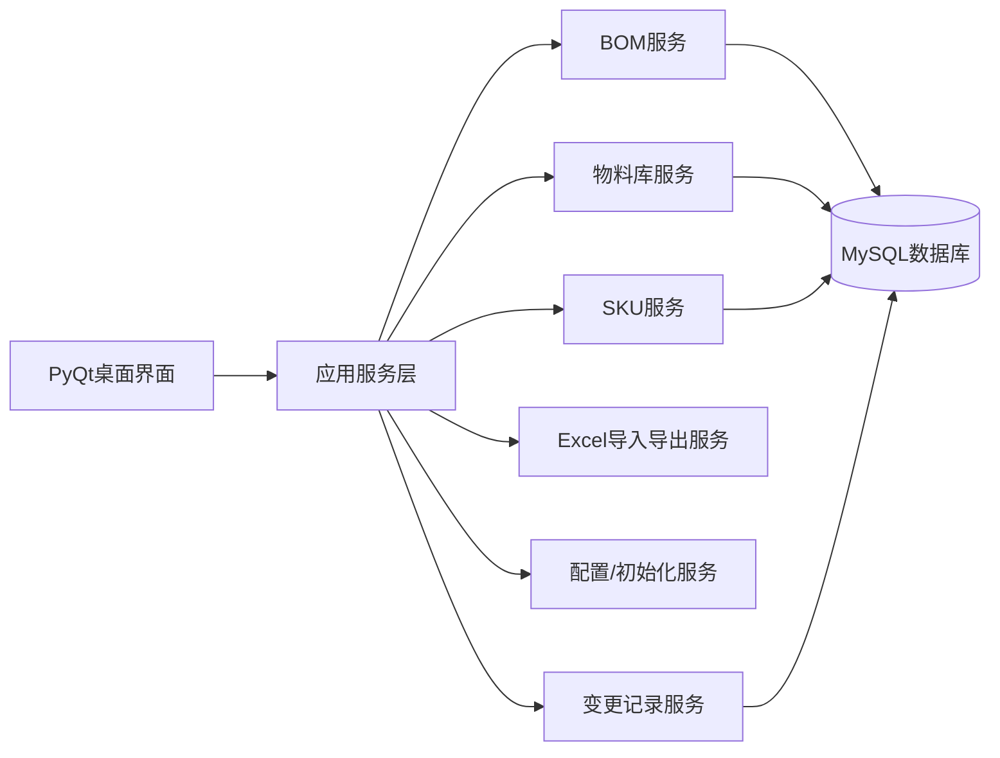
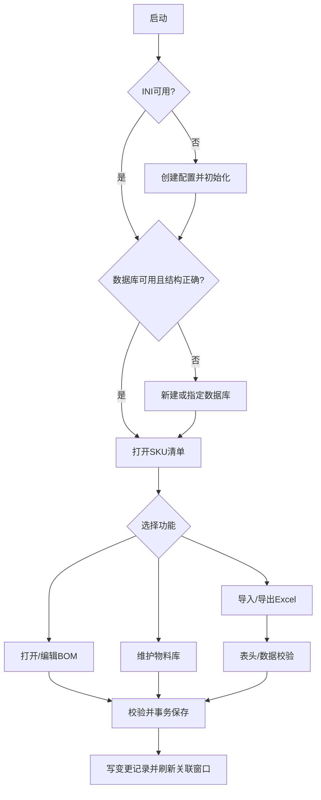

# BOM管理系统软件开发规格书

- 文档版本：1.0
- 编制日期：2026-09-24
- 初始软件版本：0.0.1
- 目标平台：Deepin 25 桌面系统
- 技术栈：Python 3、PyQt（建议 PyQt6）、MySQL、openpyxl、SQLAlchemy、PyInstaller
- 需求基线：`BOM管理系统软件开发需求.emmx`（已解析 137 条需求）及 `BOM管理系统编程指南.txt`

## 1. 建设目标与范围

系统用于管理物料主数据、可多层级复用的 BOM、SKU、替代料、版本变更和 Excel 数据交换。系统为单机桌面应用，启动后通过 INI 配置定位 MySQL 数据库；所有修改形成可追溯变更记录。首版必须覆盖本规格书第 4 节全部功能和第 8 节需求追踪矩阵。

### 1.1 角色

- **普通工程用户**：查看、新建、编辑、导入、导出物料及 BOM。
- **数据库维护用户**：在初始化或数据库不可用时新建/指定/校验数据库。
- 本版本不单独实现登录和权限体系；操作权限由桌面文件和数据库访问权限控制。

## 2. 总体架构

### 2.1 分层与模块

1. **启动与配置模块**：读取/校验同目录 `config.ini`；缺失或不可用时自动进入初始化；维护数据库地址、名称和应用版本。
2. **数据库模块**：连接 MySQL、创建基础表和 BOM 表、校验目录/结构、事务、备份连接状态。
3. **物料库模块**：物料 CRUD、唯一性、单位校验、M/P、呆滞判定、版本变更、引用检查。
4. **SKU 模块**：SKU 清单、创建/删除/版本变更、SKU 与物料映射、顶层 ROOT BOM。
5. **BOM 模块**：多层树、同级/下级新增、编辑、删除、替代料、保存/取消、跨 BOM 同步与刷新提示。
6. **Excel 模块**：模板导出、资料库/物料库/SKU BOM 导入和三类导出；表头、数据、差异和失败清单校验。
7. **项目模块**：项目名称、代码、产品名称、产品型号维护。
8. **变更记录模块**：记录新增、删除、修改物料、SKU、BOM 的时间和详细内容。
9. **界面模块**：主窗口、SKU 清单、BOM 窗口、物料库窗口、各种编辑/确认对话框。

## 3. 数据模型与约束

### 3.1 物料主数据 `materials`

`material_base_code` + `material_version` 为唯一物料 ID；字段：基础编码、版本号、名称、规格描述、单位、制造商、MPN、M/P、创建/修改时间、呆滞标志。基础编码、版本号、名称为新建必填；单位默认 `pcs`，允许：`套、ml、L、mm、cm、m、pcs`。编辑时基础编码和版本号不可改。

### 3.2 SKU `skus`

SKU 是被标记的物料；SKU 编码=基础编码+版本号，名称/描述引用物料；每个 SKU 顶层 BOM 的父项编码和父项版本号为 `ROOT`。只有“新建 SKU”产生的顶层 BOM 出现在 SKU 清单。每个 SKU 占一行。

### 3.3 BOM 行 `bom_items`

字段：父项基础编码、父项版本号、子项基础编码、子项版本号、数量、单位、位置、层级、M/P、排序。物料可拥有 BOM；SKU BOM 与非 SKU BOM 分离存储路径/命名空间，但共用一致的数据约束。相同父项下子项、数量、位置必须可校验；保存采用事务。

### 3.4 替代料 `material_alternates`

按 BOM 行维护替代料，字段：基础编码、版本号、名称、描述、制造商、MPN、排序；支持新增、删除和导出，建议每行最多 3 组并可扩展。

### 3.5 变更记录 `change_logs`

字段：序号、变更时间、详细内容、变更日期、变更时间、对象类型、对象 ID。所有物料、SKU、BOM 新增/删除/修改写入记录，并随三类 Excel 导出。

### 3.6 项目与配置

项目字段：项目名称、项目代码、产品名称、产品型号。`config.ini` 与运行文件同目录，至少包含数据库地址、名称和应用版本。数据库默认与软件同目录（部署时由配置决定）。

## 4. 功能规格

### 4.1 主界面与 SKU 清单

- 主窗口居中表格显示所有 SKU，列：序号、SKU 编码、SKU 名称、SKU 描述、修改日期时间；左下角实时显示“共计 X 个 SKU”，右下角显示版本号。
- 菜单提供：物料库、新建 SKU、导入、导出下拉菜单、修改项目信息。
- 每行最左侧提供打开按钮进入对应 BOM；右键 SKU 支持导出 SKU BOM、版本变更、删除 SKU。删除需确认并删除对应 BOM；版本变更输入新版本号并同步 SKU 清单与物料库。
- 新建 SKU：按物料基础编码自动筛选下拉候选（编码、版本、名称），确认后加入 SKU 清单并自动打开 BOM；不能选择已有 BOM 结构的物料；创建后默认数量 1、其余属性引用物料库。
- 项目信息窗口编辑项目名称、项目代码、产品名称、产品型号；项目名称默认“请输入项目名称”，确认保存，取消关闭。

### 4.2 BOM 窗口

- 左树右信息布局。树顶层为 SKU 名称；每行显示“物料编码，物料名称【数量，单位】”；支持展开/收起，默认展开 SKU 和一级、隐藏二级以上。
- 左键选中任何节点，右侧显示物料信息；修改数量、位置、备注后树显示同步更新。
- 右键普通节点：新建同级物料、新建下级物料、删除物料；顶层 SKU 不显示新建同级和删除物料。删除必须二次确认。
- 新建同级/下级通过物料编码输入框和候选下拉选择物料（编码、版本、名称、制造商、MPN），取消/确认；新节点自动选中，默认数量 1。
- 信息字段：基础编码、版本、名称、描述、数量、单位、位置、制造商、MPN、M/P、替代料、备注。只有数量、位置、备注可直接编辑，其余只读。
- 替代料表格列：基础编码、版本、名称、描述、制造商、MPN；底部“增加替代料”；右键删除并确认。增加窗口支持编码筛选、鼠标选择、取消/确认。
- BOM 保存/取消初始禁用；发生修改后启用。保存提交事务并禁用按钮，取消恢复编辑前状态并禁用按钮。
- 保存后若物料有下阶 BOM，更新物料库 BOM 状态；若被其他 BOM 引用，同步下阶结构。新建已有 BOM 的物料时自动复用其结构。
- 允许多个 BOM 窗口并行编辑。一个窗口保存后，其他窗口自动检测；有未保存编辑时顶部红字提示“BOM 有更新”并显示刷新按钮，刷新只合并外部变化且保留未保存编辑。
- 删除节点：若节点不再被任何 BOM 引用，可确认递归删除其 BOM 结构；若仍被引用，仅从当前 BOM 删除节点及其下阶。

### 4.3 物料库窗口

- 表格列：序号、基础编码、版本号、名称、规格描述、单位、制造商、MPN、修改日期时间、呆滞物料；单击选中一行。
- 菜单：导入物料清单、导出模板、新建物料、导出物料库；右键编辑、删除、版本变更。
- 新建/编辑窗口字段一致：基础编码、版本号、名称、规格描述、单位、制造商、MPN；新建前三项必填，编辑基础编码和版本号不可修改；单位默认 pcs 并限制合法值；确认/取消。
- 新建时校验唯一物料 ID，重复项红色高亮且禁止保存。
- 自动按是否被任何 BOM 引用计算呆滞物料：是标记 Y，否则 N。呆滞料确认后可直接删除；非呆滞料删除时列出引用 SKU 编码/名称，要求先从 BOM 删除。
- 版本变更：呆滞料直接更新；非呆滞料列出引用 SKU 并勾选同步范围。全选则更新原物料；部分选择则复制为新版本，原版本和新版本并存。

### 4.4 Excel 导入

- BOM 模板列：父项物料编码、父项版本号、物料基础编码、物料版本号、物料数量、位置。
- 物料模板列：物料基础编码、物料版本号、物料名称、物料规格描述、单位、物料制造商、物料MPN。
- 导入前校验表头；缺列弹窗列出不合格项并禁止整批导入。BOM 还必须校验父/子物料均存在、父项下阶项目/数量与系统一致，否则禁止整批导入。
- 物料导入必填：基础编码、版本号、单位、制造商；缺失禁止整批导入。遇已存在物料时显示具体差异，并提供跳过该物料、取消全部、覆盖导入。
- 导入结束弹窗显示成功数量、失败数量、失败编码与名称；成功或失败均须弹窗。

### 4.5 Excel 导出

所有导出均弹出路径选择窗口，确认后生成 xlsx；日期时间格式统一 `YYYYMMDD_HHMMSS`。

- **整个资料库**：默认名“项目名称_资料库_日期_时间”；Sheet1 SKU 清单，Sheet2 物料库，Sheet3 变更记录（序号、变更时间、变更详细内容、变更日期、变更时间），后续每个 SKU 一个 BOM Sheet。
- **物料库**：默认名“项目名称_物料库_日期_时间”；Sheet1 变更记录，Sheet2 物料库，列为序号、基础编码、版本号、名称、规格描述、单位、制造商、MPN、M/P。
- **SKU BOM**：默认名“SKU编号_SKU名称_日期_时间”；Sheet1 变更记录，Sheet2 SKU BOM，列为序号、层级、父项编码、父项版本、物料基础编码、物料版本号、物料名称、物料规格描述、用量、单位、M/P、制造商、MPN；MPN 后追加替代料1~3的名称、版本号、名称、制造商、MPN（按需求原文保留字段顺序）。

### 4.6 数据库与初始化

- 启动检测 INI；缺失或不可用自动新建并进入初始化。检测数据库丢失或目录结构错误时，提示“新建数据库”或“指定数据库”。
- 新建：文件窗口选择路径并设置数据库名，确认后创建 MySQL 基础结构。指定：选择数据库文件/连接目标，确认后校验；成功提示连接成功，失败提示校验失败并返回选择窗口。
- 物料库与 BOM 独立表管理；每个物料 BOM 独立表/命名空间，SKU 与非 SKU 路径分离；数据库操作具备事务和错误提示。

## 5. 关键业务流程

## 6. 界面与交互约定

使用 PyQt 主窗口 + QTableView/QTreeView + QDialog。所有危险操作采用确认对话框；验证失败以红色高亮字段并列出具体原因；耗时导入导出显示进度；窗口可关闭时提示未保存编辑。界面中文、键盘可操作、表格支持排序和列宽调整。

## 7. 非功能、工程与交付要求

- 代码按功能模块独立文件，模块头部中文注释包含模块描述、输入输出接口、编辑时间，核心代码有中文注释。
- 版本三段式，初始 `0.0.1`，按修复/功能调整自动升版。
- Git 管理；忽略编译、运行临时文件、缓存和本地配置/数据库凭据。
- 项目目录位于 `/home/biong/Documents/code/BOM管理系统`，包含 `src`、`package`、`docs`、`tests`、`test_reports`。
- 自动 PyInstaller 打包为 Deepin 25 可运行独立文件，文件名“软件名称_版本号_打包日期和时间”。
- 测试必须覆盖 code review、单元、集成、系统测试；文档包含 AI 编程规范、第三方库许可证、接口文件、使用说明（含界面截图）、项目目录说明、README 构建和继续使用 AI 编程说明。
- 数据安全：关键写操作事务化；导入失败不产生半批数据；导出失败保留原数据；日志记录异常。

## 8. 接口规格（模块输入/输出）

| 接口 | 输入 | 输出/协议 |
|---|---|---|
| `ConfigService.load()` | 配置路径 | `AppConfig`；INI |
| `DatabaseService.connect()` | 主机、端口、库名、凭据 | 连接/校验结果；MySQL |
| `MaterialService.create/update/delete()` | 物料 DTO、版本策略 | 物料 DTO/业务错误；事务 |
| `BomService.load/save/delete_item()` | 父项 ID、BOM 行、替代料 | 树数据/变更结果；事务 |
| `SkuService.create/change_version/delete()` | 物料 ID、版本号 | SKU DTO；事务 |
| `ExcelService.import_materials/import_bom()` | xlsx 路径、冲突策略 | 成功/失败明细；openpyxl |
| `ExcelService.export_*()` | 导出范围、目标路径 | xlsx 文件 |
| `ChangeLogService.record/query()` | 对象、动作、详情 | 记录列表 |
| `WindowRefreshBus.publish()` | BOM/物料变更事件 | 其他窗口刷新事件；Qt signal |

## 9. 需求追踪矩阵（100%覆盖）

下表将需求图 137 条逐条映射到本规格书章节；编号按解析顺序对应原图条目。

| 原需求编号 | 覆盖章节 | 原需求摘要 |
|---:|---|---|
|1-5|4.1、6|系统/UI、SKU清单、物料库/BOM入口、版本与SKU计数|
|6-8|4.1|物料库、新建SKU、导出菜单|
|9-13|4.1、4.5|导出选项、版本号、SKU计数|
|14-16|4.1|项目修改窗口、项目名称默认值|
|17-24|4.2、4.3、4.6|模块分类、BOM左右布局、树和主窗体|
|25-36|4.2|树右键新增、删除SKU、物料信息、替代料、保存取消、联动刷新|
|37-46|4.2、4.4|BOM菜单、Excel导入/模板、候选选择、导入校验、保存取消|
|47-51|4.2、3.2|BOM状态、跨BOM同步、复用结构、多窗口、ROOT规则|
|52-60|4.3、4.4、3.1|物料库表格、M/P、模板、导入校验、唯一ID|
|61-73|4.3、4.1|新建物料、字段/单位/校验、模板、导入结果、新建SKU|
|74-78|4.5、4.1|资料库导出、项目字段|
|79-92|4.3|选中、编辑、删除、呆滞判定、版本变更与引用策略|
|93-98|4.1、4.3|SKU行、SKU版本、删除、版本输入、BOM状态限制、SKU定义|
|99-107|3、4.6、7|MySQL、表分离、BOM命名空间、数据库/INI初始化|
|108-115|4.5|路径选择、默认命名、资料库Sheet结构、SKU BOM Sheet|
|116-121|4.5|物料库导出命名、Sheet和变更记录|
|122-128|4.5|SKU导出命名、变更记录、BOM字段、替代料列|
|129-134|4.2|顶层右键限制、删除确认、递归BOM处理|
|135-137|3.2、4.1、4.6|SKU定义、SKU管理、INI可用性|

> 逐条核查结论：原图 1~137 均已在第 3、4、5、6、7 节给出可实现规格，并在本矩阵中建立映射；实现验收必须以该矩阵逐项勾选。

## 10. 验收标准

1. 在无配置/无数据库、数据库损坏、数据库可用三种启动状态下均能按流程进入系统或得到明确提示。
2. 物料、SKU、BOM、替代料的增删改查和所有唯一性/引用/版本规则通过单元及集成测试。
3. Excel 模板、导入校验、冲突策略、三个导出范围的 Sheet、列和命名完全符合第 4.4/4.5 节。
4. 多窗口更新提示、未保存数据保护、跨 BOM 同步和递归删除通过系统测试。
5. 需求追踪矩阵 137 条全部具备测试用例和通过记录；PyInstaller 包在另一台 Deepin 25 上可启动运行。
