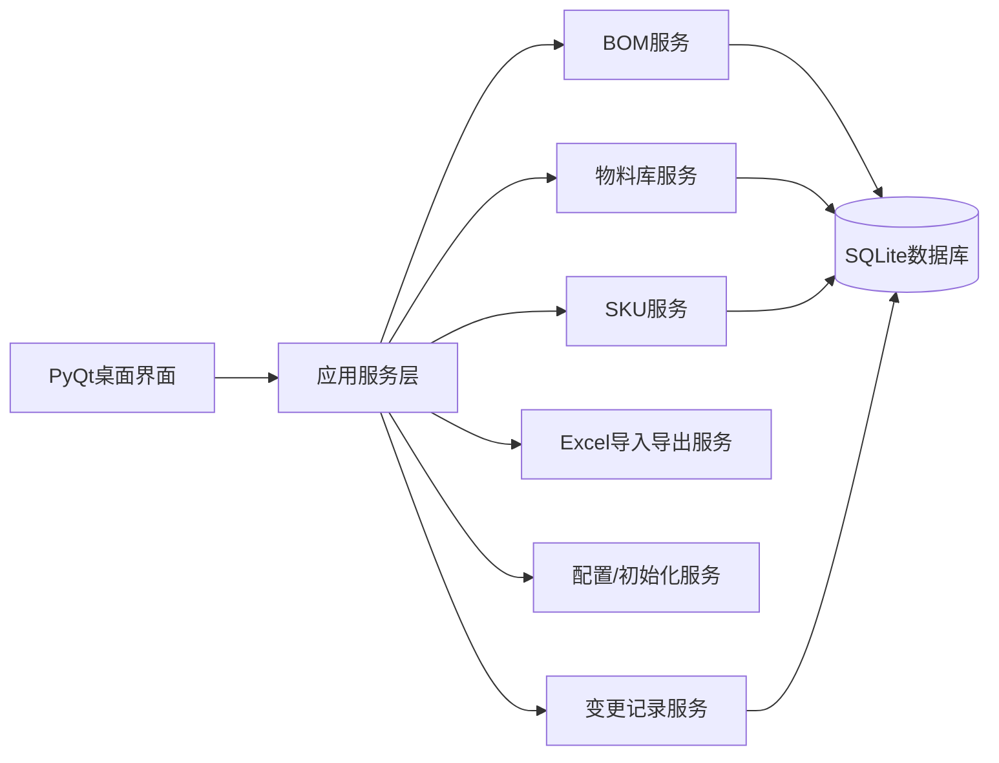
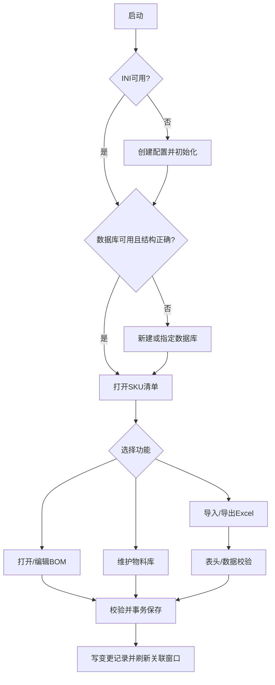
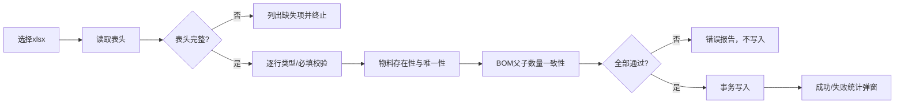

# BOM管理系统软件开发规格书

> 当前术语（2026-10-19）：软件统一使用“历史版本”（旧文档的“镜像”即历史版本），包括版本号、窗口、导出及变更记录。技术字段 mirror_version / mirror_* 保持兼容，后续开发与说明均使用“历史版本”。


- 文档版本：1.0
- 编制日期：2026-09-24
- 初始软件版本：0.0.1
- 目标平台：Deepin 25 桌面系统
- 技术栈：Python 3、PyQt5、SQLite、openpyxl、PyInstaller
- 需求基线：`BOM管理系统软件开发需求.emmx`（已解析 137 条需求）及 `BOM管理系统编程指南.txt`

## 1. 建设目标与范围

系统用于管理物料主数据、可多层级复用的 BOM、SKU、替代料、版本变更和 Excel 数据交换。系统为单机桌面应用，启动后通过 INI 配置定位 SQLite 数据库；所有修改形成可追溯变更记录。首版必须覆盖本规格书第 4 节全部功能和第 8 节需求追踪矩阵。

### 1.1 角色

- **普通工程用户**：查看、新建、编辑、导入、导出物料及 BOM。
- **数据库维护用户**：在初始化或数据库不可用时新建/指定/校验数据库。
- 本版本不单独实现登录和权限体系；操作权限由桌面文件和数据库访问权限控制。

## 2. 总体架构



### 2.1 分层与模块

1. **启动与配置模块**：读取/校验同目录 `config.ini`；缺失或不可用时自动进入初始化；维护数据库地址、名称和应用版本。
2. **数据库模块**：连接 SQLite、创建基础表和 BOM 表、校验目录/结构、事务、备份连接状态。
3. **物料库模块**：物料 CRUD、唯一性、单位校验、M/P、呆滞判定、版本变更、引用检查。
4. **SKU 模块**：SKU 清单、创建/删除/版本变更、SKU 与物料映射、顶层 ROOT BOM。
5. **BOM 模块**：多层树、同级/下级新增、编辑、删除、替代料、保存/取消、跨 BOM 同步与刷新提示。
6. **Excel 模块**：模板导出、资料库/物料库/SKU BOM 导入和三类导出；表头、数据、差异和失败清单校验。
7. **项目模块**：项目名称、代码、产品名称、产品型号维护。
8. **变更记录模块**：记录新增、删除、修改物料、SKU、BOM 的时间和详细内容。
9. **界面模块**：主窗口、SKU 清单、BOM 窗口、物料库窗口、各种编辑/确认对话框。

## 3. 数据模型与约束

### 3.1 物料主数据 `materials`

`material_base_code` + `material_version` 为唯一物料 ID；字段：基础编码、版本号、名称、规格描述、单位、制造商、MPN、M/P、创建/修改时间、呆滞标志。基础编码、版本号、名称为新建必填；单位默认 `pcs`，允许：`套、ml、L、mm、cm、m、pcs`。编辑时基础编码和版本号不可改。

### 3.2 SKU `skus`

SKU 是被标记的物料；SKU 编码=基础编码+版本号，名称/描述引用物料；每个 SKU 顶层 BOM 的父项编码和父项版本号为 `ROOT`。只有“新建 SKU”产生的顶层 BOM 出现在 SKU 清单。每个 SKU 占一行。

### 3.3 物料下阶关系 `material_bom_items`

字段：父物料 ID、下阶物料 ID、数量、单位、位置、备注、排序和时间戳。每个物料的下阶关系独立存储；BOM 管理窗口通过递归查询父物料关系形成树状结构，SKU 只作为顶层展示入口。相同父项下子项、数量、位置必须可校验；保存采用事务。旧版 `bom_items` 数据升级时迁移到该关系表。

### 3.4 替代料 `material_alternates`

按 BOM 行维护替代料，字段：基础编码、版本号、名称、描述、制造商、MPN、排序；支持新增、删除和导出，建议每行最多 3 组并可扩展。

### 3.5 变更记录 `change_logs`

字段：序号、变更时间、详细内容、变更日期、变更时间、对象类型、对象 ID。所有物料、SKU、BOM 新增/删除/修改写入记录，并随三类 Excel 导出。

### 3.6 项目与配置

项目字段：项目名称、项目代码、产品名称、产品型号。`config.ini` 与运行文件同目录，至少包含数据库地址、名称和应用版本。数据库默认与软件同目录（部署时由配置决定）。

## 4. 功能规格

### 4.1 主界面与 SKU 清单

- 主窗口居中表格显示所有 SKU，列：序号、SKU 编码、SKU 名称、SKU 描述、修改日期时间；左下角实时显示“共计 X 个 SKU”，右下角显示版本号。
- 菜单提供：物料库、新建 SKU、导入、导出下拉菜单、修改项目信息。
- 每行最左侧提供打开按钮进入对应 BOM；右键 SKU 支持导出 SKU BOM、版本变更、删除 SKU。删除需确认并删除对应 BOM；版本变更输入新版本号并同步 SKU 清单与物料库。
- 新建 SKU：按物料基础编码自动筛选下拉候选（编码、版本、名称），确认后加入 SKU 清单并自动打开 BOM；不能选择已有 BOM 结构的物料；创建后默认数量 1、其余属性引用物料库。
- 项目信息窗口编辑项目名称、项目代码、产品名称、产品型号；项目名称默认“请输入项目名称”，确认保存，取消关闭。

### 4.2 BOM 窗口

- 左树右信息布局。树顶层为 SKU 名称；每行显示“物料编码，物料名称【数量，单位】”；支持展开/收起，默认展开 SKU 和一级、隐藏二级以上。
- 左键选中任何节点，右侧显示物料信息；修改数量、位置、备注后树显示同步更新。
- 右键普通节点：新建同级物料、新建下级物料、删除物料；顶层 SKU 不显示新建同级和删除物料。删除必须二次确认。
- 新建同级/下级通过物料编码输入框和候选下拉选择物料（编码、版本、名称、制造商、MPN），取消/确认；新节点自动选中，默认数量 1。
- 信息字段：基础编码、版本、名称、描述、数量、单位、位置、制造商、MPN、M/P、替代料、备注。只有数量、位置、备注可直接编辑，其余只读。
- 替代料表格列：基础编码、版本、名称、描述、制造商、MPN；底部“增加替代料”；右键删除并确认。增加窗口支持编码筛选、鼠标选择、取消/确认。
- BOM 保存/取消初始禁用；发生修改后启用。保存提交事务并禁用按钮，取消恢复编辑前状态并禁用按钮。
- 保存后若物料有下阶 BOM，更新物料库 BOM 状态；若被其他 BOM 引用，同步下阶结构。新建已有 BOM 的物料时自动复用其结构。
- 允许多个 BOM 窗口并行编辑。一个窗口保存后，其他窗口自动检测；有未保存编辑时顶部红字提示“BOM 有更新”并显示刷新按钮，刷新只合并外部变化且保留未保存编辑。
- 删除节点：若节点不再被任何 BOM 引用，可确认递归删除其 BOM 结构；若仍被引用，仅从当前 BOM 删除节点及其下阶。

### 4.3 物料库窗口

- 表格列：序号、基础编码、版本号、名称、规格描述、单位、制造商、MPN、修改日期时间、呆滞物料；单击选中一行。
- 菜单：导入物料清单、导出模板、新建物料、导出物料库；右键编辑、删除、版本变更。
- 新建/编辑窗口字段一致：基础编码、版本号、名称、规格描述、单位、制造商、MPN；新建前三项必填，编辑基础编码和版本号不可修改；单位默认 pcs 并限制合法值；确认/取消。
- 新建时校验唯一物料 ID，重复项红色高亮且禁止保存。
- 自动按是否被任何 BOM 引用计算呆滞物料：是标记 Y，否则 N。呆滞料确认后可直接删除；非呆滞料删除时列出引用 SKU 编码/名称，要求先从 BOM 删除。
- 版本变更：呆滞料直接更新；非呆滞料列出引用 SKU 并勾选同步范围。全选则更新原物料；部分选择则复制为新版本，原版本和新版本并存。

### 4.4 Excel 导入

- BOM 模板列：父项物料编码、父项版本号、物料基础编码、物料版本号、物料数量、位置。
- 物料模板列：物料基础编码、物料版本号、物料名称、物料规格描述、单位、物料制造商、物料MPN。
- 导入前校验表头；缺列弹窗列出不合格项并禁止整批导入。BOM 还必须校验父/子物料均存在、父项下阶项目/数量与系统一致，否则禁止整批导入。
- 物料导入必填：基础编码、版本号、单位、制造商；缺失禁止整批导入。遇已存在物料时显示具体差异，并提供跳过该物料、取消全部、覆盖导入。
- 导入结束弹窗显示成功数量、失败数量、失败编码与名称；成功或失败均须弹窗。

### 4.5 Excel 导出

所有导出均弹出路径选择窗口，确认后生成 xlsx；日期时间格式统一 `YYYYMMDD_HHMMSS`。

- **整个资料库**：默认名“项目名称_资料库_日期_时间”；Sheet1 SKU 清单，Sheet2 物料库，Sheet3 变更记录（序号、变更时间、变更详细内容、变更日期、变更时间），后续每个 SKU 一个 BOM Sheet。
- **物料库**：默认名“项目名称_物料库_日期_时间”；Sheet1 变更记录，Sheet2 物料库，列为序号、基础编码、版本号、名称、规格描述、单位、制造商、MPN、M/P。
- **SKU BOM**：默认名“SKU编号_SKU名称_日期_时间”；Sheet1 变更记录，Sheet2 SKU BOM，列为序号、层级、父项编码、父项版本、物料基础编码、物料版本号、物料名称、物料规格描述、用量、单位、M/P、制造商、MPN；MPN 后追加替代料1~3的名称、版本号、名称、制造商、MPN（按需求原文保留字段顺序）。

### 4.6 数据库与初始化

- 启动检测 INI；缺失或不可用自动新建并进入初始化。检测数据库丢失或目录结构错误时，提示“新建数据库”或“指定数据库”。
- 新建：文件窗口选择路径并设置数据库名，确认后创建 SQLite 基础结构。指定：选择数据库文件/连接目标，确认后校验；成功提示连接成功，失败提示校验失败并返回选择窗口。
- 物料库与 BOM 独立表管理；每个物料 BOM 独立表/命名空间，SKU 与非 SKU 路径分离；数据库操作具备事务和错误提示。

## 5. 关键业务流程



## 6. 界面与交互约定

使用 PyQt 主窗口 + QTableView/QTreeView + QDialog。所有危险操作采用确认对话框；验证失败以红色高亮字段并列出具体原因；耗时导入导出显示进度；窗口可关闭时提示未保存编辑。界面中文、键盘可操作、表格支持排序和列宽调整。

## 7. 非功能、工程与交付要求

- 代码按功能模块独立文件，模块头部中文注释包含模块描述、输入输出接口、编辑时间，核心代码有中文注释。
- 版本三段式，初始 `0.0.1`，按修复/功能调整自动升版。
- Git 管理；忽略编译、运行临时文件、缓存和本地配置/数据库凭据。
- 项目目录位于 `/home/biong/Documents/code/BOM管理系统`，包含 `src`、`tools`、`package`、`docs`、`tests`、`test_reports`；构建临时文件统一放在 `.tmp`。
- 自动 PyInstaller 打包为 Deepin 25 可运行独立文件，文件名“软件名称_版本号_打包日期和时间”。
- 测试必须覆盖 code review、单元、集成、系统测试；文档包含 AI 编程规范、第三方库许可证、接口文件、使用说明（含界面截图）、项目目录说明、README 构建和继续使用 AI 编程说明。
- 数据安全：关键写操作事务化；导入失败不产生半批数据；导出失败保留原数据；日志记录异常。

## 8. 接口规格（模块输入/输出）

| 接口 | 输入 | 输出/协议 |
|---|---|---|
| `ConfigService.load()` | 配置路径 | `AppConfig`；INI |
| `DatabaseService.connect()` | 主机、端口、库名、凭据 | 连接/校验结果；SQLite |
| `MaterialService.create/update/delete()` | 物料 DTO、版本策略 | 物料 DTO/业务错误；事务 |
| `BomService.load/save/delete_item()` | 父项 ID、BOM 行、替代料 | 树数据/变更结果；事务 |
| `SkuService.create/change_version/delete()` | 物料 ID、版本号 | SKU DTO；事务 |
| `ExcelService.import_materials/import_bom()` | xlsx 路径、冲突策略 | 成功/失败明细；openpyxl |
| `ExcelService.export_*()` | 导出范围、目标路径 | xlsx 文件 |
| `ChangeLogService.record/query()` | 对象、动作、详情 | 记录列表 |
| `WindowRefreshBus.publish()` | BOM/物料变更事件 | 其他窗口刷新事件；Qt signal |

## 9. 需求追踪矩阵（100%覆盖）

下表将需求图 137 条逐条映射到本规格书章节；编号按解析顺序对应原图条目。

| 原需求编号 | 覆盖章节 | 原需求摘要 |
|---:|---|---|
|1-5|4.1、6|系统/UI、SKU清单、物料库/BOM入口、版本与SKU计数|
|6-8|4.1|物料库、新建SKU、导出菜单|
|9-13|4.1、4.5|导出选项、版本号、SKU计数|
|14-16|4.1|项目修改窗口、项目名称默认值|
|17-24|4.2、4.3、4.6|模块分类、BOM左右布局、树和主窗体|
|25-36|4.2|树右键新增、删除SKU、物料信息、替代料、保存取消、联动刷新|
|37-46|4.2、4.4|BOM菜单、Excel导入/模板、候选选择、导入校验、保存取消|
|47-51|4.2、3.2|BOM状态、跨BOM同步、复用结构、多窗口、ROOT规则|
|52-60|4.3、4.4、3.1|物料库表格、M/P、模板、导入校验、唯一ID|
|61-73|4.3、4.1|新建物料、字段/单位/校验、模板、导入结果、新建SKU|
|74-78|4.5、4.1|资料库导出、项目字段|
|79-92|4.3|选中、编辑、删除、呆滞判定、版本变更与引用策略|
|93-98|4.1、4.3|SKU行、SKU版本、删除、版本输入、BOM状态限制、SKU定义|
|99-107|3、4.6、7|SQLite、表分离、BOM命名空间、数据库/INI初始化|
|108-115|4.5|路径选择、默认命名、资料库Sheet结构、SKU BOM Sheet|
|116-121|4.5|物料库导出命名、Sheet和变更记录|
|122-128|4.5|SKU导出命名、变更记录、BOM字段、替代料列|
|129-134|4.2|顶层右键限制、删除确认、递归BOM处理|
|135-137|3.2、4.1、4.6|SKU定义、SKU管理、INI可用性|

> 逐条核查结论：原图 1~137 均已在第 3、4、5、6、7 节给出可实现规格，并在本矩阵中建立映射；实现验收必须以该矩阵逐项勾选。

## 10. 验收标准

1. 在无配置/无数据库、数据库损坏、数据库可用三种启动状态下均能按流程进入系统或得到明确提示。
2. 物料、SKU、BOM、替代料的增删改查和所有唯一性/引用/版本规则通过单元及集成测试。
3. Excel 模板、导入校验、冲突策略、三个导出范围的 Sheet、列和命名完全符合第 4.4/4.5 节。
4. 多窗口更新提示、未保存数据保护、跨 BOM 同步和递归删除通过系统测试。
5. 需求追踪矩阵 137 条全部具备测试用例和通过记录；PyInstaller 包在另一台 Deepin 25 上可启动运行。

## 11. 软件详细设计方案

### 11.1 运行时组件与目录

```text
src/
  main.py                 启动入口、异常捕获、版本读取
  app_context.py          QApplication、服务容器、窗口总线
  config/config_service.py
  database/{connection, schema, repositories}.py
  domain/{models, validators, errors}.py
  services/{material, sku, bom, import_export, change_log, project}.py
  ui/{main_window, bom_window, material_window, dialogs, delegates}.py
  infrastructure/{events, logger, clock}.py
```

服务层只通过 Repository 访问数据库；UI 只调用服务层，不直接执行 SQL。所有服务方法返回 `Result[T]`（成功值或业务错误），数据库异常统一转换为 `DatabaseError`，校验异常转换为 `ValidationError`。

### 11.2 核心类和接口

| 类/接口 | 关键方法 | 责任 |
|---|---|---|
| `ConfigService` | `load()`, `ensure_file()`, `save()` | INI 创建、读取、路径合法性校验 |
| `DatabaseManager` | `connect()`, `create_schema()`, `validate_schema()`, `transaction()` | SQLite 连接、建表、结构校验、事务 |
| `MaterialService` | `list()`, `create(dto)`, `update(id,dto)`, `delete(id)`, `change_version(id,policy)` | 物料主数据和引用规则 |
| `SkuService` | `list()`, `create(material_id)`, `delete(sku_id)`, `change_version(sku_id,version)` | SKU 生命周期及 ROOT BOM |
| `BomService` | `load(root)`, `add_item()`, `update_item()`, `remove_item()`, `save()`, `import_rows()` | BOM 树、递归结构、跨 BOM 同步 |
| `AlternateService` | `list(bom_item)`, `add()`, `remove()` | 替代料维护 |
| `ImportExportService` | `validate_headers()`, `import_materials()`, `import_bom()`, `export_database()`, `export_materials()`, `export_sku()` | openpyxl 文件交换和报告 |
| `ChangeLogService` | `record()`, `query(scope)` | 统一审计记录 |
| `WindowRefreshBus` | `publish(event)`, `subscribe(handler)` | 多 BOM 窗口更新通知 |
| `MainWindow` | `refresh_skus()`, `open_bom()`, `show_materials()` | 主界面和菜单 |
| `BomWindow` | `load_tree()`, `on_select()`, `set_dirty()`, `refresh_external()` | BOM 编辑和未保存保护 |

### 11.3 数据库详细设计

采用统一关系表加 `bom_kind`（`SKU`/`NORMAL`）和 `bom_root_id` 区分路径，逻辑上满足“每个物料独立 BOM、SKU 与非 SKU 分离”；避免动态建表造成迁移困难。建议表如下：

- `app_projects(id, project_name, project_code, product_name, product_model, updated_at)`
- `materials(id, base_code, version, name, description, unit, manufacturer, mpn, mp_flag, has_bom, created_at, updated_at, UNIQUE(base_code,version))`
- `skus(id, material_id, root_code, root_version, created_at, updated_at, UNIQUE(material_id))`
- `material_bom_items(id, parent_material_id, child_material_id, quantity, unit, position, remark, sort_no, created_at, updated_at, UNIQUE(parent_material_id,child_material_id,position))`
- `alternate_items(id, bom_item_id, material_id, sort_no)`
- `change_logs(id, object_type, object_id, action, detail, changed_at)`
- `schema_meta(key_name, value)`

外键使用 `RESTRICT` 防止被引用物料误删；删除 BOM 关系使用事务。`materials.has_bom` 由父物料关系实时判断并在保存事务中刷新；BOM 树通过关系表递归展开，避免为每个物料动态创建数据库表。

### 11.4 BOM 保存事务

1. UI 将编辑缓冲区与数据库版本号提交 `BomService.save()`。
2. 服务校验父子物料存在、数量为正数、单位一致、无循环引用。
3. 开启事务，写入/删除 BOM 行及替代料，更新 `has_bom`，写 `change_logs`。
4. 对相同物料的其他 BOM 执行同步策略，记录受影响根 BOM。
5. 提交事务并发布 `BomChangedEvent`；失败则回滚并恢复 UI 缓冲区。

### 11.5 并发窗口与冲突

每个 BOM 窗口保存 `loaded_revision`。保存前比较数据库 revision：相同则正常提交；不同则发布红色更新提示，禁止静默覆盖。用户点击刷新时取得外部新树，对未保存节点按 `item_id` 合并；同一节点冲突保留本地编辑并标记冲突，提供“采用外部/保留本地”选择。

### 11.6 导入校验管线



物料冲突策略为逐条询问“跳过/取消全部/覆盖”；选择取消全部时回滚整批。BOM 任一行不合规时整批回滚。错误报告包含 Excel 行号、字段、实际值、原因。

### 11.7 UI 状态机

- **编辑对话框**：`CLEAN -> DIRTY -> SAVING -> CLEAN`；取消从 `DIRTY` 回到 `CLEAN` 并恢复快照。
- **BOM 窗口**：`LOADING -> READY -> DIRTY -> EXTERNAL_UPDATE -> READY/DIRTY`；未保存时关闭必须确认。
- **数据库初始化**：`CHECKING -> CHOOSE_NEW/CHOOSE_EXISTING -> VALIDATING -> CONNECTED/ERROR`。
- **导入任务**：`SELECTED -> VALIDATING -> CONFLICT -> WRITING -> REPORT`。

### 11.8 错误、日志与可恢复性

所有异常记录时间、模块、操作、对象 ID 和堆栈到应用日志；UI 显示可读错误和下一步操作。写数据库前建立事务，导入使用临时内存模型，导出写临时文件后原子替换目标文件。启动时若配置不可解析，备份损坏文件并重新初始化。

### 11.9 测试设计

- 单元测试：编码唯一性、单位/M/P、呆滞判定、循环 BOM、递归删除、版本变更分支、表头和字段校验、导出列顺序。
- 集成测试：SQLite schema 创建、物料-SKU-BOM 联动、跨窗口事件、导入事务回滚、三类导出后再读取。
- 系统测试：按主界面、物料库、BOM、初始化、导入导出和异常恢复编写端到端用例。
- 需求验收：第 12 节每个编号至少一个测试用例，测试报告记录“通过/失败/阻塞”和证据路径。

## 12. 逐条软件需求追踪表

状态定义：`已规格化`表示已在本规格书明确实现设计；`待测试`表示编码后必须补充测试证据。

|编号|原始需求（摘要）|规格书设计位置|验证方式|状态|
|---:|---|---|---|---|
|1|BOM管理系统|4、6|单元/集成/系统测试|已规格化，待测试|
|2|界面UI&UX|4、6|单元/集成/系统测试|已规格化，待测试|
|3|特别描述|4、6|单元/集成/系统测试|已规格化，待测试|
|4|窗口居中表格显示目前所有的SKU，按顺序显示序号、SKU编码、SKU名称、SKU描述、修改日期&时间栏位|4.1/4.2|单元/集成/系统测试|已规格化，待测试|
|5|主界面-SKU清单|4、6|单元/集成/系统测试|已规格化，待测试|
|6|菜单栏显示物料库按钮，点击可以打开物料库窗口|4.1/4.2|单元/集成/系统测试|已规格化，待测试|
|7|每一个SKU的行最左边有一个打开按钮，点击可以打开对应SKU的BOM窗口|4.1/4.2|单元/集成/系统测试|已规格化，待测试|
|8|菜单栏显示新建SKU按钮，点击可以打开新建BOM窗口|4.1/4.2|单元/集成/系统测试|已规格化，待测试|
|9|菜单栏显示导出下拉菜单，包含下面选项|4.1/4.2|单元/集成/系统测试|已规格化，待测试|
|10|BOM窗口|4、6|单元/集成/系统测试|已规格化，待测试|
|11|物料库窗口|4、6|单元/集成/系统测试|已规格化，待测试|
|12|窗口右下角显示当前软件的版本号|4.1/4.2|单元/集成/系统测试|已规格化，待测试|
|13|窗口左下角显示“共计X个SKU”，实时显示SKU总数|4.1/4.2|单元/集成/系统测试|已规格化，待测试|
|14|菜单栏显示修改项目信息按钮，单击打开修改项目信息窗口|4.1/4.2|单元/集成/系统测试|已规格化，待测试|
|15|窗口正中间显示项目名称，默认文字“请输入项目名称”|4.1/4.2|单元/集成/系统测试|已规格化，待测试|
|16|BOM管理|4、6|单元/集成/系统测试|已规格化，待测试|
|17|物料库管理|4、6|单元/集成/系统测试|已规格化，待测试|
|18|数据库管理|4、6|单元/集成/系统测试|已规格化，待测试|
|19|初始化管理|4、6|单元/集成/系统测试|已规格化，待测试|
|20|主窗体分为左右两部分，左边树状图根据层级显示当前BOM的物料清单，右边显示当前点选物料的物料信息|4.1/4.2|单元/集成/系统测试|已规格化，待测试|
|21|树状图最顶层为SKU名称，BOM中的所有物料都包含在这个层级之下，每一行显示当前物料的“物料编码，物料名称【物料数量，物料单位】”，若当前物料下阶还有子级…|4.1/4.2|单元/集成/系统测试|已规格化，待测试|
|22|默认打开显示SKU以及下阶一级物料，再往下二阶及更高阶物料默认隐藏|4.1/4.2|单元/集成/系统测试|已规格化，待测试|
|23|主窗体|4、6|单元/集成/系统测试|已规格化，待测试|
|24|菜单栏|4、6|单元/集成/系统测试|已规格化，待测试|
|25|右键树状图的每一个物料，可以新建同级物料、新建下级物料|4.1/4.2|单元/集成/系统测试|已规格化，待测试|
|26|右击每一行SKU，可以删除SKU|4.1/4.2|单元/集成/系统测试|已规格化，待测试|
|27|物料信息窗口包含物料基础编码、物料版本号、物料名称、物料描述、物料数量、物料单位、物料位置、物料制造商、物料MPN、M/P、替代料、备注等栏位|4.1/4.2|单元/集成/系统测试|已规格化，待测试|
|28|物料数量、物料位置、备注栏位可以直接编辑，其他栏位不可以直接编辑|4.1/4.2|单元/集成/系统测试|已规格化，待测试|
|29|替代料栏位表格显示当前物料的替代料，包含替代料基础编码、替代料版本号、替代料名称、替代料描述、替代料制造商、替代料MPN|4.1/4.2|单元/集成/系统测试|已规格化，待测试|
|30|替代料表格最下方有“增加替代料”按钮，点击打开增加替代料窗口|4.1/4.2|单元/集成/系统测试|已规格化，待测试|
|31|窗口为一个输入框，输入物料基础编码自动下拉菜单显示根据物料编码从物料库筛选的对应物料，显示“物料编码 物料版本号 物料名称 制造商 MPN”，通过鼠标点选…|4.1/4.2|单元/集成/系统测试|已规格化，待测试|
|32|窗口包含取消和确认按钮|4.1/4.2|单元/集成/系统测试|已规格化，待测试|
|33|右键替代料表格中的替代料，右键菜单显示“删除替代料”，经过确认后可以删除替代料|4.1/4.2|单元/集成/系统测试|已规格化，待测试|
|34|物料信息窗口右下方包含保存、取消按钮，默认保存按钮&取消按钮不可点选、当信息发生修改后，两个按键可以点选，点击保存可以保存当前修改并重新让按钮不可点选，点…|4.1/4.2|单元/集成/系统测试|已规格化，待测试|
|35|左键点击树状图中的任何一个物料（包括SKU），则物料信息窗口显示点击物料的信息|4.1/4.2|单元/集成/系统测试|已规格化，待测试|
|36|物料信息修改后，同步更新左侧树状图的显示|4.1/4.2|单元/集成/系统测试|已规格化，待测试|
|37|菜单栏|4、6|单元/集成/系统测试|已规格化，待测试|
|38|菜单栏包含导入按钮，点击可以通过选择本地EXCEL文件，导入BOM|4.1/4.2|单元/集成/系统测试|已规格化，待测试|
|39|菜单栏包含导出模板按钮，点击可以向本地另存为一个EXCEL的表头，以便用于导入BOM|4.1/4.2|单元/集成/系统测试|已规格化，待测试|
|40|窗口为一个输入框，输入物料基础编码自动下拉菜单显示根据物料编码从物料库筛选的对应物料，显示“物料编码 物料版本号 物料名称 制造商 MPN”，通过鼠标点选…|4.1/4.2|单元/集成/系统测试|已规格化，待测试|
|41|窗口包含取消和确认按钮|4.1/4.2|单元/集成/系统测试|已规格化，待测试|
|42|新建物料后，默认树状图选中当前新建的物料，物料信息窗口显示当前物料信息，目量数量为1，其他属性从物料库引用，没有的则保持空白|4.1/4.2|单元/集成/系统测试|已规格化，待测试|
|43|导入时检测EXCEL文件表头的合规性，是否包含父项物料编码、父项版本号、物料基础编码、物料版本号、数量、物料位置，若没有则弹出警告，显示不合格项，不允许导…|4.1/4.2|单元/集成/系统测试|已规格化，待测试|
|44|导入检测物料基础编码与物料版本号，父项物料编码与父项版本号对应的物料是否为物料库中的物料，若未查到对应物料编码，则未不合规物料，则弹出警告，显示不合格项，…|4.1/4.2|单元/集成/系统测试|已规格化，待测试|
|45|导入时通过父项编码以及父项版本号，检测对应的子项物料与系统中该物料的下阶BOM物料的项目、数量是否一致，若不一致的，则弹出警告，显示不合格项，不允许导入整…|4.1/4.2|单元/集成/系统测试|已规格化，待测试|
|46|菜单栏包含保存、取消按钮，默认保存按钮&取消按钮不可点选、当BOM发生修改后，两个按键可以点选，点击保存可以保存当前修改并重新让按钮不可点选，点击取消则取…|4.1/4.2|单元/集成/系统测试|已规格化，待测试|
|47|点击保存后，若当前物料存在下阶物料，则在物料库中更新物料状态，标注当前物料存在BOM架构|4.1/4.2|单元/集成/系统测试|已规格化，待测试|
|48|若修改的物料存在BOM结构，同时被其他BOM所引用，则BOM保存后，将变更同步到其他BOM，确保相同物料的下阶物料保持一致|4.1/4.2|单元/集成/系统测试|已规格化，待测试|
|49|新建物料后，若当前物料具备BOM结构，则自动将该物料的BOM结构一并导入，确保相同物料下阶物料保持一致|4.1/4.2|单元/集成/系统测试|已规格化，待测试|
|50|允许同时打开多个BOM窗口，分别独立编辑，当其中一个BOM编辑保存了，自动刷新其他BOM窗口，若其他BOM有相同的物料、下阶物料更新了，则在对应BOM窗口…|4.1/4.2|单元/集成/系统测试|已规格化，待测试|
|51|任何一个物料都可以具备BOM结构，但是只有通过“新增SKU”创建的顶层BOM才会显示在SKU清单中，SKU的父项编码以及父项版本均为ROOT|4.1/4.2|单元/集成/系统测试|已规格化，待测试|
|52|主窗体|4、6|单元/集成/系统测试|已规格化，待测试|
|53|菜单栏|4、6|单元/集成/系统测试|已规格化，待测试|
|54|以表格形式显示物料库的所有物料，包含以下列：序号，物料基础编码，物料版本号，物料名称，物料规格描述，单位，物料制造商，物料MPN，物料修改日期时间，呆滞物…|4.3/4.4|单元/集成/系统测试|已规格化，待测试|
|55|M/P栏位下拉菜单选择M、P|4.3/4.4|单元/集成/系统测试|已规格化，待测试|
|56|BOM导入模板应当包含如下列：父项物料编码、父项版本号、物料基础编码、物料版本号、物料数量、位置|4.3/4.4|单元/集成/系统测试|已规格化，待测试|
|57|菜单栏包含导入按钮，点击可以通过选择本地EXCEL文件，导入物料清单|4.3/4.4|单元/集成/系统测试|已规格化，待测试|
|58|导入时检测EXCEL文件表头的合规性，是否包含物料基础编码、物料版本号、单位、物料制造商、物料MPN、若没有则弹出警告，显示不合格项，不允许导入整个物料清单|4.3/4.4|单元/集成/系统测试|已规格化，待测试|
|59|导入时检测物料基础编码及物料版本号，检测当前物料是否为物料库中的物料，若当前物料已经存在物料库中则比对导入信息与库内信息是否一致，若不一致的，则弹出提示当…|4.3/4.4|单元/集成/系统测试|已规格化，待测试|
|60|物料基础编码加上物料版本号统称为物料编码，为物料的唯一ID，不允许出现相同物料编码的物料，同理父项物料编码加上父项版本号为父项的唯一ID|4.3/4.4|单元/集成/系统测试|已规格化，待测试|
|61|菜单栏包含新建物料按钮，单击后打开新建物料窗口|4.3/4.4|单元/集成/系统测试|已规格化，待测试|
|62|新建物料窗口包含物料的属性：物料基础编码，物料版本号，物料名称，物料规格描述，单位，物料制造商，物料MPN|4.3/4.4|单元/集成/系统测试|已规格化，待测试|
|63|其中物料基础编码、物料版本号、物料名称为必填项，其他默认为空，可编辑|4.3/4.4|单元/集成/系统测试|已规格化，待测试|
|64|单位默认为pcs，合规的单位为：套、ml、L、mm、cm、m，下拉菜单进行选择|4.3/4.4|单元/集成/系统测试|已规格化，待测试|
|65|窗口下方包含确认和取消按钮|4.3/4.4|单元/集成/系统测试|已规格化，待测试|
|66|点击确认按钮后，判断物料编码是否与现有库中的物料重复，若重复则弹出提示，提示问题原因，红色高亮显示不合格项，不允许新建当前物料|4.3/4.4|单元/集成/系统测试|已规格化，待测试|
|67|菜单栏包含导出模板按钮，点击可以向本地另存为一个EXCEL的表头，以便用于导入物料清单|4.3/4.4|单元/集成/系统测试|已规格化，待测试|
|68|物料导入模板应当包含如下列：物料基础编码，物料版本号，物料名称，物料规格描述，单位，物料制造商，物料MPN|4.3/4.4|单元/集成/系统测试|已规格化，待测试|
|69|必填项为物料基础编码、物料版本号、单位、物料制造商，若必填项未填则弹出警告，显示不合格项，不允许导入整个物料清单|4.3/4.4|单元/集成/系统测试|已规格化，待测试|
|70|导入完成后，弹出导入成功提示，显示共有多少个物料导入成功，同时若有导入失败的，则同步显示导入失败的数量，以及导入失败的物料编码与物料名称清单|4.3/4.4|单元/集成/系统测试|已规格化，待测试|
|71|导入成功或者导入失败，都有弹窗进行提示|4.3/4.4|单元/集成/系统测试|已规格化，待测试|
|72|窗口包含一个输入框，输入物料基础编码后下拉菜单自动显示通过物料库筛选的对应物料，下拉菜单中显示物料基础编码、物料版本号、物料名称，可以通过鼠标进行点选|4.3/4.4|单元/集成/系统测试|已规格化，待测试|
|73|窗口下方包含取消和确认按钮，点击确认后将该物料信息添加到SKU清单中，同时自动打开BOM窗口，可以对此物料的BOM进行编辑|4.3/4.4|单元/集成/系统测试|已规格化，待测试|
|74|导出整个资料库|4.1/4.3/4.5|单元/集成/系统测试|已规格化，待测试|
|75|导出物料库|4.1/4.3/4.5|单元/集成/系统测试|已规格化，待测试|
|76|右击每一行SKU，可以导出SKU BOM|4.1/4.3/4.5|单元/集成/系统测试|已规格化，待测试|
|77|包含项目名称、项目代码、产品名称、产品型号选项，每个选项包含一个输入框可以进行编辑|4.1/4.3/4.5|单元/集成/系统测试|已规格化，待测试|
|78|窗口下方包含取消和确认按钮，点击确认按钮后保存更新后的项目信息|4.1/4.3/4.5|单元/集成/系统测试|已规格化，待测试|
|79|鼠标每次点选选中一行物料|4.1/4.3/4.5|单元/集成/系统测试|已规格化，待测试|
|80|右键物料，可以对物料进行编辑，打开物料编辑窗口|4.1/4.3/4.5|单元/集成/系统测试|已规格化，待测试|
|81|物料编辑窗口包含物料的属性：物料基础编码，物料版本号，物料名称，物料规格描述，单位，物料制造商，物料MPN，UI和物料新建窗口保持一致|4.1/4.3/4.5|单元/集成/系统测试|已规格化，待测试|
|82|窗口下方包含确认和取消按钮|4.1/4.3/4.5|单元/集成/系统测试|已规格化，待测试|
|83|其中物料基础编码、物料版本号为不可修改项|4.1/4.3/4.5|单元/集成/系统测试|已规格化，待测试|
|84|自动监控物料是否被任何BOM包含判断该物料是否为呆滞料，若为呆滞物料的，则呆滞物料一栏标记为Y，否则为N|4.1/4.3/4.5|单元/集成/系统测试|已规格化，待测试|
|85|右键物料，可以对物料进行删除|4.1/4.3/4.5|单元/集成/系统测试|已规格化，待测试|
|86|右键物料，可以对物料进行版本变更|4.1/4.3/4.5|单元/集成/系统测试|已规格化，待测试|
|87|若呆滞物料提示确认后直接删除|4.1/4.3/4.5|单元/集成/系统测试|已规格化，待测试|
|88|若为非呆滞物料，则提示当前物料非呆滞物料，并列出使用该物料的SKU编码以及SKU名称，并提示请将物料从以下BOM中删除后再进行物料删除|4.1/4.3/4.5|单元/集成/系统测试|已规格化，待测试|
|89|若该物料为呆滞物料，则直接对物料进行更新|4.1/4.3/4.5|单元/集成/系统测试|已规格化，待测试|
|90|若该物料为非呆滞物料，则提示物料被下列SKU引用（显示SKU编号，SKU名称），请勾选需要同步变更的SKU，然后点击确认|4.1/4.3/4.5|单元/集成/系统测试|已规格化，待测试|
|91|若全部的SKU都被勾选，即变更后原版本物料不再被任何一个SKU包含的，则直接对物料进行更新|4.1/4.3/4.5|单元/集成/系统测试|已规格化，待测试|
|92|若并非全部SKU都被勾选，变更后原版本物料仍被至少一个SKU包含的，则复制新建一个物料，即原版本物料和新版本物料同时存在物料库中，视为两个不同物料|4.1/4.3/4.5|单元/集成/系统测试|已规格化，待测试|
|93|每一个SKU占一行，每次选择选中一行|4.1/4.3/4.5|单元/集成/系统测试|已规格化，待测试|
|94|右击每一行SKU，可以对SKU进行版本变更|4.1/4.3/4.5|单元/集成/系统测试|已规格化，待测试|
|95|提示确认后删除当前SKU以及对应的BOM|4.1/4.3/4.5|单元/集成/系统测试|已规格化，待测试|
|96|弹出一个输入框，输入更新的版本号，点击确认后，更新SKU清单以及物料库|4.1/4.3/4.5|单元/集成/系统测试|已规格化，待测试|
|97|SKU就是物料库中的某个物料，SKU编码就是物料基础编码+物料版本号，SKU名称就是对应的物料名称，SKU描述就是对应的物料描述，每一个SKU都有一个BO…|4.1/4.3/4.5|单元/集成/系统测试|已规格化，待测试|
|98|若当前物料已经包含BOM结构，则灰置不可选中|4.1/4.3/4.5|单元/集成/系统测试|已规格化，待测试|
|99|使用SQLite数据库进行存储和管理，默认数据库文件与软件在同一个目录下|3/4.6/11.3|单元/集成/系统测试|已规格化，待测试|
|100|物料库和BOM使用独立不同的表进行管理|3/4.6/11.3|单元/集成/系统测试|已规格化，待测试|
|101|每个物料的BOM结构均独立一张表，非SKU的BOM以及被标记为SKU的BOM在不同的路径下|3/4.6/11.3|单元/集成/系统测试|已规格化，待测试|
|102|软件每次运行时，检测数据库可用性，若检测到数据库丢失或者数据库目录结构错误，则提示新建数据库或者指定数据库|3/4.6/11.3|单元/集成/系统测试|已规格化，待测试|
|103|新建数据库的，打开文件窗口，选择对应的路径并设置数据库名称后，点击确认并保存，自动完成数据库基础结构的创建|3/4.6/11.3|单元/集成/系统测试|已规格化，待测试|
|104|指定数据库的，打开文件选择窗口，选择对应的数据库文件后，点击确认进行数据库校验，校验通过的提示数据库连接成功提示，若校验不通过的提示数据库校验失败，并回到…|3/4.6/11.3|单元/集成/系统测试|已规格化，待测试|
|105|软件的配置通过ini文件的形式保存在与软件运行文件的相同路径下|3/4.6/11.3|单元/集成/系统测试|已规格化，待测试|
|106|配置文件中包含数据库的地址|3/4.6/11.3|单元/集成/系统测试|已规格化，待测试|
|107|若软件启动检测到配置文件丢失，则自动进行软件初始化，并创建软件配置文件|3/4.6/11.3|单元/集成/系统测试|已规格化，待测试|
|108|弹出文件窗口，选择导出地址并点击确认|4.5|单元/集成/系统测试|已规格化，待测试|
|109|默认名为“项目名称_资料库_日期_时间”|4.5|单元/集成/系统测试|已规格化，待测试|
|110|导出数据库为xlsx格式|4.5|单元/集成/系统测试|已规格化，待测试|
|111|第一个sheet为SKU清单|4.5|单元/集成/系统测试|已规格化，待测试|
|112|第二个sheet为物料库|4.5|单元/集成/系统测试|已规格化，待测试|
|113|第三个sheet为变更记录，表头分别为序号、变更时间、变更详细内容、变更日期、变更时间|4.5|单元/集成/系统测试|已规格化，待测试|
|114|变更详细内容包含每次新增、删除、修改物料或者SKU BOM的记录|4.5|单元/集成/系统测试|已规格化，待测试|
|115|后面每一个sheet为每一个SKU对应的BOM|4.5|单元/集成/系统测试|已规格化，待测试|
|116|弹出文件窗口，选择导出地址并点击确认|4.5|单元/集成/系统测试|已规格化，待测试|
|117|默认名为“项目名称_物料库_日期_时间”|4.5|单元/集成/系统测试|已规格化，待测试|
|118|导出物料库为xlsx格式|4.5|单元/集成/系统测试|已规格化，待测试|
|119|第二个sheet为物料库，表头分别为序号、物料基础编码、物料版本号、物料名称、物料规格描述、单位、制造商、MPN、M/P|4.5|单元/集成/系统测试|已规格化，待测试|
|120|第一个sheet为变更记录，表头分别为序号、变更时间、变更详细内容、变更日期、变更时间|4.5|单元/集成/系统测试|已规格化，待测试|
|121|变更详细内容包含每次新增、删除、修改物料的记录|4.5|单元/集成/系统测试|已规格化，待测试|
|122|弹出文件窗口，选择导出地址并点击确认|4.5|单元/集成/系统测试|已规格化，待测试|
|123|默认名为“SKU编号_SKU名称_日期_时间”|4.5|单元/集成/系统测试|已规格化，待测试|
|124|第一个sheet为变更记录，表头分别为序号、变更时间、变更详细内容、变更日期、变更时间|4.5|单元/集成/系统测试|已规格化，待测试|
|125|导出SKU为xlsx格式|4.5|单元/集成/系统测试|已规格化，待测试|
|126|第二个sheet为SKU对应的BOM，表头分别为序号、层级、父项编码、父项版本、物料基础编码、物料版本号、物料名称、物料规格描述、用量、单位、M/P、制造…|4.5|单元/集成/系统测试|已规格化，待测试|
|127|变更详细内容包含每次新增、删除、修改SKU BOM的记录|4.5|单元/集成/系统测试|已规格化，待测试|
|128|若当前BOM中的物料包含替代料，则MPN后面循环为替代料1的物料名称、替代料1的物料版本号、替代料1的物料名称、替代料1的制造商、替代料1的MPN，然后接…|4.5|单元/集成/系统测试|已规格化，待测试|
|129|若右击的是顶层SKU则不显示“新建同级物料”选项以及不显示“删除物料选项”|4.2/11.4|单元/集成/系统测试|已规格化，待测试|
|130|右键树状图的每一个物料，可以删除物料|4.2/11.4|单元/集成/系统测试|已规格化，待测试|
|131|提示确认后，再对物料进行删除|4.2/11.4|单元/集成/系统测试|已规格化，待测试|
|132|若该物料存在下阶物料|4.2/11.4|单元/集成/系统测试|已规格化，待测试|
|133|若该物料删除后，不被其他BOM包含的，则提示是否将该物料的BOM结构同步删除，若点击确认则同步删除该物料下对应的BOM结构，递归检测该物料下的每一个层级是…|4.2/11.4|单元/集成/系统测试|已规格化，待测试|
|134|若该物料删除后，被其他BOM包含的，仅从当前BOM中删除该物料以及其下阶物料|4.2/11.4|单元/集成/系统测试|已规格化，待测试|
|135|SKU就是被特殊标记的物料，SKU编码就是物料基础编码+物料版本号，SKU名称就是对应的物料名称，SKU描述就是对应的物料描述|4.2/11.4|单元/集成/系统测试|已规格化，待测试|
|136|SKU管理|4、6|单元/集成/系统测试|已规格化，待测试|
|137|软件每次运行时，检测ini配置文件可用性，若文件不存在或者不可用，则自动新建ini配置文件|4.1/6/11.7|单元/集成/系统测试|已规格化，待测试|

### 12.1 追踪表使用规则

开发任务、提交记录和测试用例必须引用需求编号，例如 `REQ-043`。需求变更时不得复用编号；新增需求追加编号并同步更新本表、接口和测试计划。发布前要求 1~137 全部有测试用例、执行结果和证据路径。

## 13. 编码实施状态（0.0.1）

已实现并通过自动化验证的基础能力：配置文件自动创建、数据库基础结构、物料唯一性和 CRUD、SKU 创建/删除、BOM 保存/读取、物料 Excel 导入与模板/物料库/资料库导出、PyQt 主界面、SKU 清单、BOM 树和物料库窗口。测试采用 Python `unittest`，覆盖唯一性、BOM 引用呆滞判定、导入导出和引用删除保护。

后续迭代必须继续完成追踪表中所有 UI 细节（替代料编辑、完整右键菜单、项目窗口、BOM 导入校验、多窗口冲突刷新、版本变更对话框、SQLite 驱动部署）并为每条需求补充测试证据；在这些项目完成前，版本不得标记为最终验收通过。

## 14. 数据库变更记录（2026-09-24）

根据最新变更要求，后端数据库统一改为 SQLite：数据库文件默认为运行目录下的 `bom.db`，通过同目录 `config.ini` 的 `[database] path` 指定；不再使用 MySQL 服务器、网络连接、PyMySQL 或 SQLAlchemy。数据库初始化、结构校验、事务、备份和导出均针对本地 SQLite 文件实现。原需求追踪表中的“使用 MYSQL”条目按变更需求解释为“使用 SQLite 文件数据库”，其余数据模型和业务规则保持不变。


## 15. SQLite结构校验与BOM交互实现记录

当前实现提供 `Database.validate_schema()` 和 `recreate_schema()`，启动或配置变更时可检查 SQLite 必需表；BOM窗口支持右键编辑数量、删除确认、保存重建、导入导出和替代料增加入口。

## 16. BOM交互补充设计

BOM树节点右键菜单包含“新建同级物料”和“新建下级物料”。同级节点沿用当前节点父项，下级节点以当前节点为父项，新增行数量默认为 1；保存时统一事务写入。SQLite连接建立后立即校验必需表集合，缺失时由初始化流程重建结构。

## 17. 替代料和SQLite恢复交互

BOM物料选中后点击“替代料”打开表格对话框，表格展示替代料六项主数据；增加从物料库候选选择，删除必须确认。应用启动完成 SQLite 连接后校验必需表，发现缺失表时提示用户并自动执行幂等结构创建。

## 18. BOM递归删除与窗口事件

BOM删除从目标行开始以队列遍历所有子孙行，事务内删除 BOM 行及替代料并记录变更。保存 BOM 后通过 `WindowRefreshBus` 发布 `bom_changed` 事件，打开的窗口可订阅该事件并执行刷新或显示未保存冲突提示。

## 19. 窗口联动和数据库路径交互

BOM窗口订阅全局变更总线；收到当前根物料事件后显示红色更新提示，点击刷新重新加载树并清除提示。SKU清单提供版本变更入口，版本号由服务层校验唯一性并写入审计记录。文件菜单提供 SQLite 数据库文件路径选择，路径写入配置后重启生效。

## 20. 初版发布物

初版版本号为 0.0.1。发布目录包含源码、测试、文档、SQLite配置说明、运行脚本和 PyInstaller 构建脚本，发布压缩包命名格式为“软件名称_版本号_打包日期和时间”，并提供 SHA256 校验文件。

## 21. PyInstaller初版独立包

已在本机安装 PyInstaller 6.22.3 并生成 x86-64 ELF 独立包，文件名为 `BOM管理系统_0.0.1_20260924_153358`。打包脚本统一使用 `python3 -m PyInstaller`，同时提供 SHA256 校验文件。无图形显示会话时使用 `QT_QPA_PLATFORM=offscreen` 进行加载烟测；完整界面验收应在 Deepin 25 桌面会话执行。

## 物料版本变更补充规则（2026-09-28）

物料库“物料版本变更”入口先查询该物料的全部直接父级BOM引用。无引用时仅输入新版本号并原位修改；存在引用时，显示新版本号输入框与可勾选引用列表，标签为“SKU编码 SKU名称/父级物料编码 父级物料名称”。独立BOM使用“未包含在SKU中”标识。

按现有共享结构，同一父级物料的BOM是一个选择单位；该BOM涉及多个SKU时，同一勾选项列出全部受影响SKU。不同父级BOM可分别选择。全部引用勾选时保留物料ID并修改版本；部分或全部不勾选时复制新版本物料，只替换勾选父级BOM的引用，原物料和未勾选关系保持原样。新版本继承全部物料属性、自身下阶关系及对应替代料；父级引用的数量、位置、备注和排序不改变。

版本不得为空或与已有同基础编码版本重复。弹窗期间引用父级发生变化时拒绝提交并要求重新选择；写入使用事务，失败时不产生半完成的新物料或引用迁移。成功后更新物料库及SKU列表，并提醒受影响的已打开BOM刷新。

## 物料引用显示及呆滞规则修订（2026-09-28）

本节替代此前仅以SKU可达性判断呆滞的规则：物料只要被任意BOM作为下阶引用，即显示非呆滞N，不要求该BOM被SKU包含；SKU根物料继续视为在用。其余为呆滞Y并整行标红。

非呆滞物料的右键“删除物料”禁用，服务层保留引用及SKU检查；增加“物料反查”，每条引用分两行显示“SKU：编码 名称”和“父级物料：编码 名称”。独立BOM以“未包含在SKU中”显示SKU信息，SKU根物料的父级显示“SKU根节点（无父级）”。

版本变更引用列表分为SKU编码名称、父级物料编码名称两列，勾选框置于行最左边；共享父级BOM的多个SKU在第一列换行列出，仍统一勾选，不改变原有版本迁移规则。

## 版本窗口布局与反查跳转修订（2026-09-28）

版本变更引用表改为三列，依次为勾选框（表头空白）、SKU、父项物料。共享BOM与新旧版本处理规则两行说明以小字号、左对齐显示在表格下面。物料反查表双击行使用该行实际SKU ID跳转，统一调用主窗口的BOM窗口注册表；目标已打开时激活并恢复最小化，保留未保存内容。独立BOM无SKU时提示，已删除SKU不创建空窗口。跳转前结束反查模态弹窗，确保目标BOM可以操作。

## 独立物料BOM管理与呆滞边界（2026-09-28）

非SKU物料即使拥有下阶及子孙BOM，只要自身没有被其他BOM引用，仍为呆滞料Y并标红；拥有下阶关系只影响“是否存在BOM结构”，不影响呆滞判断。

有BOM结构的物料在物料库右键提供“编辑物料BOM结构”，以该物料作为根节点打开现有BOM编辑器，递归管理其下阶和子孙，保留原有编辑缓存、保存确认、共享BOM通知规则。SKU入口及物料入口按根物料ID统一复用窗口。数据库切换覆盖全部SKU和独立物料BOM窗口，关闭取消时不切换数据库。

## BOM状态栏、物料库菜单和替代料交互修订（2026-09-28）

BOM更新提示改为窗口左下角状态栏中的红色“BOM有更新，请点击刷新或重新打开窗口”，取消菜单栏右侧提示与旧状态栏文案；刷新或保存成功后清除。物料库新建、导入、导出物料库、导出模板作为菜单栏直接操作项，不设下拉分组或刷新项；自动事件刷新保持启用。SKU物料在物料库中的版本变更菜单禁用，仍从SKU窗口管理版本。

取消独立替代料管理窗口及BOM工具栏替代料入口。BOM树非根物料节点右键提供“增加替代料”，选料后直接在右下角表格展示；替代料表格右键提供“删除替代料”。替代料与BOM一起缓存并提交，切换物料、刷新时保留现有节点替代料缓存，新增未保存BOM节点也可编辑替代料。保存失败保持缓存，数据库事务同时回滚结构和替代料；关闭窗口仍按统一未保存提示处理。

## 替代料作用域及BOM通知规则（2026-09-28）

替代料归属于父物料到子物料的具体BOM关系，不属于子物料的全局属性。SKU A和SKU B都含物料P时，A→P的替代料变更只更新A的BOM，不改变B→P，也不提醒仅共用P的B。若P的下阶C（或更深层子孙）的替代料变化，变更属于对应共享父级BOM，包含该共享父级的所有SKU均提示刷新并读到统一结果。

保存前比较每个父级的子项、顺序、数量、单位、位置、备注及替代料列表，仅发布实际变化父级的bom_changed事件。不因遍历到某父级而发布更新；未修改重复保存以及替代料编辑后恢复原值不产生提醒。当前正在保存的窗口继续屏蔽自身提醒。

## SKU菜单与外部刷新缓存合并修订（2026-09-28）

SKU主窗口菜单栏直接提供“物料库”操作项，取消该下拉菜单和刷新项，仍复用已有物料库窗口。

BOM刷新使用载入基线、本地编辑树、数据库最新树三方合并。数量、位置、备注仅在本地相对基线有变化时覆盖远端；未修改字段采用数据库新值。不使用可编辑的位置作为普通节点身份。保留未保存新增节点及子树、替代料与删除意图，刷新不写数据库，保存按钮保留可用状态。重复刷新继续以新数据库快照为基线。

同一字段同时变化时优先保留本地值；外部删除了本地已修改的物料/子树时保留本地内容，并在状态栏提示冲突、要求核对后保存，避免静默丢失。正常刷新清除原BOM更新红字。

## BOM未保存变更的视觉状态（2026-09-28）

- 新增物料及随其展开的子孙以绿色字体显示。
- 删除操作标记待删除，不立即移除树节点；该物料及子孙显示红色字体和删除线，编辑字段禁用，保存时排除整条分支。共享关系的全部显示副本一致标记。
- 已有物料的数量、位置、备注等编辑后整行黄字，仅修改的字段单元格加粗；恢复原值后取消对应强调。
- 外部刷新实际改变的行使用浅紫色背景，备注单元格附加“由其他BOM更新导入此变更”，已有业务备注仍显示，右侧编辑区只显示真实备注。外部变更包含物料属性、结构和替代料。
- 显示优先级：待删除红字删除线优先，新增为绿字，既有字段修改为黄字；紫色背景可与本地字体状态叠加。多次刷新保留未保存状态。
- 临时提示仅是渲染层文本；快照合并和保存均读取真实备注数据，不将提示持久化。保存成功后从数据库重建树，移除待删除节点，清除颜色、背景和加粗；保存失败保留所有标记。仅有外部高亮时也允许点击保存清除视觉状态，但无需因纯高亮弹出未保存数据警告。

## 未保存新增物料的共享BOM刷新（2026-09-28）

新增物料尚未保存到当前SKU时，编辑器保存新增时的独立基线。刷新除读取当前SKU已保存结构外，还按新增物料ID读取其最新属性、下阶结构及替代料，进行三方合并；新增引用本身的数量、位置、备注及替代料继续属于本地缓存，不从其他父级引用复制。

外部更新行叠加深紫色背景，本地新增绿字、原有物料修改黄字及待删除红字删除线保留。多次刷新使用最新远端基线，不把从共享BOM带入的绿色子孙误当作本地新增关系；未修改的远端删除可以正常导入。本地标删优先，保存时新增父物料的空子树也明确替换，防止最后子项重新出现。保存成功清除新增基线和视觉标记，临时提示不写库。

### 外部子BOM更新提示完整性（2026-09-28）

刷新检测到物料自身字段、替代料或新增/删除关系变化时，仅变化节点及其子孙叠加深紫底色（#4a148c），每个可见副本独立标记；不向父级、祖先及同级其他分支扩散。子项列表增删不视为父物料自身变化。根物料仅在自身属性变化时作为变化起点。外部删除与本地编辑冲突而保留的节点同样标记。备注列统一临时追加“有其他BOM更新导入此变更”，保留真实备注且不将提示写库。本地绿色新增、黄色修改、红色删除线优先保留；连续刷新保留标记，保存成功恢复默认。

### AppImage直接双击启动（2026-09-29）

冻结运行时禁止向AppImage挂载目录写入配置、数据库默认文件和启动错误日志。程序使用用户的 `$XDG_CONFIG_HOME/BOM管理系统`（未设置时为 `~/.config/BOM管理系统`）作为可写运行数据目录；错误日志写入失败时回退至系统临时目录。AppImage桌面入口声明 `TryExec`、`Terminal=false` 和启动通知属性，支持Deepin文件管理器直接双击运行。

### AppImage无FUSE直接启动（2026-09-29）

打包时使用定制的 type2 runtime，将 `APPIMAGE_EXTRACT_AND_RUN` 分支设为默认路径。文件管理器双击启动时即使未继承终端环境变量且系统未提供可用 FUSE，也会自动临时解压并执行 AppRun；仍保留标准 AppImage 参数和运行时行为。

### 文件管理器Qt平台兼容（2026-09-29）

AppRun检测到显示服务时将 `QT_QPA_PLATFORM` 设为冻结包自带的 `xcb` 插件，避免Deepin文件管理器传递宿主专用 `dxcb` 值造成Qt平台插件初始化失败；Wayland环境通过XWayland兼容运行。

### AppImage文件名兼容性（2026-09-29）

最终发布包使用 ASCII 文件名 `BOM_Manager_<版本>_<时间>.AppImage`，避免部分 Deepin 文件管理器在中文可执行文件路径下确认运行后无法正确创建进程。AppImage 内部应用名称、桌面入口显示名称和软件界面仍为“BOM管理系统”。

### AppImage同目录配置兼容（2026-09-29）

冻结模式启动时优先使用 `APPIMAGE` 指向的实际 AppImage 文件所在目录；当该目录可写时自动读取和保存同目录 `config.ini` 及默认数据库。若 AppImage 位于只读介质或运行时未提供实际路径，则回退到 `$XDG_CONFIG_HOME/BOM管理系统`（默认 `~/.config/BOM管理系统`），避免写入只读挂载目录。

### SKU菜单交互布局（2026-09-29）

SKU主窗口菜单栏直接提供“新建SKU”操作；“版本变更”和“删除SKU”属于当前选中SKU的上下文操作，仅在SKU清单对应行的右键菜单中提供，执行时使用右键选中的SKU，不依赖之前的表格选中状态。

### AppImage图标格式（2026-09-29）

打包图标统一由构建脚本生成标准 RGB PNG，输出 ASCII 图标名 `bom_manager.png`，同时保留中文兼容副本 `bom管理系统.png`，并安装至 AppImage 根目录及 `usr/share/icons/hicolor/256x256/apps`。桌面入口使用 ASCII `Icon=bom_manager`，避免中文文件名和RGBA图标在Deepin图标解析器中失效。

### 物料导入表头映射（2026-09-29）

物料 Excel 导入首先按标准表头自动识别。若缺少任一需求表头，打开“物料表头映射”窗口，显示读取到的文件表头、前20行数据预览及每个需求字段的下拉映射。确定时校验所有需求字段均已映射、每个文件列最多映射一次；错误时保留窗口供继续修改。取消映射则提示导入失败及取消原因，不写入任何物料。

### 表头映射读取与排版修正（2026-09-29）

映射下拉框以当前显示文本作为源表头值，避免仅设置显示文本而内部数据为空造成误判。映射表列标题采用两行布局：“需求表头/（系统字段）”与“目标表头/（文件字段）”，居中显示，提升长字段的可读性。

### 物料导入进度与结果明细（2026-09-29）

导入物料时显示模态实时进度条，按已读取行数/总数据行数更新。导入结束弹窗显示成功数量、失败/未导入数量、重复未导入数量，并逐条按“物料编码 物料名称：原因”列出失败和跳过项，同时在详细信息区域显示 Excel 行号及完整原因。

### 导入结果滚动显示与两行映射（2026-09-29，替代此前两列表头布局）

导入结果采用独立弹窗，最大高度为640像素且不超过当前屏幕可用高度的85%。顶部显示数量汇总，底部保留确认按钮；中间明细区自动换行，超出高度时提供垂直滚动条，可选中复制全部信息，逐项显示行号、物料编码、物料名称及完整原因。

映射区为两行多列：第一行“需求表头”逐列显示系统字段，第二行“目标表头”在正下方提供文件字段下拉选择。宽度不足时横向滚动，预览仍位于下方。必需字段及重复映射校验不变。

### 映射列宽与物料库表头筛选（2026-09-29）

上下两行映射的每列宽度同时考虑需求字段文字和下拉选项的完整宽度（含箭头及样式边距）；此处不沿用普通数据列25字上限，宽度超过窗口时提供横向滚动，行高适配控件。

物料库各表头显示下拉标记，点击可筛选此列、清除此列或清除全部筛选。筛选支持不区分大小写的包含文字及值多选（含空白），同列条件和多列条件均按“同时满足”应用。表头标出筛选状态，状态栏显示可见/总物料数量；数据刷新保留条件，筛选仅隐藏不匹配行，不修改数据库或导出范围，双击和右键仍作用于对应物料。

### 映射区域显示后动态尺寸修正（2026-09-29）

映射区域在显示、视口宽度、字体和样式变化后延迟重算尺寸。组合框按当前主题sizeFromContents及实际EditField绘制区域补足文字宽高和边距；需求行与目标行分别计算高度，不再以ResizeToContents覆盖组合框高度。视口足够宽时各列分配剩余宽度，窄窗口保留文字所需列宽并横向滚动；两行及滚动条完整保留。

### 可配置合规物料单位（2026-09-29）

应用启动读取当前config.ini的[materials]节units项（逗号分隔），并将同一份单位列表提供给新建/编辑下拉框、创建/修改校验及Excel导入。默认值为pcs、套、ml、L、mm、cm、m、米、M、克、g，大小写敏感；输入去除首尾空格、重复项并保留顺序，支持中文逗号。

```ini
[materials]
units = pcs, 套, ml, L, mm, cm, m, 米, M, 克, g
```

修改后重启软件生效。旧配置缺少单位节/键、或值为空时自动写回内置默认值。删除units项即可还原默认单位；配置服务也提供restore_material_units用于还原，只修改单位项，保留数据库及其他设置。自定义列表替代默认列表，不强行补回用户删除的单位。已有物料不批量改写；编辑时若原单位不再合规，需选择新单位后保存。

启动所选的同一配置服务传递到主窗口业务服务，切换数据库或记录导入路径也写回该配置文件，避免在数据库所在目录产生另一套单位配置。

### 物料库变更记录导出（2026-09-29）

导出物料库的“变更记录”页表头依次为：序号、变更日期、变更时间、变更物料编码、变更物料名称、变更详细内容。此页记录物料新增、属性编辑（含导入覆盖）、版本变更及删除；项目、SKU和BOM操作日志继续存于数据库及资料库导出。编码采用基础编码-版本号。

日志新增历史物料编码和名称快照列，旧数据库启动时非破坏补列。新建记录初始属性，编辑按字段记录旧值→新值（空值明确标记），删除记录删除前属性，版本变化记录旧/新版本及同步父级BOM编码名称；日志与变更事务一起提交。历史快照不随改名、改版本、删除或ID复用改变。

旧日志未保存的编码名称及字段前后值不伪造，导出明确标记“历史记录未保存”和历史明细限制。Excel提供冻结表头、筛选、列宽和详情自动换行。

### 启动数据库异常恢复（2026-09-29）

启动时检查配置数据库是否存在、是否为空，并通过只读连接执行SQLite完整性和BOM业务表结构检查。不存在、损坏或结构不可用时，不自动创建默认库或重建已有库，而是弹出“新建数据库”“选择数据库”“退出”供选择。

新建打开可自行命名的保存窗口，通过排他创建禁止覆盖同名文件；选择数据库打开已有文件窗口并重新检查可用性。取消文件窗口返回恢复提示，退出则正常终止启动。失败会显示原因并允许继续选择，原配置直到成功才保存新路径；成功打开后进入主窗口。相对数据库路径相对于config.ini目录解析。已有合法旧库仍允许执行已支持的升级迁移。

### 多工作表物料导入（2026-09-29）

XLSX包含多个Sheet时先弹窗选择物料库所在Sheet，工作表列表仅用于选择；单Sheet文件自动使用唯一Sheet。取消选择提示导入失败及取消原因，不写入物料。

表头自动识别从所选Sheet第一行单元格读取，映射下拉选项使用该行字段，前20行数据预览及实际导入（含映射确认重试）始终使用所选Sheet；映射窗口标题显示Sheet名。文件变化导致所选Sheet不存在时明确报错，不自动回退其他Sheet。Excel读取结束或失败均关闭工作簿。

### SKU项目名称位置调整（2026-09-29）

SKU主窗口移除表格上方独立项目名称栏，改在菜单栏右侧显示“项目名称 BOM管理系统”，窗口标题同步使用该文案。修改项目信息或切换数据库后刷新同步；未设置项目名称时显示“BOM管理系统”。

### 导入必填项缺失明细（2026-09-29）

物料导入逐条列出全部缺失必填字段，提示格式为“必填项缺失：物料名称、单位”等。必填规则保持基础编码、版本号、名称、单位、制造商；空白文本同空值处理。自动表头识别及手动映射共用校验，结果窗口保留行号、物料编码、名称和具体字段列表。

### 导入预览滚动、分类结果及空行（2026-09-29）

映射文件预览固定显示横向、纵向滚动条，保持前20行预览规则。结果窗口使用“导入失败”“自动跳过”“其他未导入”独立页签及计数，自动跳过仅含全部信息相同的重复项；手动跳过及取消记录归入其他未导入，各页保留行号、编码、名称和原因以及滚动查看。

当映射后的物料基础编码、物料名称均为空或纯空白时，视为空行，在必填与单位校验前忽略，不计成功、失败或重复；仅其中一项为空仍按必填缺失报错。进度继续反映读取行数，Excel原始行号不变，数字0不视为空值。

### 映射列宽、重复物料对比及结果完整编码（2026-09-29）

映射表固定显示水平滚动条并支持像素滚动。列宽按本列需求字段、当前选中的目标字段和样式边距适配，避免最长候选项撑宽全部列；选项变化时可增宽或缩小，下拉候选列表独立适配全部选项。

重复且信息不同的物料采用只读上下两行对比表：上行为现有数据库，下行为目标导入，列含基础编码、版本号、名称、描述、单位、制造商、MPN。不同字段两行均标黄，长内容换行及滚动查看，提供覆盖、跳过、取消全部；关闭窗口视为取消。完全相同物料继续自动跳过。

导入结果三类明细中的物料编码统一为“基础编码-版本号”，缺少基础编码或版本号时在对应部分明确标空，保留行号、名称和原因。

### 署名及全局主题切换（2026-09-29）

SKU主窗口署名改为“Power by Biong & BrainCo Inc.”。菜单栏最右端在项目名称后增加太阳/月亮图标按钮，图标表示当前主题（太阳浅色、月亮深色），点击切换。首次默认浅色，应用级Fusion调色板覆盖已打开及后续创建的窗口、表格、菜单、输入框和禁用控件；按钮具有操作提示及无障碍名称。主题仅改变显示，不重载业务数据或丢弃未保存编辑。

BOM已有物料编辑状态字体由黄色改为黄棕色#9a6700，保持修改字段加粗、待删红字、新增绿字及外部更新紫色背景优先级。太阳/月亮图标由Qt绘制，不依赖系统表情字体或外部图片。

### 新建SKU搜索及删除结构清理（2026-09-29）

新建SKU使用可输入下拉框，按基础编码、版本号、名称包含匹配实时筛选（不区分大小写）。已有下阶BOM或已经是SKU的物料标明不可用并禁选；任意输入文字不能作为物料提交，确认创建重新校验所选物料是否存在及是否有BOM，避免选择期间结构变化。

删除SKU在事务内清空该根物料的BOM引用、直属替代料、旧格式根BOM记录及SKU记录，更新根物料has_bom状态，通知相关窗口。共享子物料自身的下阶BOM及物料记录保留，避免破坏其他SKU引用。

### BOM多Sheet映射与结构校验（2026-09-29）

BOM导入多Sheet文件先选择工作表；识别所选Sheet首行，缺失标准表头时复用上下两行映射及同Sheet预览。需求字段为父项物料编码、父项版本号、物料基础编码、物料版本号、物料数量、位置（位置允许空值）。重复映射及重复源表头拒绝导入。

父、子物料都按基础编码和版本精确定位，使用显式parent_material_id构建关系，输入行顺序无关。校验物料存在、必填字段、有限且至少0.1数量、自身包含、同父重复子项、根可达性及循环，保存层同时检查与现有共享结构组合后的循环。无指定根时必须可推导唯一根；窗口导入必须属于当前根。全部校验通过后在窗口形成待保存编辑缓存，点击保存才事务写库；失败不改变数据库及原编辑。空数据不清空当前BOM。

当前BOM存在未保存编辑时先确认是否放弃，导入失败保留本地编辑；成功用导入结果替换编辑缓存并显示递归树，启用保存按钮；正式保存后才发送共享结构更新通知。

### BOM导入ROOT根声明（2026-09-29）

父项物料编码、父项版本号同时为ROOT/root（去空格、不区分大小写）表示根声明，该行物料基础编码及版本号必须与当前BOM根物料完全一致，否则提示“BOM选择错误”，显示文件根及当前根编码版本并禁止导入。根声明可位于任意数据行，在验证普通关系前统一核对，不生成自引用，数量和位置不作为根关系导入。

同表仅允许一个根声明；仅一个父项字段为ROOT视为不完整声明并拒绝。兼容此前无ROOT声明文件的根可达性校验；只有匹配ROOT声明且无子项时代表空BOM，导入缓存标记当前根下阶引用待删除，点击保存后才清空数据库引用。未传入根ID的服务调用可以由ROOT声明推导根。

### BOM空表头、编辑缓存及树线框（2026-09-29）

空值或纯空白表头视为无效列，不参与自动识别或映射下拉选项，预览隐藏该列；不因忽略无效列而改变有效列的数据索引。必需字段仍必须映射到非空有效表头。

窗口导入使用只读预演：复用正式保存的关系合并与循环检查，构建含共享子树及替代料的完整递归编辑树，不修改关系、日志、has_bom，不发布更新事件。服务保留持久化入口兼容程序调用。导入新增节点绿字、移除节点红字删除线、属性变化沿用编辑样式。关闭窗口沿用保存/放弃/取消确认；只有用户保存才正式提交，失败保留缓存。

BOM树按实际行高及列宽绘制横竖线框，保留自动换行、树形缩进、展开按钮及编辑着色；线条使用当前主题调色板，随浅深主题切换。

### BOM导入完整扫描及编码展示（2026-10-09）

完成工作表选择和有效表头映射后扫描全部数据行。ROOT不匹配、不完整或重复声明、缺失必填项、父子物料不存在、非法数量、同父重复、自引用等记录问题并继续；同一行的独立问题分别列出。读取结束后检查所有分支的循环和根可达性，并复用只读保存预演检查共享结构。任一问题存在即整体拒绝导入，不部分导入、不修改数据库、不覆盖原编辑缓存。

问题弹窗显示问题总数、Excel行号和具体原因，固定最大高度，长清单支持滚动及复制。无法打开文件或尚未建立合法表头映射时，先处理文件/映射错误，避免错误解释列数据。

所有新生成的组合物料编码显示为基础编码直接拼接版本号，如BC3-0000197与100显示BC3-0000197100。覆盖SKU清单、BOM标题及树节点、选择框、反查/版本引用、重复提示、导入结果及新生成的导出/日志编码；基础编码中原有连字符保留，数据库编码和版本字段仍分开保存，历史审计记录不重写。

### 物料等级与列对齐（2026-10-09）

物料新增grade文本字段（物料等级），默认空字符串；启动时为旧SQLite数据库幂等新增列，不改变原物料、关系或版本。物料库在单位之后展示等级，支持筛选；新建及右键“编辑物料”均可填写。BOM右侧在物料单位下一行用只读标签显示等级，根节点、已有节点及未保存新增子树均携带该属性。修改等级触发已打开引用BOM的刷新提醒，刷新后更新显示。

Excel物料导入支持可选“物料等级”表头及自定义映射，等级不参与必填校验，旧模板仍可使用。新物料无等级列时默认空；已存在物料遇到无等级列的文件保留原等级，显式空等级列可通过覆盖清空。等级差异参与重复对比、覆盖和相同自动跳过；导出模板、物料库及数据库导出物料页同步包含该列。物料版本分支复制保留等级，变更日志记录等级前后值。

物料库版本号、单位、M/P、是否存在BOM结构、是否为呆滞料各列内容水平垂直居中，刷新/筛选后保持；BOM树现有独立单位列居中（版本仍和基础编码同格拼接），保留树形缩进及其他列原对齐。

### 按软件目录限制单实例（2026-10-09）

在读取INI、检查/创建/迁移数据库之前获取目录独占锁。AppImage使用APPIMAGE指向的原始文件的实际父目录，普通冻结程序使用可执行文件父目录，源码运行使用项目根目录；路径解析符号链接，不以版本号、文件名、工作目录或临时挂载目录作为标识。同目录不同版本的软件共用一把锁，不同目录可以独立运行。

使用Linux flock非阻塞排他锁，持有至数据库连接关闭；重复启动不进入数据库流程，通知现有实例激活主窗口/当前模态窗口，然后退出。已有实例正在启动而尚无窗口时记录激活请求；通信暂不可用时提示软件已在运行。锁或通信端点初始化异常时拒绝启动，不绕过互斥。

内核在进程正常或异常退出时自动释放锁，后续持锁者清理遗留QLocalServer端点。锁文件位于/tmp，名称由软件目录SHA256生成；不删除锁文件，避免unlink引起不同inode同时持锁。启动取消、启动异常和正常关闭均执行资源释放。

此规则按软件目录隔离，不等价于跨不同软件目录的数据库独占锁；不同目录显式配置到同一数据库不在本规则范围内。

### SKU BOM导出排版（2026-10-09）

SKU独立导出及整库导出的SKU BOM页使用同一生成逻辑。列依次为序号、层级、父项编码、父项版本、物料基础编码、物料版本号、物料名称、物料规格描述、物料位置、用量、单位、物料等级、M/P、制造商、MPN、备注。

序号以文本存储，按递归路径和兄弟排序生成1、1.1、1.1.1等，根的直属项从1开始；共享子BOM每条显示路径独立编号。父项编码/版本对应实际直属父物料。位置、等级、备注读取已保存数据，用量保持一位小数。

所有表头及数据单元格四周黑色细边框、自动换行，表头加粗。列宽根据内容估算（中文按双宽），最大60个Excel字符单位，最小5；根据换行估算行高（不超过Excel行高限制）。层级、父项版本、物料版本号、用量、单位、物料等级、M/P水平垂直居中，其余列左对齐并垂直居中；冻结首行。空BOM仍输出已格式化表头。

### 导出物料库及变更明细排版（2026-10-09）

BOM及物料库导出共用格式化函数，自动估算内容列宽，上限60字符，自动换行、黑色四边细框、表头加粗并估算行高。物料库Sheet最左增加序号，从1开始；序号、单位、物料等级、M/P、是否存在BOM结构、是否为呆滞料居中。独立物料库导出与整库导出行为一致。

变更记录统一六列表头（序号、日期、时间、变更物料编码、名称、详细内容）。详细内容按中文/英文分号分隔的条目转为单元格内换行；不修改数据库日志原文。SKU BOM导出包含当前根及其当前子树物料/BOM和本SKU的相关日志。历史组合编码仅根据日志明确的基础编码/版本快照去除额外连接符，避免损坏基础编码本身；无法确定的历史文本保留，不猜测身份。

### 变更类型、筛选选择与替代料导出（2026-10-09）

导出变更记录在详细内容前新增变更类型，以object_type/action生成中文类型；详细内容开头独立的“新建物料、修改物料、删除物料、创建SKU”等类型行移入类型列，字段差异及换行保留，数据库日志原文不修改。

BOM新增同级/子级/替代料使用可输入组合框，补全结果按包含匹配、不区分大小写实时筛选。输入必须精确对应候选项才可确定，仍沿用同父去重、祖先循环检查及自身替代排除规则。取消不修改缓存。

SKU BOM导出默认文件名为“基础编码版本号 SKU名称.xlsx”，物料库为“项目名称 物料库.xlsx”；文件名中的路径分隔符等无效字符替换为下划线，文件对话框允许用户改名。

SKU BOM及整库BOM页根据每条关系的替代料最大数量生成n组列，位于备注前；每组依次为替代料n物料编码（基础编码）、版本号、名称、供应商、MPN。供应商使用当前制造商字段；按替代料sort_no排序，不足组数补空，不存在替代料时不生成额外列。沿用边框、60字符限宽、换行样式，版本号居中。

### BOM导入替代料动态映射（2026-10-09）

选择BOM工作表后始终显示映射确认窗口，标准字段自动选中同名表头。点击“增加替代料”新增一组“替代料n编码/替代料n版本号”，两项均须映射到有效且不重复的源列。右键该组任一需求字段或目标下拉框可“删除替代料”，整组移除。动态字段不改变服务共享的标准BOM表头。

每行按替代料基础编码及版本号精确匹配物料库，按映射组顺序存入当前父子关系。两格全空表示该组无替代料；仅一格为空、不存在、自身替代或重复替代料均汇总行号错误并整体拒绝导入。无替代料映射的导入行明确使用空替代料列表，不保留原关系替代料。

替代料预演进入编辑缓存，右侧立即显示；保存前不写库，放弃导入编辑不影响原关系。保存时按关系更新替代料并沿用共享BOM通知规则；映射取消和校验失败保持已有编辑。

### 新建日志显示与删除分支清理（2026-10-09）

导出新建物料日志的详细内容为空，变更类型仍为新建物料；历史原文保留。新BOM/SKU日志保存对应物料编码名称快照。旧BOM/SKU日志缺快照时显示仍可定位对象的当前编码名称，已删除对象明确标注；旧物料历史无法确定身份时不猜测。

BOM保存删除分支时，在同一事务递归检查原分支候选物料：保留仍有外部父项或SKU引用的物料及其全部可达子树，清除其他候选物料的下阶关系和替代料，数量/位置/备注随关系删除，更新has_bom并通知受影响窗口。清除相关旧bom_items根记录，避免重开后旧结构回灌；清除无父关系的替代料孤儿记录。物料库属性及审计历史保留，未保存的删除不操作数据库；任何清理失败整体回滚。

### 替代料引用纳入呆滞判断（2026-10-09）

物料只要是SKU、被任意BOM作为主物料引用，或被任意有效BOM父子关系作为替代料引用，即为非呆滞料N。替代料引用通过alternates关联material_bom_items确认有效关系，不要求其同时为主物料；多处替代引用只有全部移除后才可恢复呆滞。无所属关系的历史孤儿替代记录不计入引用。物料库颜色、删除禁用与Excel导出统一使用该结果；服务层额外拒绝删除仍被用作替代料的物料。

### BOM树展开记忆与实际变更日志（2026-10-09）

树节点展开/折叠状态通过QSettings持久化，按规范化数据库路径、根物料ID和祖先物料ID路径隔离。保存、刷新、重新打开重建树时恢复已有路径状态，不依赖会改变的父子关系ID。新路径沿用默认显示，展开状态不标记BOM业务脏编辑。

保存比较数据库前后关系及替代料，记录实际新增、删除、数量、单位、备注、排序、替代料变化，位置变化以旧位置删除及新位置新增记录。按实际受影响父项记录日志，只有子BOM变化时根节点追加摘要；共享SKU可导出共享父项日志。无实际变更不产生BOM修改记录；日志与结构写入同事务，失败回滚。导出读取已保存数据库内容，未保存编辑不产生持久化日志。

### 单变更点单记录（2026-10-09）

每次保存中，同一父项/子物料关系的属性和替代料变化合并为一条记录，明细明确父项编码名称、物料编码名称、原位置及各变化前后值。可唯一配对的位置变化合并显示旧位置→新位置，不拆为删增两条。多个同物料不同位置无法唯一配对时仍按实际关系分别记录。

取消根节点重复摘要，新增bom_log_roots关联表保存日志与受影响SKU/操作根的归属，共享SKU导出同一日志只出现一次，子树删除后仍能追溯。旧版以“父项 ”开头的重复摘要不再导出，原始数据库审计文本保留。

### 排序排除与替代料增删明细（2026-10-09）

BOM和替代料排序仍正常保存，但不计入业务属性变更日志。关系替代料按身份集合比较，新增逐条显示“增加替代料：编码版本 名称”，移除逐条显示“删除替代料：编码版本 名称”；同一关系仍合并为一条记录，保留父项、当前物料与位置。删除整个关系时也列出随之删除的替代料。历史结构化排序行在导出时隐藏，仅包含排序变化的记录不显示，原始审计数据保留。

### SKU历史生命周期与细分变更类型（2026-10-09）

删除SKU在同一事务删除其SKU日志和根日志关联，专属BOM日志无其他根归属时一并删除，共享日志保留给其他根。记录该根的历史重置标记，重建时以新建日志ID为起点，导出不再按当前子树重新带入旧生命周期日志。物料库自身的独立物料历史不随SKU删除。

BOM日志导出类型按实际内容区分新增物料、删除物料、修改物料、新增替代料、删除替代料；同一关系同时发生多类变化时类型用顿号连接，明细仍保持单记录，避免重复。历史无法细分的BOM修改归类修改物料，不显示笼统修改BOM。

### 变更物料身份修正（2026-10-09）

BOM日志object_id继续使用父项用于共享归属，但material_code/material_name快照明确使用实际变更子物料。新增、修改、删除关系均遵循此规则；父项编码名称只在详细内容中定位。旧版结构化日志有“物料：”行时，导出按该历史明细提取实际物料身份，保留名称中的空格，不依赖当前物料名称，不重写原始日志。

### 主窗口菜单栏文字移除（2026-10-09）

菜单栏最右侧仅保留主题切换按钮，删除“项目名称 BOM管理系统”标签；项目名称继续显示在系统窗口标题中，启动、刷新项目或切换主题都不在菜单栏重复显示。

### BOM导入入口与导出状态（2026-10-10）

SKU主窗口底部居中显示“Powered by Biong & BrainCo Inc.”，版本号保持右下角。BOM窗口工具栏删除导入按钮，导出按钮名称为“导出BOM”；BOM存在未保存编辑时禁用，保存成功或无编辑时启用。

结构树任意物料右键提供“导入BOM”。导入窗口以当前节点物料作为根校验ROOT声明，并将文件中的子孙关系放入该节点的编辑缓存；导入前保留原缓存确认，失败不写库，点击保存才写入数据库。根节点必须与选中节点基础编码和版本号一致，不一致禁止导入。根节点右键仍提供新增子级物料和导入BOM。

### 导出路径记忆与SKU右键导出（2026-10-10）

所有界面导出功能（资料库、物料库、物料模板、BOM）共享QSettings中的export_directory。成功选择并完成导出后记录文件所在目录；下次所有导出对话框默认打开该目录。首次无记录或目录不存在时，冻结包使用AppImage/可执行文件父目录，源码使用项目根目录。取消导出不更新路径。

SKU主窗口表格右键新增“导出BOM”，按所选SKU导出，使用与BOM窗口一致的默认命名和路径记忆。BOM窗口底部署名与版本号位于同一行，署名居中、版本号靠右。

### SKU底部固定统计栏（2026-10-10）

SKU主窗口底部使用固定footer布局，左侧显示“共计X个SKU”，中部显示“Powered by Biong & BrainCo Inc.”，右侧显示版本号。统计文字不再写入QStatusBar，鼠标移动、临时状态提示、菜单操作不会覆盖或清除；刷新SKU列表时仅更新统计标签文本，三项始终同一行。

### 下阶非空时禁用BOM导入（2026-10-10）

结构树节点右键的“导入BOM”仅在当前物料没有下阶关系时启用。判断同时覆盖已保存的material_bom_items和当前树中未保存的子节点：任一存在即禁用，菜单提示“当前物料已有下阶物料，不能重复导入”。根节点和普通子节点统一执行，避免导入覆盖既有结构；删除未保存子节点后重新右键即可恢复可用。

### SKU修改时间、项目命名与底部布局（2026-10-10）

SKU列表的修改日期时间读取根物料updated_at，SKU属性修改后立即刷新列表。BOM保存时在同一事务中更新受影响SKU的时间：以实际变更的父物料与保存前后SKU包含的物料集合求交集，覆盖共享子BOM新增、删除、数量属性和替代料变化。仅某SKU直属关系修改不更新其他共享子物料的SKU；无实际变化的保存和导入预览不更新时间。保存提交后通过变更事件实时刷新SKU列表。

窗口标题为“项目代码 项目名称 BOM管理系统”；资料库和物料库默认导出名分别为“项目代码 项目名称 资料库.xlsx”和“项目代码 项目名称 物料库.xlsx”，保留导出路径记忆。主窗口隐藏空状态栏，仅保留统计、开发署名、版本号所在的一行固定底栏。

### 联动导出状态、反查定位与资料库导出（2026-10-10）

BOM编辑窗口收到联动更新提醒立即禁用“导出BOM”；刷新导入外部变更后仍禁用并启用保存，只有保存成功后恢复导出，保存失败保持禁用。导出入口同时校验按钮状态，避免绕过禁用。原有本地未保存编辑在刷新合并时继续保留。

物料反查双击所选SKU/父项行时复用或打开对应SKU BOM窗口，按目标物料及父物料ID定位，展开其祖先路径、滚动到目标并选中，同步右侧信息。保持其他展开状态与编辑缓存；同一关系存在多条路径时选择首个有效匹配。

资料库的SKU清单使用黑色细边框、自动列宽（最多60字符）、换行与自适应行高，序号居中，表头加粗；资料库变更记录仅输出object_type=material记录。单独导出BOM的结构工作表使用SKU物料名称；按Excel限制替换非法字符、截断至31字符，重名时自动添加数字后缀。

### BOM导出包含SKU根节点（2026-10-10）

单独导出BOM以及资料库中的BOM工作表均在表头后的第一条数据输出SKU本身：序号为文本“1”、层级为0、父项编码及父项版本均为ROOT；物料信息取SKU根物料，用量为1.0，位置、备注及替代料列留空。直属子项序号为1.1、1.2，孙项为1.1.1等；原层级从1递增保持不变。无下阶的SKU仍输出根节点，所有数据统一应用边框、列宽和换行格式。ROOT行支持导入时校验目标SKU身份。

### BOM物料复制粘贴（2026-10-10）

BOM树及物料库右键增加“复制物料”。使用系统剪贴板中的专用物料格式共享数据库路径、物料ID、基础编码和版本；普通文本、其他数据库或失效身份不显示粘贴入口。同一数据库的同窗口、跨BOM窗口均可使用。

复制对象为物料身份；粘贴复用新增逻辑，数量1.0、位置备注为空，自动载入物料已保存的下阶BOM，不复制源关系的未保存编辑。全部新增节点使用绿色标识，进入编辑缓存，保存前不写库，并自动选中新节点及显示物料信息。

可识别剪贴板时右键显示“粘贴为同级物料”“粘贴为子级物料”。同级紧跟右键节点，子级追加到末尾；SKU根节点同级粘贴禁用。目标层已存在相同物料（包括待删除尚未保存的节点）、粘贴自身/祖先或通过数据库及当前编辑树关系形成循环时，禁用对应按钮并显示原因；执行时再次验证。剪贴板辅助逻辑放在src/ui/material_clipboard.py。

### BOM同级上下移动（2026-10-10）

普通BOM节点右键提供“物料上移”“物料下移”，每次在同一父节点内移动一行，携带完整子树，保留焦点和展开状态。首行禁用上移，末行禁用下移，SKU根节点及待删除节点不可移动。同一共享父物料的其他显示副本同步排序。

被主动移动的物料整行背景标记为淡粉色（#f8d7e3），优先于外部变更紫色，原有新增/修改/删除字体规则保留；默认字体使用深色保证可读。进入未保存状态，保存后排序写库并清除标识；刷新合并保留本地排序及标识，外部新增节点追加在本地排序之后。纯排序不生成变更明细。

### 物料库组合查找（2026-10-10）

物料库菜单栏增加“查找物料”按钮，打开独立对话框，提供物料编码、物料名称、物料规格、制造商、MPN五个输入框。至少输入一个条件，非空条件按AND组合，忽略首尾空格、大小写，进行部分文字匹配。物料编码按基础编码与版本直接拼接匹配。

结果区显示完整物料库清单的1起始行号、物料编码、物料名称、物料规格，支持换行和双向滚动。查找覆盖全部物料，不受原表头筛选限制。双击结果按稳定物料ID刷新定位原物料库、选中整行并滚动到目标，关闭查找窗；若目标被筛选隐藏则清除筛选，若目标已删除则提示重新查找。对话框实现独立放置于src/ui/material_search.py。

### 查找窗口保留与表格响应式列宽（2026-10-10）

查找窗口以非模态方式打开并复用，双击结果仅定位和激活物料库，不关闭查找窗口，保留输入及结果供再次操作。结果新增物料制造商和MPN两列。

通用表格及BOM树默认列宽按内容计算，范围为5至25个中文字符。视口宽度大于默认列宽总和时，按默认列宽比例扩展填满；缩小时不低于默认宽度，使用按需横向滚动条。隐藏列不参与比例计算，版本选择勾选列保持固定宽度，行高随换行重新计算。映射表继续保证文字和下拉框完整显示，额外空间按列宽比例分配。公共实现位于src/ui/table_layout.py。

### 关于窗口与构建提交信息（2026-10-10）

SKU菜单栏增加“关于”按钮，显示软件名称、当前运行版本、可点击Git网址、完整提交编号、作者、带时区提交时间、完整提交说明以及版权声明。采用只读标签和滚动区域，支持复制文字。版权署名沿用Biong & BrainCo Inc.，第三方组件归各自权利人所有。

源码运行读取当前仓库元数据；AppImage构建在Git提交完成后生成.tmp/build_info.json并嵌入程序，运行时读取随包信息，无需Git和网络，也不读取用户机器的其他仓库。缺失或损坏元数据时显示未提供信息，不影响窗口打开。

### 开发交接与独立构建（2026-10-10）

README作为跨机安装、运行、测试、AppImage构建及Codex接续开发入口；docs/CODEX_MEMORY.md存储可共享项目事实和约定，不保存认证或内部会话。依赖必须包含图标生成所需Pillow；打包创建被Git忽略的package目录；测试不得依赖旧机器绝对源码路径。

### 0.5.0跨平台构建与验证

目标发布平台为deepin25/Ubuntu24.04及以上x86_64 AppImage，以及Windows10/11 x64单文件EXE。Linux以目录模式构建进AppImage，检查ELF架构、glibc<=2.38及动态库；Windows必须原生构建onefile/windowed EXE并嵌入ICO、版本和Git信息。两种发布均执行临时数据Qt/SQLite/Excel/单实例自检和SHA256。

Windows使用msvcrt文件锁，配置按可写exe目录/LOCALAPPDATA回退；Linux保持fcntl和现有AppImage路径规则。日志使用系统临时目录，不依赖/tmp。跨平台测试入口tools/run_tests.py、Windows构建tools/build_windows.py、CI工作流在.github/workflows。最终兼容性结论必须按目标系统实际运行记录，未执行的平台标记待验收。

### Windows开发环境初始化（2026-10-10）

提供tools/windows.ps1作为init/run/test/build/finish统一入口。初始化发现Git及Python3.12+ x64，复用或创建项目虚拟环境，安装并校验依赖、启用本仓库提交钩子并运行需求审计、回归和编译；不启动常驻监控，不修改全局PATH。运行使用PyQt5和SQLite；构建生成原生单文件EXE，收尾仍通过tools/finish_ai_change.sh升版、详细提交及post-commit打包，核对当前提交成功标记。

Shell脚本与钩子检出固定LF；测试、收尾和Windows钩子共用解释器选择，优先BOM_PYTHON及项目.venv，避免Windows的python3商店别名。测试报告记录解释器、平台和各步骤退出码。Windows单实例通知回归允许Qt异步投递，在有限时间内仍必须恰好激活一次。Qt用户设置权限不足必须与业务失败区分，按权限流程验证。

本轮按用户选择完成Windows环境和EXE；本机未安装WSL/Linux，AppImage构建及SHA256留待Linux环境。原有BOM未保存缓存和数据库持久化规则不变。

### Windows签名与新建空库约定（2026-10-16）

Windows发布包嵌入产品名称、文件版本和产品版本。支持通过Windows证书存储区的证书指纹精确选择受信任代码签名证书，使用SignTool执行SHA256 Authenticode签名及RFC3161时间戳，再验证签名信任链和时间戳；包内自检通过后才对最终文件计算SHA256。签名配置不完整或签名、验证、自检失败必须中止，不能悄悄回退为未签名发布。BOM_REQUIRE_SIGNED=1时缺少证书直接拒绝构建。具体环境变量和操作见README的Windows签名章节。

用户确认当前无证书，允许先完善签名支持并输出明确标注unsigned的开发包。SmartScreen“Windows已保护你的电脑 / 无法识别的应用”与文件/发布者信誉相关，受信任签名也不保证新文件立即免提示；不得通过禁用系统保护或移除来源标记实现免提示。真实签名和下载首次启动验收需后续接入证书，并在目标Windows完成。

首次启动新建空库、主窗口切换至新建空库以及重新打开该空库，完成初始化后数据库目录只产生用户选择的最终数据库文件，不生成.pre-latest-catalog备份。已有物料、SKU、关系、替代料或历史数据的旧库继续先备份后迁移，备份失败不得迁移；此变更不删除既存备份，也不取消真实旧库迁移和孤立数据清理的恢复保护。SQLite事务期间的临时日志仍由SQLite管理。

Windows完整测试按测试文件隔离Python/Qt进程，逐一发现并执行全部test_*.py，不跳过用例、不放宽性能阈值。经tools/run_test_module.py在Python退出前显式释放残留Qt窗口和QApplication，清理异常必须导致非零退出。启用原生崩溃诊断，单文件180秒超时记失败；报告记录每步退出码与总通过步骤数，任何文件失败均阻止收尾。该措施解决跨测试文件的Qt全局状态干扰，不代表真实用户界面多窗口压力验收完成。

Windows快速连续保存可能读取相同系统时间。BOM实际修改后的UTC保存时间必须大于本次受影响SKU的原时间；若时钟未前进，使用受影响记录最大时间加1微秒，并在同一事务内为全部受影响SKU及对应根物料写入相同时间。无关SKU、未改变内容及预览保持不更新时间。固定时钟回归验证这一既有连续保存要求，不依赖休眠或重试规避碰撞。

Windows快速连续保存可能读取相同系统时间。BOM实际修改后的UTC保存时间必须大于本次受影响SKU的原时间；若时钟未前进，使用受影响记录最大时间加1微秒，并在同一事务内为全部受影响SKU及对应根物料写入相同时间。无关SKU、未改变内容及预览保持不更新时间。固定时钟回归验证这一既有连续保存要求，不依赖休眠或重试规避碰撞。

### 长共享路径启动及只读目录恢复（2026-10-12）

Deepin将直接执行文件的完整路径转为systemd服务名，包含多字节字符的长共享路径可能超过255字节，在程序运行前被拒绝。提供tools/install_desktop_launcher.py安装短名bom-manager.desktop入口，Exec引用真实软件路径，避免路径派生超长单元名；不更改系统挂载权限。

配置路径探测使用普通命名临时文件而非可能不被SMB支持的O_TMPFILE；只读AppImage目录回退本地配置时明确显示位置。新建数据库优先选择可写目录，拒绝只读目标并提示，下次对话框自动回到可写配置目录。数据库选择使用Qt非原生对话框避免宿主文件选择器干扰，继续排他创建保护已有文件。

### SMB锁失败恢复与启动验证边界（2026-10-12）

SQLite不直接接受smb://URI。选择此类地址时解释要求本地或支持SQLite锁的挂载路径；database is locked/busy区分其他程序占用及SMB/GVFS锁能力，下一次新建回退用户本地数据目录，不禁用SQLite锁。runtime使用等长无条件跳转保证环境变量存在与否均解压运行。Deepin长路径启动前的systemd名称限制仍须短名桌面入口解决，不承诺仅更换二进制即可绕过。


## 2026-10-12 撤回快捷方式，修复 Deepin 原生启动

此前短名 desktop 入口方案已按用户要求撤回；桌面和应用菜单的 bom-manager.desktop 均已清理，安装器删除。历史章节提及的快捷方式方案不再适用。

直接启动失败定位在 dde-application-manager 1.2.59：路径派生单元名称过长，以及 systemd 异步错误未返回。补丁在名称超过255字节时采用SHA256摘要，并返回systemd错误；原执行路径不变。使用相同上游版本构建，通过用户级90-bom-long-path.conf覆盖启用，不改系统原二进制、不使用MIME关联、不改变文件管理器安全确认。系统包升级后需要撤销/重新评估覆盖；其他电脑需要单独修复桌面环境，AppImage本身不会安装系统补丁。

复现构建：tools/build_deepin_launch_fix.sh；原生启动验证：tools/verify_deepin_launch.py；报告：test_reports/deepin_direct_launch.json。SMB写配置成功不等同SQLite锁支持，此次不声称共享数据库锁问题已解决。原共享目录0.5.2安装包复测时已不存在，改用本地更长中文路径进行回归，须区分接口自检与人工双击验收。

验证结果：原生executeCommand接口六项检查通过（长中文路径AppImage真实xcb窗口自检、短标识、255字节边界及超界、长Unicode标识、systemd错误返回）。报告test_reports/deepin_direct_launch.json。人工文件管理器双击验收尚未完成，不据此宣称共享目录双击已完全验收。


## 物料导入单位大小写归一化（2026-10-12）

物料Excel导入忽略单位大小写，按当前config.ini的materials.units标准写法保存；未配置时沿用内置默认单位。配置中同一单位存在多个大小写写法时，以首次出现的写法为准（默认m/M统一为m）。归一化在重复物料比较、覆盖提示与入库前执行，因此与现有标准单位仅大小写不同的相同物料自动跳过。未知单位仍失败，空单位仍明确报必填项缺失。不批量修改已有物料。

回归：tests/test_material_units.py新增默认大小写/空白、相同重复自动跳过/覆盖入库、自定义单位优先/无效及空单位三项测试；完整验证与发布记录由收尾脚本生成至test_reports。


## config.ini跨平台相对路径（2026-10-12）

数据库path及last_import_dir保存为相对config.ini所在目录的路径，统一`/`；默认bom.db。解析独立于工作目录，兼容反斜杠，支持中文/空格/百分号。旧本机绝对路径自动迁移；异系统绝对路径保留供数据库恢复流程提示，不尝试同名文件猜测。整套文件跨系统复制时须保持目录相对布局。

选择数据库先验证相对路径可表示并成功保存配置，再切换连接，失败关闭候选连接并保留旧连接。Windows跨盘符或UNC不同共享根无法表示相对路径，提示用户调整数据库位置；不可迁移的导入历史目录清除并回退桌面。该限制不是SQLite共享锁的修复。

tests/test_config_paths.py覆盖默认/绝对路径迁移、复制项目后打开正确数据库、Windows/POSIX/UNC语义和分隔符、非法/跨盘符/异系统路径、异系统旧配置不误选本地同名数据库。已有启动选择测试更新为验证相对保存；全量报告在test_reports。Windows路径语义在Linux验证，未宣称完成Windows GUI实机测试。


## 采购BOM导出（2026-10-12）

SKU窗口右键菜单、BOM编辑窗口工具栏新增“采购BOM导出”，入口及导出路径记忆遵循现有导出BOM功能。BOM编辑窗口未保存、收到外部更新、刷新后待保存及保存失败时禁用；保存成功后启用，避免导出编辑缓存。SKU窗口沿用原有导出BOM的已保存数据库导出逻辑。默认文件名“物料编码 SKU名称 采购BOM.xlsx”，物料编码直接拼接基础编码与版本。

用户已确认统计所有下阶物料，包含中间组件、不含根SKU。以根数量1递归展开，每条路径逐层相乘，同一物料版本跨路径累加，不同版本分别统计。使用Decimal完成乘算汇总，仅最终总量四舍五入到小数点后一位。替代料不作为额外采购数量。

列依次为：序号、物料编码、物料名称、规格、用量、单位、物料等级、M/P、制造商、MPN；按最大替代料数量动态增加替代料n物料编码、替代料n物料名称、替代料n规格、替代料n制造商、替代料nMPN；最后备注。替代料按身份去重、原备注去重换行合并；不同位置替代关系不同时，备注说明各位置适用的替代料（包含无替代料的位置）。

沿用BOM表格格式：黑色细边框、表头加粗、自适应列宽最大60字符、自动换行、冻结表头，用量一位小数；序号、用量、单位、物料等级、M/P居中。空BOM输出表头；物料BOM编辑窗口也可导出该物料的全部下阶采购清单。

验证：tests/test_purchase_export.py五项回归覆盖真实Excel读回、三层共享物料及版本隔离、Decimal累加后舍入、动态替代料/备注/格式/M/P、空BOM/非SKU根、窗口保存与联动刷新状态、SKU右键入口及取消。报告存放test_reports/purchase_export.txt，全量验证与版本提交打包由收尾脚本执行。


## 物料等级与M/P可选导入（2026-10-12）

物料导入统一字段定义，模板和表头映射均包含“物料等级”“M/P”，二者为可选字段，不参与必需表头校验。自动识别同名列；手动映射可明确选择未映射，不因Excel存在同名列而重新启用。新建未映射或映射单元格为空时，等级默认为空、M/P默认为M。覆盖已有物料时未映射字段不导入，保持原值；已映射空值使用默认值。

M/P去除两端空白并转大写，仅允许M/P；非法值在导入结果中明确说明失败，继续扫描其他行。物料等级及M/P共同参与重复物料比较、差异表展示及覆盖保存。导出模板两处入口共用相同表头定义，避免模板与导入字段不一致。

验证：tests/test_material_optional_import.py五项回归覆盖自动/自定义映射、未映射/缺列/空单元格默认值、覆盖保留未映射字段、M/P单独变化识别及差异展示、非法M/P和错误映射、两个模板导出入口。test_reports/material_optional_import.txt记录专项测试，全量测试及新版本打包由收尾脚本执行。


## BOM导入子结构差异确认（2026-10-12）

BOM文件完成全表扫描和基础合法性校验后，按父物料身份比较所有明确提供子项且系统也已有子项的BOM，包含导入根物料。按子物料编码及版本比较子项增删、数量、位置、备注及替代关系；顺序变化不单独视为结构冲突。未提供下阶定义的物料延用已有系统结构。

发现不一致弹出可滚动的五列表：父项物料、子项物料、不一致项、系统子BOM、新导入子BOM。一次列全差异，用户选择“停止导入”“继续导入并以系统子BOM为准”“继续导入并以新导入子BOM为准”，窗口关闭默认停止。无差异不弹窗。

以系统为准保留冲突物料的完整系统子树（包括备注、替代关系和叶子定义），排除被替换分支留下的孤立导入定义；以导入为准采用文件中明确提供的子项定义。由于下阶定义由同一父物料共享，同一物料在不同位置统一处理。选择完成后再次检查最终组合结构的循环引用；非法组合禁止导入。

UI两种继续方案均只更新编辑缓存，不写库，不发送联动刷新；点击保存后由既有保存机制写库并通知所有受影响SKU。停止/校验失败保留原缓存及数据库。直接调用服务存在差异且未提供conflict_resolver时默认停止，不能静默覆盖。

验证：tests/test_bom_import_conflicts.py覆盖一致免提示、差异列表、停止不写、系统完整子树及孤立数据排除、导入缓存及保存后共享SKU通知、关闭弹窗、替代料/备注、组合循环、导入根冲突；既有BOM导入测试中的主动替换场景更新为显式选择新导入结构。专项及全量报告存放test_reports。


## 导入映射记忆（2026-10-12）

config.ini的import_mappings节分别以materials和bom保存已确认的需求字段→源列名JSON，随配置跨平台携带。映射通过校验并点击确定后保存；取消或校验失败不覆盖历史。无历史时沿用同名表头自动匹配。

物料两处导入入口优先使用记忆映射，避免标准同名列覆盖用户选择；历史源列不存在时进入映射对话框，该项恢复未映射，不能按位置或自动同名猜测。其他仍存在的列保留选择，主动未映射的可选字段也保持未映射。

BOM窗口自动恢复基本字段及动态替代料映射组（含非连续编号），源列缺失时置空让用户补选或删除该组；组的删除在确认后更新记忆。物料与BOM记录隔离，取消不写入，损坏JSON忽略并恢复初始匹配。

验证：tests/test_import_mapping_memory.py覆盖重新实例化/列重排恢复、缺列不回退同名、取消/校验失败不保存、BOM替代料组恢复删除与类型隔离、两个物料UI入口优先记忆、损坏配置容错。专项报告test_reports/import_mapping_memory.txt，全量报告和发布由收尾流程生成。


## BOM导入目录记忆修复（2026-10-12）

BOM文件选择器不再每次传入空初始路径。选择文件后立即将其目录写入config.ini的database.last_bom_import_dir，相对配置目录保存并与物料导入路径独立；即使后续映射取消/文件不合法也保留选定目录，取消文件选择不覆盖记录。重启及其他BOM窗口均读取同一记录；目录暂不可用回退桌面，保留历史以便重新挂载后恢复。

支持file://解码和smb://映射至已挂载CIFS/GVFS本机路径，Windows使用UNC；不将SMB地址直接交给openpyxl或Path作为普通文件名。不自动挂载共享、不写共享测试数据，找不到挂载/文件时明确提示。

本机只读验证用户指定MFH1目录：smb://192.168.77.143/!项目文件夹/Mobius Foot（脚踝）/02 研发设计资料/90BOM/MFH1正确解析为/media/biong/smbmounts下对应目录，is_dir=True。未读取/导入业务BOM。tests/test_bom_import_paths.py覆盖相对路径持久化、file URI、SMB挂载映射、目录失效/恢复记录、未挂载不覆盖历史、真实UI第二次文件选择初始路径。测试报告test_reports/bom_import_paths.txt。


## SKU排序、悬停反馈与必选映射标记（2026-10-12）

SKU窗口支持点击SKU编码、SKU名称、修改日期时间表头升降序切换并显示排序箭头。刷新后保留当前窗口排序状态，按完整行排序确保打开按钮及隐藏SKU ID对应一致；其他列不响应排序，表格禁止直接编辑。

应用级主题样式为启用的QPushButton、QToolButton添加悬停和按下颜色，并为菜单栏/菜单提供选择高亮，浅色和深色主题分别配置对比色。禁用按钮不使用可点击悬停样式。

物料/BOM表头映射中所有必选字段显示“字段名 *”，物料等级和M/P等可选字段不加星号；BOM动态替代料编码/版本号也标注。星号仅作用于界面，不修改真实映射键、Excel表头或已保存映射。提示栏说明星号含义。

tests/test_sku_sort_hover_required.py覆盖三列双向排序、刷新保持、排序后按钮身份、非排序列、映射星号与数据键、浅/深主题鼠标悬停实际图像变化；专项报告test_reports/sku_sort_hover_required.txt。全量测试、提交与打包走统一收尾流程。


## 删除仍被引用的SKU（2026-10-12）

删除SKU时在事务内检查该物料是否作为任意BOM的子项或替代料被引用，不限于其他SKU根。若被引用，仅移除SKU身份及该SKU自身历史，保留物料、根BOM和子孙结构、数量/位置/备注、替代关系、has_bom及共享BOM历史。SKU历史重建边界继续保留，避免重新创建SKU继承旧SKU历史；不清理共享BOM日志归属。仅发送sku_changed，不发虚假的bom_changed。

未被引用时沿用原删除BOM及历史清理逻辑。UI确认提示随引用情况明确显示仅移除标记或删除SKU及BOM。tests/test_delete_referenced_sku.py覆盖主料引用和仅替代料引用、非SKU父物料、结构与替代关系/日志原样保留、提示文案、事件类型、重开数据库持久性。原无引用清理测试继续纳入全量回归。


## 物料库SKU总用量动态列（2026-10-12）

物料库固定字段后按SKU数量追加列，标题为SKU基础编码+版本号及名称。以每个SKU数量1统计根与所有下阶主物料，路径数量逐层连乘、相同物料不同出现位置累加，版本按物料身份区分；不存在显示NA。替代料不额外计入主BOM数量。Decimal计算、最终一位小数，动态列居中显示并支持现有筛选及自适应宽度。

动态列顺序跟随SKU窗口当前排序，SKU表刷新后继续保持；独立物料库在无SKU窗口时按默认SKU顺序显示。SKU增删、物料更改、BOM保存触发刷新。动态列筛选按SKU ID迁移，删除SKU同时移除其筛选，不误套至其他SKU。

tests/test_material_sku_quantities.py覆盖多路径与层级连乘、根1.0、未引用/替代料NA、Decimal最终汇总、无SKU、两种物料窗口跟随排序、筛选迁移及增删/保存实时刷新。专项报告test_reports/material_sku_quantities.txt，全量测试/升版/提交/打包由收尾脚本执行。


## 物料库SKU列选择与冻结显示（2026-10-12）

SKU用量列标题采用两行显示：第一行为完整SKU编码（基础编码直接连接版本号），第二行为SKU名称。横向滚动时冻结基础编码、版本号、名称三列；冻结区共享原表模型与选择状态，保持纵向滚动、行高、隐藏筛选行、右键操作及双击编辑一致，并同步手动列宽调整。

物料库菜单栏最右端增加“SKU用量列”按钮，弹窗列出全部SKU，支持逐项勾选、全选、全不选、确定与取消。默认显示全部；当前窗口内刷新及SKU排序变化时按SKU ID保留勾选，新增SKU默认显示，删除SKU移除对应记录。隐藏SKU列时移除该列筛选，避免不可见筛选影响物料结果。此选择仅在当前窗口保留，不写入配置文件。

验证：tests/test_material_frozen_columns.py覆盖两行表头、共享数据和选择、横纵向滚动、冻结区行对齐与列宽同步、双击事件、勾选隐藏、取消、排序后保留选择、筛选行同步和SKU删除；原用量与筛选测试一并回归。物料专项51项通过，报告test_reports/material_columns_latest.txt；完整测试、版本更新、提交及AppImage打包由tools/finish_ai_change.sh执行。


## SKU用量列持久选择与BOM物料查找（2026-10-13）

替代2026-10-12的“默认全部显示、仅当前窗口保存”规则：SKU用量列默认全部不勾选，新增SKU也不勾选；用户确认选择后保存到config.ini的sku_columns节。按数据库相对路径区分选择集，记录SKU ID，重开窗口/软件恢复，排序不改变对应关系；取消不保存，全部不选也可保存。配置随项目目录迁移仍可恢复，不同数据库不互相套用；损坏记录回退未选择。配置写入失败显示错误，不改变本次选择。

BOM编辑工具栏增加“查找物料”。查找窗口标题和菜单栏显示“SKU编码 SKU名称 物料查找”，沿用物料库编码、名称、规格、制造商、MPN的大小写无关模糊AND匹配。仅查找当前BOM编辑树（含根与未保存新增，不含待删除节点及非树中的替代料）。结果显示BOM位置、物料编码、名称、规格、制造商、MPN；同一物料不同路径分别显示。双击按完整祖先路径定位，展开祖先、选中并更新右侧详情，查找窗口保持打开。无匹配显示“未查到物料”；结果对应物料已移除时提示并重新查找。

验证：tests/test_bom_search_sku_preferences.py覆盖默认不选、确认持久保存、窗口重建恢复、新SKU不选、数据库隔离、全不选保存、BOM重复物料准确路径、树重建后的定位、未保存新增/删除、组合条件及无结果提示；原物料专项51项通过。专项报告保存test_reports/bom_search_sku_preferences.txt和test_reports/material_search_preferences.txt。全量测试、版本升级、Git提交及AppImage验证使用统一收尾脚本。


## SKU用量列宽、悬停提示与底色（2026-10-13）

物料库SKU用量列按完整SKU编码的实际字体宽度加筛选箭头及边距确定宽度，不再由SKU名称撑宽；保留两行标题，名称过长时通过表头悬停查看完整编码及名称。SKU列保持固定编码宽度，窗口变宽时由其他物料列承担比例拉伸。筛选、刷新、隐藏再显示后继续保留完整表头提示。

SKU用量单元格无对应物料（NA）为浅灰色#eeeeee，有对应物料为浅绿色#d9ead3，文字黑色保证浅/深主题下可读。呆滞料红色优先级最高，整行红底覆盖SKU单元格上述底色。数量统计、勾选持久保存逻辑不变。

验证：tests/test_material_sku_quantities.py新增长名称不撑宽、编码像素宽度、窗口缩放/刷新后宽度、筛选后完整悬停提示、NA灰色/用量绿色/呆滞整行红色回归。52项物料专项通过，报告test_reports/material_sku_styles.txt；全量测试、自动版本升级、Git提交及AppImage验证由收尾流程执行。


## SKU表头滚动及BOM信息布局（2026-10-13）

SKU列保留编码宽度及两行标题。超出可见宽度的文字在对应行内自动往返滚动，两端暂停1秒，速度30像素/秒；完整编码/名称悬停提示保留。仅重绘屏幕可见且超长的SKU表头区域，窗口隐藏停止动画，不改变表格数据或列宽。物料库标题为“项目编码 项目名称 物料库”，查找物料菜单按钮移至导出模板右侧。

BOM左右分区默认各以当前字体100个M字符的像素宽度作为目标宽度，受屏幕可用宽度限制时按相同比例缩小，分隔条仍可拖动。小屏幕降低结构树的最小宽度限制。物料详情只读标签使用纯文本自动换行，右侧增加滚动容器应对长内容；可编辑的位置、备注使用支持换行的文本框，保留text/setText接口并实时同步编辑树缓存，超长内容可滚动查看。数量字段保留一位小数数字输入。

验证：tests/test_header_bom_layout.py以两帧实际表头绘制图像确认滚动生效，覆盖隐藏停表、项目标题、按钮顺序、屏幕限制下两侧等宽、详情换行、长备注及多行位置切换节点后缓存一致。更新原菜单顺序回归断言。专项报告test_reports/header_bom_layout.txt，全量测试与AppImage发布由统一收尾流程执行。


## 窗口布局记忆与Ctrl+N（2026-10-13）

正式启动时安装统一Qt顶层窗口布局管理器，首次显示恢复config.ini的window_geometry记录，隐藏/关闭和应用退出保存尺寸、位置与最大化状态；工具提示和弹出菜单不记录。窗口类别隔离，普通Qt对话框进一步按标题隔离，BOM窗口按数据库相对路径及根物料ID隔离。布局损坏忽略，屏幕改变时将窗口限制在可用屏幕内；写入失败记录日志，不使软件崩溃。系统原生文件选择器的位置由操作系统管理。

config.ini新增[ui] reset_window_geometry = false，默认关闭。设为true后每次启动清除window_geometry历史，从各窗口默认尺寸位置开始；开关不自动关闭，改回false后后续启动恢复最近保存布局。重置只影响窗口尺寸位置，不改变BOM展开状态、SKU勾选或导入/导出路径。

SKU清单的新建SKU与物料库的新建物料菜单动作分别绑定Ctrl+N，使用WindowShortcut限制当前活动窗口，避免两个窗口同时触发。窗口尺寸恢复、重置、损坏布局及真实Qt按键触发由tests/test_window_geometry_shortcuts.py验证，专项报告test_reports/window_geometry_shortcuts.txt。全量回归、版本更新、Git提交和AppImage验证由统一收尾流程执行。


## 新增同级物料插入顺序修复（2026-10-13）

BOM右键新增同级物料按选中节点的位置插入到其紧邻下方，不再追加到父节点最后；新增子级物料仍追加至子级末尾。插入顺序在建立编辑基线前完成，保留新建绿色标记、子BOM自动载入、焦点与右侧详情同步，保存按树顺序持久化。

新增tests/test_bom_ui.py的test_new_sibling_inserted_after_selection_and_persisted覆盖根下同级和嵌套父级、中间节点下插入、选中及新建标记、详情更新、保存后数据库排序及重新载入。44项BOM界面测试通过，报告test_reports/bom_sibling_order.txt；全量测试、升版、提交和AppImage验证由收尾流程执行。


## BOM物料替换（2026-10-13）

非根且非待删除物料右键增加“替换物料”，复用可输入实时筛选的物料选择器。确认后新物料紧邻原物料下方按新建逻辑插入，继承原节点当前编辑缓存的数量、位置、备注和替代料（包括未保存变更）；新物料基础信息及子BOM使用新物料自身数据。原节点及子树按既有删除逻辑标红加删除线，保存前保留，点击保存才写数据库。焦点及详情切换至新物料。

候选列表排除本物料、同级已有物料、造成循环的物料以及继承替代料中的物料（避免自身替代）。根节点不提供替换。共享父级在当前树出现多次时所有对应关系同步替换，避免保存被其他显示副本覆盖。取消选择不变更编辑内容。

tests/test_bom_replace.py覆盖候选限制、取消、紧邻插入、新建/删除标记、当前编辑属性和替代料继承、新物料子BOM载入、未保存数据库不变、保存后的数量与替代料持久化、共享父级多路径同步替换。专项2项通过，报告test_reports/bom_replace.txt；全量测试、升版、提交和AppImage验证由收尾流程执行。

本次全量回归同时定位Qt反复替换Fusion样式引发崩溃，主题初始化改为应用级一次，浅/深色切换继续更新调色板及样式表；更新已有右键菜单测试以包含新增替换动作。


## 替换物料的多位置勾选（2026-10-13）

选择替换目标后扫描当前BOM编辑树，按material_id（同编码同版本）查找原物料全部非待删除位置；若存在多处，弹出同步替换清单，显示勾选、全部BOM完整路径、物料、数量、位置、备注及检查结果。默认仅勾选发起替换的关系，其他关系默认不选。取消清单不改变缓存；至少勾选一项才允许确认。

同一父级、子级和位置对应数据库中一条共享关系，所有出现路径合并为一行、共用一个勾选项并标明共享关系，避免假装可独立替换但保存时联动。不同父级的关系可以独立勾选，未勾选的关系不更改。逐关系检查重复子料、循环及自身替代冲突，冲突行不可勾选并说明原因。每个选中关系继承自己的数量、位置、备注和替代料，不复制发起位置的属性给其他关系；保存前保持新增/删除标记及原数据库不变。

验证tests/test_bom_replace.py覆盖共享路径分组、取消无变更、多父级部分勾选、冲突行禁用、默认选中当前关系、逐位置不同数量/位置及替代料继承、未选中关系保存后仍保持原物料。3项专项通过，报告test_reports/bom_replace_selection.txt；完整回归、升版、提交与AppImage验证由收尾流程执行。


## 替代料切换成主物料（2026-10-13）

BOM右侧替代料表格右键增加“切换成主物料”。选中的替代料成为新主料，原主料在原替代料列表位置替换该候选，其余替代料及顺序不变；数量、位置、备注继承当前编辑缓存。新主料加载自己的基础属性和子BOM，旧节点按既有替换流程标记待删除，新节点标记新增并自动选中，保存时正式写入。当前共享父级关系的全部显示副本同步交换。

使用现有循环/同级重复检查，冲突时禁用右键动作并提供原因，直接调用入口也再次校验。数据库在保存前保持不变。共用replace_nodes实现普通物料替换及主替互换的插入、属性继承与删除流程。

专项tests/test_promote_alternate.py覆盖实际右键选择、未保存属性与替代料缓存继承、主替交换及其他替代料顺序、目标子BOM载入、保存后持久化以及循环/同级重复拒绝。2项专项通过，报告test_reports/promote_alternate.txt；全量回归、升版、提交与AppImage发布按收尾流程执行。


## 物料替换/替代料搜索窗口性能（2026-10-13）

原替换候选逐物料调用paste_block_reason，每次重复扫描数据库关系及编辑树，随候选数量放大。改为一次加载数据库与当前编辑树关系，构建反向图，从父级反向遍历一次得出全部导致循环的候选，再合并同级物料与继承替代料排除集。仍覆盖数据库已有及未保存关系，规则保持不变。

替换窗口使用原始物料字段查询，新增替代料窗口只取ID/编码/版本/名称，不再查询物料库has_bom/idle等无关计算。保留可输入筛选和选择校验。tests/test_material_picker_performance.py以10000条物料测量从调用操作到真实QEvent.Paint的耗时，并限制SQL数量；本机专项替换116.4ms（3次查询）、增加替代料114.3ms（2次查询），低于300ms。另对比新旧循环/重复规则结果。性能结果为本机离屏Qt测试，其他机器/网络数据库需实机验证，不代表所有环境绝对时间保证。

报告test_reports/picker_performance.txt；完整功能回归、升版、Git提交及AppImage验证按统一收尾流程执行。


## BOM保存与联动SKU时间修复（2026-10-13）

BOM保存影响范围继续按保存前后包含发生变化父物料的SKU并集判定，覆盖直接修改、共享子BOM增删及替代料变更。修复只更新materials根记录、未写skus.updated_at的问题：在同一事务中用同一UTC微秒时间同步更新受影响SKU及其根物料，提交后显式发送sku_changed携带全部受影响ID，确保SKU清单刷新。微秒精度避免同一秒连续保存显示时间不变。保持现有UTC存储约定、无关SKU及未实际变更/预览不更新。

tests/test_sku_timestamp_title.py新增连续无等待保存回归，检查两表同步、联动SKU相同保存时间、无关SKU不变、清单立即刷新、无变化保存不更新时间；原新增/数量/替代料/删除共享BOM影响测试保留。7项专项通过，报告test_reports/sku_save_timestamps.txt；全量测试、升版、Git提交与AppImage验证按统一收尾流程执行。


## BOM信息复制及操作视图稳定（2026-10-13）

BOM右侧全部只读物料属性标签开启鼠标/键盘文本选择，支持Ctrl+C复制，同时保留纯文本和自动换行。数量、位置、备注继续沿用可编辑控件的复制能力。

新增统一preserve_bom_view操作包装器，用首个可见节点及像素偏移作为视图锚点，记录横向滚动和列宽。新增、删除、替换、粘贴及上下移动操作期间禁用树的自动scrollTo和中间重绘，嵌套操作共用最外层保护；完成布局后恢复锚点偏移及横向位置、列宽，避免fit_columns及选中根/新节点造成视图跳跃。保留自动选择和右侧详情更新；主动查找定位不受影响。

专项tests/test_bom_view_stability.py通过真实Ctrl+C核对剪贴板，创建80个BOM节点并滚动至中部，连续执行新增、删除、替换和主替料互换，检查事件循环及布局完成后的可见行像素位置、横向位置不变，同时验证新主料选择及详情。报告test_reports/bom_view_stability.txt；全量回归、版本升级、Git提交和AppImage验证按收尾流程执行。


## BOM编辑后的条件滚动定位（2026-10-13）

更新视图稳定规则：结构编辑完成、恢复原滚动锚点及列宽后，检查最终选中节点的可见矩形。若节点与视窗纵向范围相交，则保持位置；若完全位于视窗外或祖先折叠导致不可见，则展开祖先并以PositionAtCenter滚动定位。位于树首尾的节点受正常滚动范围限制，保证可见。保持横向滚动及列宽；批量替换和主替互换仅对最终选中节点定位，避免中间节点反复跳动。

更新tests/test_bom_view_stability.py，覆盖可见物料新增/替换/主替互换位置不变、删除后根节点可见，以及视窗外新增、替换、主替互换后的像素级居中验证。报告test_reports/bom_view_visibility.txt；全量回归、升版、提交、AppImage验证执行统一收尾流程。


## 取消删除与筛选回车选首项（2026-10-13）

BOM待删除节点右键提供“取消删除”。删除时为整棵分支及共享关系副本记录同一删除标记，撤销对应标记恢复该次删除；若子节点此前已单独删除，恢复父级时继续保留此前删除状态。点击由父级删除继承标记的子节点撤销时恢复所属删除分支，避免恢复节点后仍因父级删除无法保存。重建待删除关系集合，保留编辑数量/位置/备注及替代料，支持保存持久化并沿用条件滚动规则。

统一MaterialSelectionDialog及NewSkuDialog输入框和补全弹窗的回车行为：按Enter/Return按当前文本大小写无关包含匹配选中第一条启用候选，关闭候选弹层但不确认业务窗口；无匹配保留输入，禁用候选跳过。覆盖新增同级/子级、替换、替代料及新建SKU选择入口。

专项tests/test_restore_delete_enter.py验证嵌套删除恢复、先前子级删除保留、继承删除撤销、缓存及替代料保留和保存；真实按键验证首项选中、不自动确认、无匹配与禁用候选。报告test_reports/restore_delete_enter.txt。全量测试、版本更新、Git提交和AppImage构建验证按收尾流程执行。


## Ctrl+F查找快捷键（2026-10-13）

物料库菜单与BOM编辑工具栏的“查找物料”动作增加Ctrl+F，采用Qt.WindowShortcut限定当前活动窗口，调用现有对应查找入口并复用已存在的查找窗口。窗口间互不触发。tests/test_window_geometry_shortcuts.py新增真实按键验证窗口归属、显示及重复调用复用；专项3项通过，报告test_reports/ctrl_f_search.txt。完整测试、升版、提交及AppImage验证执行收尾流程。


## 独立SKU镜像、SKU筛选与日志本机时间（2026-10-13）

用户确认：各镜像BOM独立。skus增加mirror_version（默认100）和scope_id，唯一约束改为(material_id,mirror_version)，SKU ID保持不变且使用AUTOINCREMENT防止删除后复用。现有SKU与新建SKU均为100；复制从源镜像完整复制结构、顺序、数量、位置、备注和替代料，SKU基础编码/物料版本不变，镜像版本递增；若编号已占用，则顺延至当前最大镜像版本+1。镜像版本变更仅修改正整数镜像编号，同SKU重复编号禁止。

原有scope_id=0维持既有共享物料BOM规则；每个复制镜像按SKU ID生成专属关系、替代料和历史表，通过MirrorDatabase/MirrorServices隔离访问。复制只保留源根可达的BOM关系，保留历史快照。已捕获的物料（含空叶节点）不跟随其他镜像或公共BOM变化。向镜像新增尚未捕获物料时，捕获其当前公共子BOM定义供编辑使用；在保存主BOM前不添加该物料到根树。物料库基础信息仍共用同一物料身份，不复制物料编码；BOM结构与关系属性、替代料、历史及保存时间相互独立。

SKU清单在描述后增加“版本号”列，右键增加复制BOM、镜像版本变更，将原版本变更更名SKU版本变更。同镜像仅开一个窗口，不同镜像可同时打开；镜像窗口、搜索标题及导出文件名包含镜像编号。未保存的源窗口要求先保存再复制。窗口几何/树展开记忆按镜像隔离，换库时同时关闭镜像窗口。复制镜像的删除只清理该镜像数据和历史，不影响其他版本；复制失败在事务内回滚。

SKU菜单栏新增筛选按钮，按SKU编码、名称、描述、版本号、修改日期进行多列包含/值集合筛选，支持清除全部，排序及刷新后继续应用。版本列数字排序。物料库SKU用量列、导出BOM、采购BOM、资料库导出及反查读取所选镜像；镜像引用纳入呆滞判断、删除保护、物料版本更新的独立引用勾选。镜像保存只通知相同scope的BOM编辑窗口，主清单仍刷新时间/数量。

首次升级旧库前自动SQLite backup至“原数据库路径.pre-mirrors-时间戳.db”，再迁移SKU约束并保留ID。打开镜像库会检查镜像私有表是否完整。变更日志新记录采用电脑本地时区，格式YYYY-MM-DD HH:MM:SS.xx，秒后两位。旧版由SQLite CURRENT_TIMESTAMP写入的UTC历史按本机时区迁移一次，app_metadata.local_log_time_v1阻止重复转换；无法解析的历史不伪造。导出保留两位小数及中文复制/镜像版本变更类型。SKU修改时间内部仍沿用原UTC精度，不与日志本地存储混用。

新增tests/test_sku_mirrors.py覆盖结构/替代料完整复制、双向独立编辑、独立窗口及通知、100默认/递增/重名校验、筛选、用量、Excel导出、独立删除和重开、旧库备份及ID保留、本地时间两位与迁移幂等、镜像引用保护及版本选择、新插入子BOM捕获和复制失败回滚。更新原SKU列下标、排序、日志导出时间断言；打包冒烟增加独立镜像检查。全量249项通过，报告test_reports/mirrors_full_initial.txt；最终收尾再次全量验证、升版、提交与AppImage构建。


### BOM对比（2026-10-14）
SKU主菜单增加“BOM对比”，选择左右SKU及镜像版本，对比已保存数据库内容，不包含未保存草稿。同一SKU不同镜像使用各自独立数据。根节点及所有下阶按父项对应关系并排显示，左右空位保持行对齐并同步滚动。右侧新增及其子树绿色底色；左侧删除及其子树红色底色并加删除线；双方内容修改黄色底色，变化字段加粗。比较编码、版本、名称、规格、用量、单位、等级、制造商、MPN、M/P、位置、备注和替代料；排序变化不算内容差异。优先同父项同物料匹配，仅唯一的同基础编码不同版本配对为修改，不跨分支匹配。切换选择清除旧结果，点击对比重新读取保存内容。


### BOM对比单元格与字符差异展示（2026-10-14，替代此前整行着色规则）
左右BOM表格最左列为独立“状态”列，之后依次为层级、父项物料编码、物料编码、版本号及其余属性，按BOM父子层级逐行对齐展示。根节点层级为0、父项编码为ROOT，其他父项编码为基础编码直接连接版本号。状态不参与内容着色。仅值不同的单元格着色，修改为双方黄色；新增/删除与空白对应侧比较，仅非空单元格使用绿色/红色，删除文字保留删除线。同值单元格保持默认颜色。使用字符序列差异匹配，仅不同字符加粗，相同前后缀以及中间相同字符不加粗；支持中文、换行及HTML特殊字符。表格使用富文本绘制但保留原始文本数据和提示，列宽变化后重新计算左右统一行高。


### BOM对比结构替换与窗口操作（2026-10-14）
窗口支持最小化、最大化、还原、手动缩放，以及全屏按钮/F11切换；全屏时Esc返回先前的普通或最大化状态。
对比以对应父项下的兄弟序列为范围：先匹配同物料、唯一同基础编码版本变更，以相同项为序列锚点；锚点之间未匹配项按顺序作为对应位置的替换项配对，多余项为新增或删除。配对的替换父项继续递归对比子树，而非整树删除/新增。子项展示实际父项编码，但忽略父项编码差异，不将祖先替换传播成子项修改。纯排序仍不计为内容差异。新增行在对应锚点前显示，不集中追加到清单末尾；空白占位使左右相同行对齐。
左右滚动条占位固定、行高统一，双向同步滚动；列宽变化重算行高期间屏蔽滚动值中间变化，恢复同一滚动位置，避免换行文字引起两边错位。


### BOM对比合并编码与联动选择（2026-10-14）
物料编码列显示基础编码直接连接版本号，取消独立版本列，底层仍分字段比较；版本差异在合并编码中进行字符级加粗。左右表格采用单选整行模式，鼠标选择任意单元格或方向键换行时，对侧对应整行（包含新增/删除的空白占位行）同步选中，不转移输入焦点或主动改变对侧滚动位置。重新对比及切换选择清除旧选择。


### BOM对比格式与身份规则（2026-10-14）
列宽按双侧表头与单元格内容统一自动计算，以当前字体40个中文字符宽度为上限，长内容自动换行、左右统一行高。状态、层级、序号、单位、用量、M/P居中（含富文本绘制）。层级后增加序号列，根节点1、下阶1.1、孙项1.1.1，各侧按自身保存顺序生成。序号和父项编码仅供显示，不参与差异判定。
相同父分支内先按物料身份匹配，换序不算修改；唯一同基础编码不同版本配对为修改。其余物料优先按名称相似度配对展示（去空白、不区分大小写，字符序列相似度至少0.6，得分优先、位置距离及索引决定同分顺序），然后沿用序列间隙位置配对。不同基础编码配对项显示为左删除、右新增，而不是修改；仅差异单元格左红色删除线、右绿色，子项仍递归比较。汇总分别计入新增与删除数量。


### BOM对比展示排序与序号（2026-10-14，替代各侧原始顺序编号）
对应父项分支内先匹配相同物料，再匹配同基础编码剩余版本，随后匹配相似名称，统一对齐展示顺序。多个版本同时存在时，同基础编码匹配优先于相似名称。以对齐后的位置生成展示序号：根1，兄弟行1.1/1.2，子行1.1.1等；左右对应行使用相同编号，单侧增删的空白占位也占用该展示位置。序号仅修改对比用的独立快照，不更改数据库顺序、编辑缓存或SKU更新时间；原始BOM及导出顺序保持不变。


### BOM对比冻结与差异文字背景（2026-10-14，覆盖此前40字符/差异单元格着色）
默认列宽上限30个中文字符宽度。水平滚动至序号列抵达左边缘后，冻结序号、父项物料编码、物料编码、物料名称四列；滚回则解除冻结。冻结区与主体共享数据及选择模型、行高和纵向滚动，支持跨BOM整行选择。窄窗口下冻结区列宽按比例收缩并换行，保留属性滚动显示空间。
任一字段有差异时，左右对应整行（包括占位行）底色为淡黄色；仅变化字符背景使用红色删除、绿色新增、橙黄色修改，并加粗。相同字符没有特殊文字背景，整行底色仍作提示。保留删除线、字符转义和层级编号忽略规则。


### BOM对比完整料号、换料及交换（2026-10-14）
基础编码与版本号为完整料号，任一部分变化时，对整段合并料号加背景色和粗体；其他文本继续按字符差异处理。已配对的不同基础编码物料，两侧统一标为换料，不再分别计为删除/新增；差异文字采用修改的橙黄色，保留淡黄整行提示，不加删除线。
主替料交换采用双向身份确认：左右主料不同，右主料在左替代料集合内，左主料在右替代料集合内。识别为交换，两侧统一标注并单独汇总。精确物料匹配后优先识别交换，再同基础编码版本及相似名称匹配；不依赖名称相似或原序号，其他替代料保留。单向替代关系不算交换；仅增删替代料仍为修改。


### BOM对比紧凑操作与点击稳定显示（2026-10-14）
全屏按钮使用固定尺寸，与提示文字共用顶部横向布局，放在右上角，不再独占整行。左右联动仅同步整行选择，不强制设置对侧当前单元格；冻结视图不自行执行scrollTo，纵向位置由主体统一控制。禁用鼠标边缘自动滚动，并抑制鼠标点击部分可见单元格时的自动定位，键盘导航保留正常定位。选中操作不得触发行高重算或延迟改变视口。


### 2026-10-14 BOM对比最大列宽更新
BOM对比窗口默认最大列宽由30字符调整为20字符（按当前字体中文字符宽度计算），保留自动换行、同步行高和冻结列。更新现有列宽上限回归断言，收尾流程执行全量测试及AppImage打包。此规则覆盖此前30字符设置。


### 2026-10-14 非模态实时BOM对比与定位编辑
主窗口复用非模态BOM对比窗口，允许其他窗口同时操作。左右选择默认None，提示“请显示对比的BOM”，选择两侧后才比较。订阅BOM草稿/保存、物料和SKU事件，在事件循环合并刷新；所选SKU已打开且dirty时读取编辑树及替代料缓存，排除待删除节点，否则读取已保存数据。窗口关闭取消订阅，数据库切换销毁旧对比窗口。实时刷新抑制中间绘制并恢复滚动位置。
普通表格及冻结表格右键物料提供“打开BOM进行编辑”，复用该SKU窗口，沿完整物料路径展开并选中对应节点；空白占位不提供菜单。新增回归验证默认空选、非模态、独立镜像草稿实时更新、重复物料分支精确定位、复用编辑窗口、关闭草稿后恢复数据库比较。报告test_reports/bom_compare_targeted.log，收尾全量测试及打包。


### 2026-10-14 BOM树直接编辑物料
BOM编辑窗口根节点及普通物料右键增加“编辑此物料”，调用MaterialDialog加载数据库最新物料属性，基础编码/版本保持只读标签。保存通过update_material写入物料库并沿用material_changed通知相关BOM刷新，不修改BOM数量/位置/备注缓存；取消不写入，失败提示不崩溃，待删除节点继续只提供取消删除。测试tests/test_bom_edit_material.py覆盖根/子项、只读编码、保存刷新、取消、失败、待删除防护及关系属性不变，报告test_reports/bom_edit_material.log。


### 2026-10-14 对比窗口直接编辑物料
BOM对比普通及冻结区域物料右键增加“编辑此物料”，按所点击侧的material_id加载最新数据库物料，复用MaterialDialog，基础编码/版本保持只读。保存触发物料通知及对比刷新，取消不写入、失败提示，空白占位不提供编辑。草稿对比采用最新主数据属性并保留未保存数量/位置/备注，确保物料修改及时反映。新增保存双侧更新、只读、取消和失败回归，针对性24项通过；报告test_reports/bom_compare_targeted.log，收尾全量测试及打包。


### 2026-10-14 SKU清单修改时间显示
SKU主窗口修改日期时间统一显示YYYY-MM-DD HH:MM:SS.xx：超过两位的小数截取前两位，一位补零，无小数补.00，空值保持空。不改写历史时间值或时区；普通SKU与独立镜像均通过ui.time_display.sku_timestamp格式化，排序/筛选使用统一格式。测试tests/test_sku_time_display.py覆盖精度/补零/空值、主窗口普通及镜像展示、排序及数据库原值不变；报告test_reports/sku_time_display.log。


### 2026-10-14 数量精度、删除焦点与保存优化
取消BOM数量固定一位小数/四舍五入。统一domain.quantity.format_quantity：整数不显示小数，存在小数保留有效位并去尾零，适用于编辑树/输入、对比、SKU用量及采购/BOM导出；导入与save_bom不再round(quantity,1)，必须为大于0的有限数。编辑输入支持12位小数，数据库沿用SQLite REAL精度，无法恢复历史已被舍入的数字。Excel数量保留数值及可选小数格式。
标记删除后当前选择保留在被删除物料，preserve_bom_view保持可见位置，已标删项仍禁止属性编辑。
保存增加立即显示的应用模态进度条，覆盖整理、检查、关系写入、历史记录、通知和显示刷新；禁止重复保存，失败保留草稿并关闭进度。批量获取前后替代关系、缓存日志物料、用关系图计算SKU可达集合代替重复展开、跳过未变化关系写入，保留事务/共享联动/日志语义。
测试tests/test_bom_quantity_save.py验证高精度存储和导出、尾零、删除焦点/位置、进度、有限值校验、替代查询上限、未变关系不写入；旧测试按新数量和焦点需求更新。全量278项通过。test_reports/bom_save_benchmark.txt：120关系修改一项，3次均值由0.00617秒/742 SQL降至0.00244秒/143 SQL（服务层本机基准，不代表所有规模）。报告均存test_reports。


### 2026-10-14 SKU镜像变更描述
SKU右键新增编辑变更描述，使用可保存/取消的多行纯文本编辑窗口。skus新增change_description NOT NULL默认空，现有数据库自动添加；按SKU id隔离，各镜像独立，新建/复制的镜像描述默认为空。保存更新该SKU修改时间及日志并刷新清单，取消不写入，可清空。镜像版本号列有非空描述时悬停500ms显示多行提示，空描述不提示；离开、滚动、排序、数据刷新取消计时/隐藏提示，转义特殊字符以纯文本显示。测试覆盖历史数据库升级、独立镜像持久化、保存取消清空、500ms延迟和空值不提示，报告test_reports/sku_change_description.log；收尾执行全量测试及打包。


### 2026-10-14 BOM对比仅显示差异
底部统计提示行最右侧增加“只显示变更差异”复选框，默认不勾选。选中按Difference.status隐藏same行，左右主表和冻结视图同时隐藏；包括所有层级的相同行，不保留无变化祖先占位。新增/删除/修改/换料/交换保持显示。取消恢复完整清单，不重建快照，不改变序号或右键行索引。实时更新与重新比较继续应用当前开关；全相同时可为空表。测试覆盖默认、双侧冻结隐藏、重新比较与实时变化、全相同以及恢复完整序号，针对性25项通过，报告test_reports/bom_compare_targeted.log；收尾全量测试和打包。


### 外部Excel临时BOM及候选排序（2026-10-14）
左右下拉列表按SKU主窗口当前展示排序实时重排，保留已选SKU/镜像及对比结果；末尾增加“载入其他BOM”，外部来源列在内部SKU后、该操作前。支持.xlsx(openpyxl)和.xls(xlrd)，每次选择工作表，再进入全字段映射和读取预览。必选：父项物料编码、父项版本号、物料基础编码、物料版本号、物料名称、用量、单位；其余层级、序号、规格、等级、制造商、MPN、M/P、位置、备注可不映射。可增删替代料映射组（编码/版本必选，名称/规格/制造商/MPN可选）。映射使用compare_bom独立记忆。
按父项编码+版本构建独立内存树，无物料库存在性或单位白名单检查。ROOT/root父项双字段声明根；无ROOT行仅允许唯一缺失父项推断根（名称空），建议完整ROOT记录。扫描汇总缺必填值、非法数量、重复关系冲突、父项缺失、循环引用和孤立节点，失败不替换来源；相同共享定义重复行合并。序号/层级依据构建树及对齐重新生成。按完整编码版本识别跨来源身份及主替交换，不依赖数据库id。
可内外或外外对比，外部物料无数据库编辑菜单，临时树不写库，关闭会话/切换数据库后不持久化。文件选择取消恢复原来源。xls运行依赖纳入requirements及打包冒烟检查。


## 2026-10-15 BOM编辑中的物料版本更新
- 非根节点右键增加“物料版本更新”；仅选择物料库中相同基础编码的其他版本，没有其他版本时禁用。SKU/物料根节点保持原有身份管理方式。
- 替换继承数量、位置、备注、替代料，载入目标版本子BOM；目标无子BOM而原物料有子BOM时提供复制/不复制/取消，复制包含未保存的子项编辑与替代料，排除待删除项。
- 采用编辑缓存，旧物料标记删除、新版本标记新增，点击保存后写库；共享父项的显示副本同步替换，独立镜像保持隔离。
- 检查同级重复、循环引用、自身替代料，禁止无效替换；复制到当前树已存在的空目标版本时同步显示其子BOM。
- 验证：tests/test_bom_version_update.py 的8项回归覆盖版本候选/菜单禁用、复制与保存、拒绝复制/取消、目标已有结构、重复与循环、共享副本及镜像隔离；完整收尾测试报告位于 test_reports/。


## 2026-10-15 外部BOM文件记忆及SKU整行选择
- BOM对比左右两侧共用上次外部文件选择记录，config.ini 的 database.last_compare_bom_file 保存相对于配置目录的完整文件路径；复用本地/挂载SMB路径解析。
- 下次选择外部BOM时，已存在的文件作为文件对话框初始选中项；不存在、路径不可用或首次选择时打开系统桌面。取消文件选择不覆盖记录，选择文件后取消sheet选择仍记忆所选文件。
- SKU清单采用整行选择，保持已有排序、筛选、双击及右键行为。
- 回归：tests/test_external_bom_compare.py 新增窗口重开后的文件记忆、相对路径、文件删除后的桌面回退和真实鼠标点击整行选择验证；测试报告放置于test_reports。


## 2026-10-15 SKU清单只显示最新BOM
- SKU主窗口底部右侧、版本号右侧增加“只显示最新BOM”勾选框，默认不勾选，不增加额外状态行。
- 勾选后按SKU对应的物料身份分组，以数值比较镜像版本号，仅显示各组最高版本；不同SKU物料版本独立分组。取消后恢复所有镜像，仍遵守既有列筛选条件。
- 与列筛选取交集，不因最新镜像被列筛选排除而显示旧镜像；计数显示可见条数及总数。
- 排序、刷新、复制BOM、修改镜像版本号及删除SKU后自动重新计算，保留当前勾选状态。
- tests/test_sku_latest_filter.py覆盖数值版本排序、多SKU分组、勾选切换、列筛选交集、排序、复制/修改/删除联动与空清单；报告保存在test_reports。


## 2026-10-15 SKU菜单与底部布局优化
- 菜单按“文件、项目、物料库、新建SKU、筛选、BOM对比、关于”排列，“关于”为最后一个菜单项，主题按钮仍在独立右侧位置。
- 移除SKU底部“Powered by Biong & BrainCo Inc.”文字；版本号居中，SKU计数居左，“只显示最新BOM”居右，保持单行布局。
- 使用三列等伸展网格布局，避免左右信息宽度不同使版本号偏移；更新页脚、主题、BOM导入界面及标题相关回归断言。
- tests/test_sku_footer.py验证菜单完整顺序及800/1100/1600宽度下版本号中心位置；完整测试报告保存在test_reports。


## 2026-10-15 同类窗口即时复用尺寸
- 窗口几何按自定义窗口类共享，不再按BOM根物料、数据库或镜像单独分组；通用Qt对话框继续按用途标题区分，避免不同用途相互覆盖。
- Resize/Move/WindowStateChange即时更新内存，随后打开的同类窗口立即复用；既有已打开窗口不被强制同步调整。
- 300ms合并写入config.ini，隐藏及正常退出时刷新配置。关闭未再调整的旧窗口不会覆盖同类窗口最新尺寸。
- 兼容首次打开对应旧BOM时迁移其历史尺寸；保留屏幕边界保护、损坏记录容错及reset_window_geometry启动恢复默认开关。
- tests/test_window_geometry_shortcuts.py覆盖即时跨BOM/镜像复用、旧窗口关闭不覆盖、同类不同标题查找窗口、不同类型隔离、重启恢复、旧记录迁移、默认恢复及快捷键；测试报告保存在test_reports。


## 2026-10-15 SKU右键进入BOM对比
- SKU右键菜单增加“BOM对比”，按当前行的SKU记录ID（包含具体镜像身份）设置左侧基准BOM，兼容列表排序筛选。
- 复用主窗口已有的非模态对比窗口并激活显示；首次打开右侧保持未选，已有右侧选择保持并自动重新计算差异。
- 原菜单栏BOM对比入口保持已有选择，不强制修改基准。
- tests/test_bom_compare.py新增右键菜单真实分发、排序后镜像定位、关闭重开复用、基准切换和对比结果刷新验证；测试报告存入test_reports。


## 2026-10-15 SKU及BOM双计数
- SKU主窗口底部显示“共计n个SKU，m个BOM”：n按清单完整SKU编码去重，同编码的不同镜像仅计一个SKU；m按全部SKU镜像记录计数。
- 筛选、仅显示最新BOM时仍展示项目总数，悬停提示当前可见SKU去重数量和BOM数量，避免隐藏镜像改变总量含义。
- 数据刷新、复制镜像、删除SKU后自动更新，空清单显示“共计0个SKU，0个BOM”。
- 更新SKU筛选、页脚及主题回归，覆盖多编码多镜像、复制删除和空列表，测试报告位于test_reports。


## 2026-10-15 镜像版本号按变更描述加粗
- SKU清单镜像版本号在变更描述包含非空白内容时加粗；描述为空、仅空白或清空后恢复普通字体。
- 编辑保存后通过现有刷新事件立即更新，排序及刷新保持具体镜像的加粗状态，原500ms悬停描述提示保持有效。
- 扩展test_sku_change_description.py现有回归，验证填写、清空、纯空白、镜像隔离及排序刷新，报告保存在test_reports。


## 2026-10-15 对比手动启动与映射颜色提示
- 菜单栏或SKU右键打开/切换BOM对比时清除旧结果，保留左右选择和右键指定基准，不再立即对比；关闭窗口也清除已对比状态，点击“对比”后才计算。
- 用户启动对比后保留BOM编辑联动实时刷新；再次从入口打开时重新等待手动对比。
- 共用表头映射窗口对已选择的目标列设置浅绿色底和深色文字，未映射移除局部样式，恢复当前主题默认颜色。
- 覆盖物料/BOM/外部对比导入、自动识别、记忆恢复与动态替代料映射；缺失记忆列退回未映射并恢复默认色。
- 回归文件test_bom_compare.py与test_import_mapping_memory.py验证手动启动、窗口复用及三类映射状态变化；报告存入test_reports。


## 2026-10-15 保存SKU变更描述后保持选择
- 修复清单刷新重建后按旧行号选中其他SKU的问题，刷新前记录当前SKU镜像ID，完成排序及筛选后按ID恢复整行选择。
- 恢复横纵滚动位置；选中行因修改日期排序移出视口时滚动至该行。目标已删除或不可见时清空选择，避免选中无关SKU。
- tests/test_sku_change_description.py新增35个SKU及独立镜像场景，验证描述保存、编码排序、时间排序、刷新、版本字重及滚动位置。
- 测试报告位于test_reports，沿用完整测试、版本升级、提交和AppImage打包收尾流程。


## 2026-10-15 镜像物料替换复制子BOM与物料库结构标志
- 修复普通物料替换未提示复制子BOM：与物料版本更新共用复制/不复制/取消流程，目标已有结构时使用目标结构，原有草稿数量、位置、备注和替代料随子树复制，仍在保存后写库。
- 物料库has_bom判断同时检查公共关系及现存SKU镜像的有效主料父子引用，避免镜像独有子BOM显示N；删除子项或镜像后按有效引用重新计算，不将镜像图写入公共图。
- 回归tests/test_bom_version_update.py新增镜像107普通替换复制、取消/不复制、保存前后标志、物料库自动更新、删除子项、重新新增及删除镜像验证，确认公共BOM保持独立。
- 测试报告存入test_reports，沿用完整测试、版本升级、提交、AppImage打包收尾流程。


## 2026-10-15 规则修订：仅SKU存在镜像，非SKU子BOM统一公共结构
本条替代此前“复制整棵BOM后所有子孙结构均独立”的约定。
- SKU镜像仅隔离该SKU的直接下阶关系及这些关系的数量、位置、备注、顺序、替代料。非SKU父物料的下阶关系和关系属性统一存储于公共material_bom_items/alternates；通过各SKU镜像递归访问同一份公共结构。
- 已有镜像关系表转换为根关系本地表与公共关系组合视图；写入按父项路由，公共子BOM不再复制进新镜像。镜像根关系ID重映射避免与公共关系冲突，替代料同步映射。
- 公共子BOM保存后通知包含该物料的所有SKU窗口及镜像，更新引用索引、修改时间和物料库结构状态；根关系变更仍按镜像隔离。删除镜像引用不清理公共子BOM。普通物料版本更新按公共父项合并列出所有受影响镜像。
- 公共子BOM编辑同时校验各SKU根关系组合下的循环引用；镜像保存产生的公共子BOM历史同步到公共历史，镜像导出合并公共历史并去重。
- 旧数据迁移：打开旧库或切换旧库时逐项列出有冲突的非SKU父物料，展示公共及各镜像的子项、数量、单位、位置、备注、排序和替代料；用户必须逐项选择。空结构也作为有效候选。取消不打开该库且不迁移，组合成环拒绝迁移。
- 迁移前使用SQLite备份生成原库旁的 .pre-shared-bom-时间.db；全部迁移在一个事务中执行，失败回滚。原候选结构及选择保存在shared_bom_migration_archive中，避免静默覆盖；不修改真实业务库，仅在用户使用新软件打开后按选择迁移。
- 验证：test_shared_child_bom.py覆盖冲突确认、取消、空结构选择、备份、重开、失败回滚、跨结构循环、根镜像隔离、公共联动、替代料、复制镜像及导出历史；现有镜像和对比测试按新规则更新。


## 2026-10-15 变更描述窗口关闭后定位编辑目标
- 编辑开始记录目标SKU镜像ID；保存触发清单刷新时优先恢复该目标，而非原先当前单元格。
- 保存、取消、保存失败提示关闭后均按镜像ID恢复整行选择、版本号当前单元格及清单键盘焦点，恢复滚动位置；目标不可见时定位到可见区域。
- Qt模态窗口/右键菜单结束后，通过窗口所属单次定时器再恢复焦点，防止Qt回交到旧按钮；切换数据库后不执行旧库目标恢复。
- test_sku_change_description.py增加真实exec_模态窗口测试，初始焦点在其他镜像打开按钮，验证保存/取消后目标选择与键盘焦点。

## 2026-10-15：整树镜像隔离及父项版本检查（替代旧公共子BOM规则）

- SKU镜像隔离整棵BOM树：父子关系、数量、位置、备注、排序、替代料、BOM历史和保存时间均属于当前镜像，包含非SKU子BOM。复制后修改不联动其他镜像。同一镜像内同一物料的重复出现仍使用同一结构定义。
- **SKU不适用父项自动升版检查。SKU版本只能由用户手动变更，下阶增删、换料或升版都不要求SKU升版。** 此豁免也适用于作为子节点引用的SKU物料。
- 非SKU物料以“基础编码＋版本号”定义直接子料的基础编码集合。增加、删除或替换子料基础编码时，保存弹出父项版本选择表，用户选择兼容的既有版本或输入新版本；数字新版本必须大于旧版本。仅子料版本、数量、位置、备注、排序及替代料变化不要求父项升版；父项版本变化也不导致祖父项升版（基础编码未变）。
- 取消版本选择保留编辑草稿；不兼容版本或保存失败时整体回滚，不遗留新物料。父项升版保留关系属性和未编辑的替代料。
- 物料库保留历史与当前物料，新增“是否被最新镜像使用”列；按每个SKU编码的最高镜像判断，包含主料及替代料。具有多份最新镜像子BOM的物料，通过物料库编辑时选择所属SKU镜像。新增物料捕获最近更新的最新镜像结构，此后独立维护。
- 启动及切换数据库调用snapshot_bom迁移。原scope=0和旧共享视图均转为每SKU独立表；迁移前生成原库旁的`.pre-whole-tree-时间.db`备份。保持当前数据库实际可读的各镜像内容，不自动统一冲突。历史同版本不同子料基础编码的结构保留，并在编辑保存时要求明确升版；无法从当前数据库重建早期共享操作已经覆盖的历史，应使用以前备份恢复。
- 物料基础资料仍按基础编码＋版本号共享；镜像隔离的是BOM结构及关系属性，不是复制独立的物料主数据档案。
- 实现：snapshot_bom.py、MirrorServices、ParentRevisionDialog、snapshot_migration.py；SQLite嵌套保存点保证父项新版本与BOM写入原子性，旧shared_bom模块仅留作旧格式迁移测试。
- 验证：test_snapshot_bom.py覆盖SKU豁免、普通父项升版、子料仅升版、删除下阶、复制隔离、替代料保留、取消草稿、错误回滚、最新镜像用量、迁移备份/重开及历史冲突；旧镜像/对比测试恢复隔离断言，旧共享格式测试验证迁移到独立整树。

## 2026-10-16：父项升版提示仅展示差异

父项升版对话框的子料列改为“移除的子料基础编码”和“新增的子料基础编码”，分别展示旧集合减新集合、新集合减旧集合，隐藏双方相同项；无差异的一侧显示“（无）”。仅修改展示，保存校验仍使用完整子料集合。表格按内容换行和行高显示，溢出时提供上下/左右滚动条，使用逐像素滚动，保证单个父项的长差异清单也可滚动至底部。SKU豁免与版本选择逻辑保持原规则。

验证：test_snapshot_bom.py增加长单行差异回归（80项），检查共同项隐藏、增删分列、无移除项、垂直滚动条及底部可达。按统一收尾流程执行完整测试、编译、版本升级、Git提交和AppImage构建，报告保存在test_reports。

## 2026-10-16：物料选择回车确认

共用物料选择窗口（新增同级/子级、替换物料、物料版本候选、替代料）及新建SKU窗口：当前文本已匹配有效物料时，Enter或小键盘Enter调用窗口既有确认校验；补全列表可见且已高亮候选时确认高亮项，不改选第一项。仅输入筛选文字而无预选时，首次回车选择首个可用候选，再次回车确认。无匹配或禁用项不可确认。测试覆盖完整预选、两种回车键、筛选后再次确认、非首项高亮候选和原有禁用项规则。按统一收尾执行测试、升版、提交和AppImage打包；报告位于test_reports。

## 2026-10-16：父项升版按当前镜像独占引用判断，并展示其他引用

最新规则覆盖此前无条件父项版本约束：非SKU父物料只在当前正在编辑的SKU镜像中被引用时，修改其直接子料基础编码可直接保存，不要求父项升版，并更新版本定义供后续检查。若被任何其他已保存BOM引用，则继续执行原升版检查。**同一SKU的不同镜像也属于“其他SKU/BOM”，不能按SKU编码合并豁免。** 检查所有已保存镜像，包含历史镜像、主料及替代料引用，不以窗口是否打开、是否为最新镜像判断。当前镜像内重复路径不算外部引用。SKU自身始终保持手动升版豁免，整树隔离不变。

父项升版表格新增“引用此父物料的其他SKU / 镜像”列，逐行显示SKU完整编码、名称、镜像版本；排除当前镜像，对同一外部镜像重复引用去重。保留新增/移除子料差异列、版本选择及长清单滚动。保存仍重新检查引用，避免使用过期的升版清单。

验证：test_snapshot_bom.py覆盖单镜像修改/清空/再新增无需升版、其他SKU与同SKU其他镜像要求升版、提示引用清单、历史镜像和替代料引用、解除其他引用后可直接保存、界面免弹窗，以及原有升版回滚/取消/属性继承。完整测试和编译由收尾流程执行，报告写入test_reports，自动升版、提交并打包AppImage。

## 2026-10-16：公共物料最新子BOM、勾选同步与缓存清理

本节覆盖此前全部镜像均不联动的规则。物料基础资料按物料身份共用；公共material_bom_items/alternates作为当前子BOM目录，取各SKU最高镜像的已保存结构。新增同级/子级、粘贴、替换及物料版本更新均重新读取公共资料和完整子BOM（含子孙及替代料），即便当前镜像以前捕获过该物料也不复用旧结构。导入仅进入UI草稿，不预写镜像关系；最新空结构不回退到历史非空缓存。目标无结构时保留“是否复制原子BOM”的选择。

保存最新镜像且影响其他SKU最新镜像时，先弹出同步确认：按父物料列出物料增删、数量/位置/备注及替代料变化，列出受影响SKU编码、名称、镜像号，提供默认勾选的逐项复选框。全部勾选则同版本同步最新镜像；部分或全部不勾选则要求对应父物料新版本，即便仅数量变化也须升版；当前BOM和勾选目标使用新版本，未勾选目标保留旧版本。确认后重查影响清单，变化则阻止使用过期确认。取消任一步保留草稿。SKU父项部分同步时遵循SKU只能手动升版的规则，提示先手动升版；不会自动更改SKU版本。历史镜像始终保留，修改历史镜像不发布到公共目录。全部最新镜像确认同步的父项不再因历史镜像引用而强制升版。

同步的关系、替代料、记录、更新时间、父项新版本和勾选目标重定向位于同一事务；失败整体回滚，事件只在最外层事务提交后发布。目标窗口收到自身镜像的更新提示，刷新保持本地草稿。复制或调整镜像版本产生新的最新镜像时，将非SKU子BOM与公共目录对齐；历史镜像本身不变。

已有业务数据的数据库首次升级生成原库旁的.pre-latest-catalog-时间.db备份；新建空数据库仅初始化结构和标记，不生成该备份。同一物料的既有最新镜像结构不一致时按最新镜像的保存时间、ID确定最近一份，统一当前目录和最新镜像，不覆盖旧历史。迁移事务失败回滚。公共物料库“是否存在BOM结构”反映当前目录，历史仍保留但不导致已清空的当前结构显示Y。

删除与保存后清理当前镜像中根节点不可达的关系、替代料、旧bom_items及mirror_captured_materials和无效冲突缓存；公共目录清理全部最新镜像不再可达的分支。保留物料主资料、有效历史记录及其他镜像仍用的数据。补充替代关系及引用父项索引，批量读取替代料，关闭数据库时PRAGMA optimize；空闲页由SQLite复用，不在每次保存阻塞执行VACUUM。

验证：test_current_catalog.py覆盖公共取数、历史缓存绕过、替换/版本切换、最新同步与历史隔离、空结构、删除递归清理、迁移备份/重开/索引、同步失败与循环回滚、通知和草稿保留、全部勾选、部分勾选升版与重定向、无勾选升版、过期确认和取消UI。发布自检增加公共目录同步确认及历史保留检查。完整报告位于test_reports，按自动收尾升版、提交与AppImage打包。

### 公共子BOM原样导入的确认边界

新加入当前BOM的物料，其子BOM差异基线使用公共目录，而非当前镜像中不存在的空关系。原样导入公共子BOM不触发同步确认或父项升版；真正修改其内容才进行影响分析。test_current_catalog.py补充新SKU插入完整公共子BOM后直接保存的服务及UI回归。

## 2026-10-16：物料BOM结构标记覆盖所有包含镜像

修复公共目录已清理但105等历史镜像仍有子BOM时，物料库误显示N的问题。检测不再只看公共material_bom_items或mirror_material_usage索引，而是遍历各SKU/镜像真实可达结构。每个SKU先取实际包含该物料的最高镜像（更高镜像未包含此物料不能排除较低镜像）；跨SKU候选再按保存时间、ID取最新结构。该最新包含结构有下阶显示Y，无下阶显示N，明确空结构不被较旧非空结构覆盖；无任何包含镜像时才回退到独立公共结构。忽略镜像内不可达残留关系。

物料库显示、Excel导出、选择物料时读取的子BOM及“编辑物料BOM结构”的打开定位使用相同来源；从历史镜像补取结构为只读操作，不把旧关系重新持久化到公共目录、不改变历史镜像和当前同步确认规则。循环检查同时包含该来源的有效关系。物料主资料仍来自共享物料库。

验证：test_current_catalog.py复现105含子BOM、106不再含物料、公共目录已清理的情形，验证Y标记、子BOM读取、窗口定位105、导出及重开；另覆盖最新包含镜像为空、旧镜像较晚编辑、引用索引缺失与不可达残留。完整测试/编译及AppImage启动检查由自动收尾执行，报告保存于test_reports。

## 2026-10-16：物料反查真实引用与孤立结构清理

原因：公共目录是各镜像的结构缓存，但旧反查先把公共关系当作独立BOM查询scope=0 SKU。迁移后SKU均位于独立镜像，公共关系因找不到scope=0 SKU被误列为“未包含在SKU中”，随后又列出真实镜像引用。现公共缓存不再作为独立引用；反查扫描全部SKU/镜像真实可达结构，包含主料、替代料和可达替代结构，按镜像及父项去重，显示完整SKU和镜像号。版本更新引用清单同样去掉公共缓存伪引用。替代料双击定位到对应主料。

打开/切换数据库完成迁移后执行孤立BOM检查：各镜像只保留从自身SKU根经主料和替代料可达的关系；公共结构保护所有镜像（包括历史）的有效物料。删除不可达关系、悬空替代关系、旧bom_items和无效捕获缓存，刷新受清理镜像的引用索引。物料主资料、有效历史结构及变更记录不删除。实际需要清理时先创建数据库旁`.pre-orphan-cleanup-时间.db`备份，备份失败不删除。清理提交后仅在实际删除结构行时运行VACUUM回收数据库文件空间并PRAGMA optimize；锁等导致压缩失败不影响已完成的逻辑清理，原因及行数/前后大小记录于app_metadata.last_orphan_cleanup。无孤立数据时不备份、不压缩。备份文件保留供恢复，会单独占用空间。

验证：test_bom_maintenance.py覆盖公共伪引用消除、多镜像与替代料反查、无归属结构清理、历史结构和日志保护、备份失败不删除、压缩缩小、幂等清理、启动清理及重开、可达替代料子结构保留。完整测试及编译、Git提交、AppImage构建自检按自动收尾执行，报告保存test_reports。本轮不直接修改未指定的业务数据库，新软件下次打开数据库时自动完成检查。


## 2026-10-19：进度框与弹窗居中定位

- 物料导入/映射后重新导入、BOM保存进度框不再使用持久化窗口位置；QMessageBox提示框及QInputDialog简单输入框同样排除旧位置恢复。进度框旧记录不再生效，不改写其他窗口配置。
- 短时弹窗按所属可见窗口所在屏幕可用区域居中；无可见所属窗口时回退鼠标所在屏幕。首次打开或布局记录损坏的业务对话框也居中，已有有效业务窗口尺寸/位置记忆保持。
- 从物料库发起导入时，文件选择、sheet选择、映射、重复提示、结果及进度弹窗归属物料库，避免SKU主窗口位于另一屏幕时错屏显示。
- 进度提示自动换行且限制屏幕宽度。适配Deepin异步原生标题栏：先立即定位，再执行最多3次短期校正，完成后停止，不持续跟踪用户移动。隐藏/再次显示及进度提示变长时重新计算。
- 验证：test_dialog_placement.py覆盖旧进度位置、不同提示框、长标签、负坐标副屏、映射重试、BOM保存、业务布局保留及校正停止；test_window_geometry_shortcuts.py保留原布局/快捷键回归。Deepin xcb实际显示验证进度、提示、输入框中心偏差均为0，证据test_reports/dialog_placement_xcb.json。完整测试与包自检由收尾执行，报告放test_reports。
- 用户确认“不进行Git提交”仅限上一轮按现有提交构建，本轮起恢复自动测试、补丁升版、详细Git提交与AppImage打包；不自动推送。


## 2026-10-19：BOM树物料反查、历史版本用语与右键菜单分组

- BOM树根节点、普通物料及待删除节点均提供“物料反查”。复用MaterialUsageDialog，按物料ID查询全部已保存SKU历史版本中的实际主/替代引用；草稿不预写数据库。双击反查结果复用已打开BOM，展开并选中目标位置。
- 界面、弹窗、选择列表、物料状态列、导出默认名称/工作表、错误提示及新变更记录统一使用“历史版本”；“新增替代料”用于新增按钮、选择窗口及日志。旧变更记录导出时转换显示用语，保留原始记录与数据库标识，避免破坏已有历史版本数据。
- SKU右键菜单：描述/版本、复制/对比、导出、删除。BOM树：编辑/反查、替换/物料版本、新增/导入、复制粘贴、同级排序、删除。根节点不出现不允许的同级/替换/删除操作，待删除节点提供取消删除及反查。
- 物料库：资料编辑/版本、结构编辑/反查、复制、删除；替代料：切换主料、删除；BOM对比：打开BOM、编辑物料；列筛选：选择条件、清除条件。不同功能组使用分隔线，单项菜单不添加无意义分隔。保留原有循环引用、重复物料、根节点保护及禁用条件。
- 验证：test_history_wording_menus.py覆盖真实右键动作分组、全历史版本反查及复用定位、根/待删除节点安全、旧日志Excel转换且数据库不变、新记录与弹窗用语。原有BOM UI、替代料增删/交换、历史版本独立性、同步及迁移测试同步验证。报告保存test_reports，按常规收尾升版、提交并打包，不自动推送。


## 2026-10-19：新建物料非模态窗口

- 新建物料改用show及finished信号管理，不再调用exec_阻塞其他窗口；SKU主窗口入口、物料库菜单/Ctrl+N及独立物料库入口均生效。相同所属窗口重复新建复用当前草稿窗口。物料编辑及其他确认弹窗保持原行为。
- 新建专用对话框在accept内校验并保存，失败保留输入可继续修改，成功后通过现有material_changed事件即时刷新物料库并关闭；防止重复提交，取消不写数据库。
- 对话框绑定创建时数据库，数据库切换后拒绝错库写入。成功切库或所属窗口关闭时关闭创建窗口，finished后释放对象。
- test_nonmodal_material_creation.py覆盖其他三类窗口可点击、模态状态、窗口复用、成功刷新、重复提交、失败保留及重试、取消、错库防护、所属窗口关闭和独立物料库入口。完整验证及打包按收尾流程执行，报告存test_reports。


## 2026-10-19：保存与确定统一Ctrl+S

- BOM编辑保存动作绑定窗口范围Ctrl+S，保留未修改禁用与保存中保护。各业务对话框通过应用级注册器在显示时创建窗口所属快捷键：点击唯一可见的接受/应用按钮，遵守按钮可用状态及原有校验，不直接调用accept绕过验证。包含新建/编辑物料、新建SKU、项目、表头映射、版本输入、替换选择、同步确认、父物料升版、变更描述、筛选与SKU用量列选择等。
- 模态及非模态窗口只处理当前活动窗口，按键不传播到所属BOM；关闭窗口后快捷键随窗口销毁，禁止按键自动重复触发。标准保存确认及BOM关闭时“保存并退出”也支持；覆盖/跳过、删除Yes/No等多选决策不自动选中，只有关闭的窗口无保存动作。
- test_save_shortcuts.py覆盖表单及多行文本确认、映射校验失败/禁用、输入值、BOM未修改禁用与保存成功、新建物料与父BOM隔离、模态子窗口隔离、标准/自定义保存关闭提示和危险确认不执行。全量报告在test_reports，按常规收尾升版提交打包。


## 2026-10-20：物料库类似新增物料

- 物料库右键菜单在复制功能组新增“类似新增物料”。读取选中物料的最新资料，预填名称、规格描述、单位、等级、制造商、MPN、M/P；基础编码和版本号保持为空并由用户填写。此操作仅预填物料资料，不复制BOM结构、使用关系或变更历史。
- 使用原有非模态新建窗口，沿用Ctrl+S、必填/重复校验、失败保留输入、保存即时刷新、错库防护与关闭清理。确认前及取消不写入数据库，原物料不修改。
- 已存在新建草稿时提示是否放弃草稿后加载类似物料，默认否；拒绝则保留并激活原窗口，确认后替换为新预填窗口，避免静默丢失输入。
- 验证：test_similar_material_creation.py覆盖真实右键入口、所有属性预填、编码/版本留空、必填校验、保存刷新、源物料不变、取消不写库、草稿确认及最新资料读取；菜单分组回归同步更新。完整测试、审计、版本升级、提交和AppImage打包由tools/finish_ai_change.sh执行，报告保存test_reports。


## 2026-10-20：多项目管理与历史项目切换

- SKU窗口“项目”菜单增加“新增项目”“导入项目”“打开历史项目”，保留“修改项目信息”；文件菜单增加“导入项目数据库”。历史项目显示“项目代码 项目名称”，当前项目勾选标识，支持右键删除历史记录（不删除数据库）。
- 新增项目窗口标题“请填写新项目信息”，填写项目代码、名称、产品名称和型号；先将资料草稿存入当前config.ini，再选择数据库目录及自定义文件名。排他创建、禁止覆盖已有文件；取消选择保留资料草稿，下次新增自动恢复，不改变当前项目。取消未保存BOM退出时不切换项目，并清理本次创建的空数据库。
- 导入旧config只读取、不修改原文件：相对路径按原config目录解析，再转换为当前config的相对路径。项目资料来自原数据库，若配置包含项目资料则同步采纳；复制合规单位、导入列映射及导入路径设置。成功后直接管理原数据库，无须保留旧config。通过“导入项目数据库”则先只读校验完整性及业务表，再进行兼容迁移、加入清单并切换。
- config.ini新增[projects]当前项目ID及[project:<稳定ID>]资料、数据库相对路径与项目级设置；旧单数据库配置首次运行自动登记。项目间切换恢复各自物料单位、列映射和导入路径；窗口尺寸及主题等全局偏好保持全局。数据库仍是BOM、SKU与物料资料的存储载体。
- 历史项目数据库缺失时提供“指定数据库”“删除历史项目”“取消”；指定路径后校验通过才更新关联。删除当前历史记录后仍可继续使用数据库，但下次启动不会自动重新加入该历史记录。重新导入数据库可重新登记。
- 切换前处理所有BOM窗口的未保存编辑；取消保持原项目。切换后关闭旧物料库、新建物料草稿及对比窗口，清除SKU筛选，刷新项目标题、SKU及资料。修改项目信息同时更新数据库和config清单。软件退出关闭最终活动数据库；配置采用同目录临时文件+原子替换，降低中断导致历史项目清单损坏的风险。
- 自动验证：tests/test_multi_projects.py覆盖11项集成测试，包括资料/数据切换、各项目设置恢复、相对路径、旧config只读导入与原配置删除后继续使用、无效数据库拒绝且不改动、新建/取消/同名保护、未保存取消切换、菜单文字及编辑、缺失路径取消/重新关联/删除、右键删除、重启恢复与删除记录不复活。沿用数据库启动恢复、SMB锁故障及全量回归；完整报告保存test_reports。按收尾脚本升版、提交、AppImage打包并自检。


## 2026-10-20：首次启动无数据库模式

- 新config的database.path默认为空，不预设bom.db。首次启动仅生成默认config，直接进入SKU主窗口，不弹出恢复/新建数据库窗口，不创建磁盘数据库或内存占位数据库，不生成虚假历史项目。未建项目关闭后再次启动仍保持此状态。
- 空项目主窗口显示“未打开项目，请通过‘项目’菜单新建或导入项目”；禁用物料库、新建SKU、修改项目信息、导出、筛选、BOM对比和旧数据库选择入口，保留新增项目、导入项目、导入项目数据库、历史项目、关于与主题切换。
- 新增项目确认资料并指定目标地址/文件名后才创建对应数据库；取消或导入失败保持空项目。首个项目建立/导入后更新标题、SKU列表、菜单状态和config数据库路径；下次启动正常恢复该项目。已有配置明确关联数据库时仍保留原来的缺失、损坏和锁错误恢复流程。
- 项目登记、切换与退出支持无当前数据库，避免空引用和误关闭。tests/test_first_launch_empty_project.py新增5项测试，覆盖真实main进入事件循环、只生成config、重复启动、菜单状态、新建指定路径、取消/失败及从空窗口导入数据库；旧恢复测试明确设置缺失数据库路径，保留相关回归覆盖。
- 完整测试、审计及打包报告保存test_reports；使用收尾脚本自动升级版本、Git提交、生成AppImage并自检。


## 2026-10-20：启动恢复上次项目与SKU BOM

- 启动默认按当前config关联的上次项目数据库重新打开，先校验文件存在、SQLite完整性、必需业务表和BOM兼容迁移，再从数据库读取最新项目资料、SKU和物料/BOM数据。没有关联项目时仍直接进入空项目窗口，不创建数据库。
- 数据库不存在、损坏或不可访问时，启动提示“指定数据库”“打开其他项目”“关闭项目”。指定数据库只打开已有文件，校验成功后重新关联原历史项目；取消文件选择返回三项选择。打开其他项目按历史列表选择并校验，成功后恢复目标项目设置；没有其他项目时可返回指定/关闭。
- 关闭项目清空活动数据库路径及活动项目ID，保留历史项目条目和数据库文件，进入未打开项目主窗口；下次启动不反复提示已关闭项目。
- 记录每个项目最后打开的SKU BOM及历史版本身份（SKU ID、基础编码、物料版本、历史版本号），重启后自动恢复该BOM编辑窗口。恢复以数据库实际身份核对为准，已删除或身份改变的SKU不误打开，不恢复未保存编辑缓存。正常数据库每次重新连接查询，不依赖config中的旧业务数据。
- 新增tests/test_startup_project_restore.py的7项测试，覆盖最新数据库数据与BOM恢复、缺失关闭及下次空启动、移动数据库重关联、切换其他项目及其设置、损坏/无效选择文件不修改、取消选择返回决策、SKU身份变化不误打开。旧启动恢复工具函数保留兼容测试，应用入口使用新的项目恢复策略。
- 完整测试/审计/打包报告保存在test_reports，按自动收尾脚本升版提交并生成AppImage。


## 2026-10-20：允许同目录多开，按项目数据库互斥

- 本条替代之前“同软件目录单实例”的限制：应用入口不再获取软件目录锁，允许同目录启动多个软件进程；每个进程可打开不同项目或保持未打开项目状态。
- 新增infrastructure/project_lock.py：项目数据库在本机使用系统文件锁持有占用权，使用数据库文件身份（设备/文件号）识别同一文件，避免相对路径、符号链接和硬链接绕过。Linux使用flock，Windows使用msvcrt；锁文件保留在系统临时目录，关闭连接释放锁，异常退出由内核释放，不使用后台监控。占用锁与SQLite事务锁分开，不关闭SQLite锁，不修改用户数据库锁配置。文件身份互斥范围为本机，网络数据库本身仍须满足SQLite文件锁要求。
- 启动恢复、指定/导入已有数据库、新建项目及历史项目切换均在数据库业务初始化/迁移前获取占用权。占用失败显示“当前项目已经被打开”，仅提供“打开其他项目”“关闭项目”；其他项目照常校验。关闭项目处理原窗口未保存BOM，取消则保留当前项目，确认后释放本实例连接并回到空项目，其他软件连接不受影响。
- Database通过exclusive参数持有项目锁，初始化失败、正常关闭、切换及软件退出均释放。只读结构校验不会改写被占用数据库。非UI测试/数据维护连接保持显式非独占模式。
- 共用config的读改写增加短时系统互斥，保存时按加载快照合并改动，避免并发修改不同历史项目或界面偏好时整份覆盖。继续同目录临时文件原子替换；配置锁只在读写时持有。
- tests/test_project_ownership.py新增10项测试：真实双软件进程同目录进入窗口、跨进程同库拒绝/不同库允许、异常退出释放、符号/硬链接、连接失败释放、占用启动关闭/选择其他项目、两窗口切换关闭保护、真实占用弹窗选项、旧快照合并及双进程并发写配置。AppImage自检改为project_ownership项目互斥；旧软件目录锁工具仅保留兼容测试，不被应用入口调用。
- 全量测试、需求追踪、编译检查和AppImage自检按收尾脚本执行，报告保存在test_reports；自动升版和Git提交，不自动推送。

- 打包前重复回归发现并修复表头映射列宽计时器访问已释放组合框的偶发崩溃：窗口隐藏停止计时器，异步回调仅在可见窗口执行，布局前及重入后检查控件生存状态；新增关闭窗口与控件释放回归测试。上一提交已通过431项测试，但打包被该偶发故障中止，本补充修复重新执行完整收尾。


## 2026-10-20：SKU锁定与BOM只读浏览

- SKU清单在“打开”按钮右侧新增“锁定”列，锁定时显示绘制的小锁图标及提示。为兼容既有排序、筛选、焦点与历史版本提示，使用逻辑追加列、视觉移动至按钮后，原字段逻辑索引保持不变；整行选择包含新列。
- SKU右键增加独立分组“锁定SKU/取消锁定”；锁定状态持久化在skus.locked（默认0，自动迁移旧库），作用于当前SKU历史版本。锁定/解锁写入该SKU变更记录并广播状态。存在未保存编辑时提示先保存或放弃，避免把草稿误视为已锁定内容。复制锁定BOM创建独立、默认未锁定的新历史版本。
- 已锁定BOM打开标题增加“BOM浏览”，支持查看、展开、查找、复制物料、反查和导出；数量/位置/备注不可编辑，保存与全部树编辑/替代料/导入功能禁用，直接调用编辑方法也阻止。已打开窗口随锁定状态实时切换，无需重新打开；锁定SKU的描述/版本/删除操作不可用。
- 数据库最外层事务在提交前比对全部锁定SKU的有效BOM、主/替代物料资料、父子关系、数量/位置/备注/顺序、SKU历史版本及描述。若实际变更触及任何锁定BOM，则整笔事务回滚（包括联动目标、物料升版、日志、缓存与时间），丢弃待发变更事件，并抛出含全部受影响SKU/对应物料/父项物料的结构化错误。无锁时只查询锁定SKU索引条件，不遍历BOM。不会拦截无实际影响的独立历史版本及无关物料操作。
- 共享子BOM同步、物料编辑/版本变更、Excel覆盖导入、增删替代料、删除SKU及旧公共BOM均受事务保护；修复物料更新函数在嵌套事务中提前commit的问题，统一由外层事务提交。SKU锁定浏览本身不生成未保存编辑。
- 冲突以“下列BOM已被锁定，请解除锁定后再进行编辑”弹窗及可滚动三列表格展示SKU（包含历史版本）、对应物料、父项物料；BOM保存失败保留编辑草稿。物料库右键编辑补充异常处理，避免锁定错误导致程序退出。
- tests/test_sku_lock.py增加14项专项测试，覆盖持久化、多个锁定目标完整清单、无事件/无残留事务回滚、主/替代物料及SKU信息保护、同步保存与解锁恢复、独立历史/复制、UI图标和真实菜单/只读/已打开窗口切换、未保存锁定拦截、明细表格、Excel覆盖、嵌套事务整体回滚、旧公共BOM。全量测试、审计及AppImage打包报告保存在test_reports，按收尾脚本自动升版提交。


## 2026-10-20：锁定列与BOM剪切、键盘删除

- SKU锁定列使用居中图标代理，固定宽度并兼容系统字体最小宽度；响应式布局及刷新不再改变该列宽度，其他列继续自适应。
- BOM树获得焦点时Delete提示删除选定物料及其子物料，默认确认按钮支持Enter；取消不修改草稿。输入框中的Delete不触发树删除，根节点、待删除节点和锁定BOM不允许删除。
- 右键复制分组增加剪切物料：先复制，再将原物料及子孙标记删除，不立即写库；支持同窗口和跨窗口粘贴同级/子级。剪切保留数量、位置、备注及替代料，子BOM仍按新增规则获取最新物料库结构。待删除物料右键仍可复制（复制沿用物料身份语义）。
- 粘贴重复检查忽略待删除物料，仍禁止向待删除节点粘贴以及循环引用、同级重复；取消删除时若已粘贴同料则提示重复并阻止恢复，避免保存冲突。锁定浏览仅可复制，不允许剪切或删除。
- 新增四项回归覆盖锁头实际绘制居中、固定列宽、Delete/Enter/取消/输入焦点、剪切属性及子树/跨窗口粘贴/保存、删除节点复制、重复恢复与只读保护。专项测试通过；完整测试与打包证据保存test_reports，执行自动收尾升级提交。

## 2026-10-20：Windows原生确认框回归环境

Windows上涉及真实QMessageBox显示的删除确认、弹窗定位及Ctrl+S回归使用windows平台插件，避免Qt 5.15.2离屏插件的原生访问异常；其他平台继续offscreen。Delete/Enter用例独立成测试模块，剪切/复制/粘贴回归继续使用offscreen内存剪贴板，避免依赖共享系统剪贴板状态。原生窗口定位检查须等待既有有限定位校正完成，仍按2像素上限验证。测试保持真实确认按钮、取消、键盘焦点和草稿保护，不模拟跳过确认框；业务功能不变。Windows打包继续要求全量测试、137条需求追踪审计、编译、EXE包内自检及最终文件SHA256通过。

## 2026-10-20：主窗口退出与未保存BOM保护

关闭SKU主窗口须先按所属BOM窗口执行保存/不保存/取消确认，重复引用同一窗口只关闭一次。任何BOM选择取消或保存失败，主窗口不得隐藏或取消刷新订阅；未处理的草稿、新建物料窗口、物料库及对比窗口保持可用。全部BOM允许关闭后，再关闭辅助窗口并取消相应数据订阅，最终关闭主窗口；应用事件循环退出后按原流程关闭数据库。保存退出须写入数据库，放弃退出不得写入未保存关系。test_main_window_exit.py覆盖四种路径及取消后继续刷新。


## 2026-10-20：启动仅显示SKU清单

- 本条替代此前“启动恢复上次SKU BOM窗口”的要求。启动继续恢复上次项目、校验数据库并读取最新SKU数据，但仅显示SKU清单，不自动打开BOM编辑/浏览窗口。
- 根因是main入口show主窗口后显式调用restore_last_bom；已移除调用及上次BOM自动恢复/记录函数。旧config中的last_bom兼容保留但不再使用，不影响项目关联、窗口尺寸及手动打开BOM。
- 启动回归通过真实main入口测试旧配置分别记录锁定/未锁定SKU：启动时只有SKU主窗口，读取最新物料名称，随后手动打开仍正常遵守锁定浏览规则。原数据库缺失、损坏、重新关联、切换项目测试保留。专项7项通过；完整测试、审计和AppImage按正常收尾执行，报告保存在test_reports。


## 2026-10-20：物料整行选择与SKU多选批量操作

- 物料库普通表格及冻结列统一整行选择，共用选区，单击任意物料单元格显示整行选中。
- SKU表格明确启用ExtendedSelection，支持Ctrl不连续及Shift范围多选。右键已选中行保留全部选区，右键未选中行清空旧选区并选中该单行；空白区不打开菜单，隐藏行不参与批量操作。
- 右键增加编辑/浏览BOM，按当前选中SKU逐个打开/激活并遵守锁定只读规则；导出BOM和采购BOM导出多选时仅选择一次统一目录，按选中顺序分别生成含历史版本的文件名；记忆导出目录，同名追加编号不覆盖，取消目录不生成文件。单项失败继续后续导出，结束统一显示成功/失败数量及可展开详情。单选仍使用原文件保存窗口。
- 多选可统一锁定或取消锁定，混合状态提供两个明确动作；锁定前检查所有目标的未保存草稿，拒绝后不部分执行，事务保护批量操作。事件刷新后按SKU身份恢复多选。
- 编辑变更描述、SKU版本变更、历史版本变更、复制BOM、BOM对比、删除SKU多选时禁用，单选沿用原有锁定限制。
- tests/test_sku_multi_select.py覆盖Ctrl/Shift鼠标、右键选区切换、菜单禁用、批量打开/两种导出、混合锁定/解锁、草稿预检与刷新后选区、冻结及普通物料列整行选中。报告保存test_reports，正常测试、审计、升版提交与AppImage打包收尾。


### 2026-10-20补充：批量导出使用同一地址

按用户补充要求，批量导出仅弹出一次目录选择，不逐文件询问路径。新增真实Excel输出检查，覆盖BOM/采购BOM同目录输出、历史版本文件名、同名不覆盖、取消无输出、失败不中断后续项；tests/test_sku_multi_select.py共6项通过。正常执行收尾并以最新AppImage为交付，前序0.6.20为补充要求到达前的提交。


## 2026-10-20：物料新建/编辑多行文字输入

- MaterialDialog及共用的新建、类似新增表单所有可编辑文字字段改用多行纯文本：基础编码、版本号、名称、规格描述、制造商、MPN、等级。左对齐，按控件宽度自动换行，长连续字符串可在任意字符处折行，不依赖水平滚动查看。
- 名称默认3行、规格描述4行，其余2行；超长内容提供垂直滚动条。表单置于可滚动区域，窗口缩小时所有字段仍可访问，确定/取消按钮独立固定于底部。
- 编辑态不可改基础编码及版本号仍为可选择复制、自动换行的标签；单位和M/P仍使用原有下拉菜单。Enter在文本框内插入换行、Tab切换字段、Ctrl+S继续执行既有保存/校验，不自动截断内容。
- tests/test_material_multiline.py三项覆盖实际排版换行、长文本/小窗口滚动、只读身份标签、回车不提交、多行内容新建Ctrl+S保存及编辑数据库读写。完整测试、需求审计和打包由收尾流程执行，报告保存在test_reports。


## 2026-10-21：BOM跨窗口复制携带关系属性

- 根因：普通、锁定浏览及待删除节点的复制入口只调用物料身份复制，剪切才提供quantity/position/remark/alternate_material_ids，导致复制后粘贴使用默认数量与空属性。
- 新增统一copy_bom_material入口，三个右键复制路径和剪切均读取当前节点的数量、位置、真实备注及当前替代料清单，包含未保存草稿。剪贴板序列化为复制时快照，复制后源窗口继续编辑不改变已复制内容。
- 粘贴沿用既有关系属性恢复、编辑缓存与保存事务，数量/位置/备注/替代料在左侧树和右侧详情一致，并支持同级、子级及跨窗口。临时外部更新提示不作为备注复制，删除/新增/差异颜色等UI标记不复制。
- 根节点和物料库无父子关系属性，继续按默认关系新增；子BOM按既有规则读取最新物料库结构；重复、循环、跨库、锁定目标保护继续生效。
- tests/test_bom_clipboard.py新增2项专项：未保存多行属性、多个替代料、复制后源编辑、跨窗口同级粘贴、真实SQLite保存重载；锁定和待删除菜单复制、子级粘贴及根节点清除旧关系属性。8项专项通过；全量、审计及打包按收尾流程执行，报告保存test_reports。


## 2026-10-21：非SKU物料BOM以选中物料为根

- 根因：历史版本模式下MainWindow.open_material_bom通过material_sources找到来源SKU后调用open_bom_id，导致“编辑物料BOM结构”实际展示整个SKU。删除非SKU的该跳转，直接创建根为所选物料的BomWindow。
- 非SKU结构仍由既有template_service规则选择最新包含来源（包括仅历史版本包含的物料），保留正确作用域及锁定保护；不随意换到其他SKU根。真正SKU物料仍复用SKU对应历史版本窗口。
- 物料窗口按物料ID独立缓存，SKU窗口按SKU ID缓存，两者互不代替。独立打开的物料库采用相同来源选择和根节点语义。
- 局部编辑保存前将修改的父项关系合并到来源SKU的当前完整结构，再进入原有同步确认/父项升版/事务流程，避免丢失父级引用、其他分支及替代料。若当前物料已不在所属SKU中则拒绝保存并提示重新打开，保留草稿。保存后仍显示所选物料根，发生父项升版按原映射更新根。
- 更新仅105历史版本包含物料的回归并新增真实右键根节点、SKU与物料窗口并存/复用、局部保存及其他分支保留、最新SKU同步通知、独立物料库和锁定来源测试。test_current_catalog.py共22项通过；执行全量测试、需求审计、升版提交和AppImage打包，报告存test_reports。


## 2026-10-21：所选物料BOM结构导出

- 物料库中has_bom=Y的物料右键增加“导出BOM结构”，按既有物料最新包含来源规则获取结构；BOM编辑和锁定浏览窗口中有子节点的物料（含根）右键增加同名入口，使用当前窗口历史版本作用域。
- 抽取Services.export_bom_structure为SKU导出和物料子BOM导出的公共流程。包含变更记录和以根物料名称命名的BOM sheet；根序号1、层级0、父项编码/版本ROOT，递归下阶编号1.1等，保留数量、位置、备注、动态替代料列和原60字符最大列宽、黑色边框、换行及对齐格式。
- 导出范围仅所选根及子孙，不包含上级和兄弟分支。保存对话框沿用默认物料编码+名称+历史版本及导出目录记忆；取消无输出，失败提示。BOM草稿、待刷新或刷新未保存时禁用树导出，锁定浏览允许导出已保存内容。
- 同步修正非SKU子BOM窗口顶部“导出BOM”，现在导出窗口物料根而非其来源SKU整树。
- tests/test_subtree_export.py三项覆盖编辑/浏览真实右键、物料库菜单及物料根工具栏、Excel根/范围/替代料/格式、叶节点无入口、草稿和刷新禁用、取消不写文件。既有SKU导出通过同一服务复用，完整回归/审计/打包报告存test_reports，正常收尾升版提交。


## 2026-10-22：BOM同父级多选复制剪切

- BOM树启用整行ExtendedSelection，Ctrl/Shift配合鼠标选择同父级兄弟节点；跨父级点击后移除其他父级选区。右键已选节点保留选区，右键未选节点切为单选；多选菜单仅提供复制、合规剪切及粘贴，不误执行单节点编辑。
- 剪贴板新增有序items格式，保持旧单物料/物料库格式兼容。按原树同级顺序写入物料身份及数量/位置/备注/替代料快照，不按点击顺序；跨窗口同级粘贴连续插入目标下方，子级粘贴追加末尾，子BOM沿用最新物料库载入规则。
- 整批预检同级重复、循环、目标删除及剪贴板合法性；任一冲突不插入。剪切先复制整批再标记各节点及子孙删除，保存前不写库；锁定浏览多选仅允许复制，删除节点不允许剪切。
- tests/test_bom_clipboard.py共11项覆盖真实Ctrl/Shift和右键选区、原顺序/属性、跨窗口两种粘贴、保存、冲突整批拒绝、批量剪切和锁定保护。按正常流程执行全量、审计、升版提交和AppImage打包，报告存test_reports。


## 2026-10-22：BOM行颜色、可保存调色板及层级灰度

- BOM编辑树右键新增“设置颜色”二级菜单，单行和同父级多选均可应用；锁定浏览和待删除节点不可设色。初始仅浅红、浅黄、浅蓝、浅绿；“设置更多颜色”打开完整QColorDialog，可立即应用并选择保存；色块右键删除（包括默认色），另提供清除行颜色。调色板以bom_colors.palette JSON保存于当前config.ini，空清单不自动恢复；删除色块不修改已设置的BOM。
- SQLite新增bom_row_colors(scope_id,parent_id,material_id,color)独立呈现表，以BOM作用域及父子关系保存，根行parent_id=0。行颜色先进入编辑缓存，BOM保存时与结构、根色同事务提交；取消不写入。历史版本复制仅携带可达关系颜色并独立修改，SKU删除清理作用域颜色，关系及物料删除清理对应颜色；旧数据库自动补表。锁定事务快照包含颜色，防止绕过UI修改锁定BOM。
- 背景按sRGB相对亮度比较黑/白对比度，选择更清晰的文字色。未设色行按层级使用4档循环灰度（适配浅/深主题），不写入数据库。自定义色最低优先级：新增绿字、删除红字删除线、修改黄棕字、移动粉底及外部更新深紫底均覆盖；保存后恢复用户颜色或默认层级灰度。
- 颜色随刷新三方合并保留本地草稿，修复缺失颜色字段与空颜色被误认为外部变化的问题；复制粘贴携带颜色。配色改变广播同作用域刷新、更新SKU时间，不修改公共物料资料或自动改变其他历史版本配色。
- SKU和物料BOM结构Excel共用导出，已保存自定义行色及黑/白字一致输出，原字体加粗/边框/换行/列宽保留，未设色行不导出灰度；选中子BOM作为导出根时携带该行颜色。
- tests/test_bom_colors.py六项覆盖真实子菜单、默认/自定义色保存删除/取消、颜色缓存与事务保存、重新连接数据库、根和子项Excel配色、默认灰不导出、覆盖优先级、刷新保留、历史复制隔离、锁定回滚及删除清理。旧UI透明背景断言更新为灰度断言，两项菜单测试改用真实菜单；44项BOM界面回归及颜色专项通过。全量审计、升版提交与AppImage按正常收尾执行，报告存test_reports。


## 2026-10-22：层级灰度由深到浅

- 默认未设色BOM行按从根到叶的深度逐渐变浅，取消每4级循环，避免更深层突然变深；浅色和深色主题均保持上层深、下层浅。
- 灰度达到可读性上限后保持，不无限变浅；用户配色、变更颜色优先级以及默认灰度不导出规则不变。
- 颜色专项验证根、父项、子项亮度递增；按收尾流程执行完整测试、版本升级、Git提交及AppImage打包，报告保存test_reports。


## 2026-10-22：五档轻量层级灰度

- 按最新要求，将默认背景改为五档半透明灰度：根到下阶使用黑色叠加alpha 24/18/12/6/0（255为不透明）；白底约呈现#e7e7e7/#ededed/#f3f3f3/#f9f9f9/透明。第五层及更深层保持全透明，不循环。随主题底色自然融合，最深仅浅灰。
- 自定义配色及变更标识优先级、默认背景不导出Excel保持不变。新增八层树检查五档及透明截止，完整测试和打包通过收尾脚本执行，报告存test_reports。


## 2026-10-22：保护默认调色板

- 浅红/浅黄/浅蓝/浅绿为固定默认颜色，右键删除颜色操作置灰，处理函数同时阻止删除；仅自定义颜色可删除。
- 读取旧配置时自动补齐默认颜色并去重，保留用户自定义颜色，修复旧版本已删除默认颜色的状态；不改变已设行色。
- 回归验证四个默认删除入口禁用及防御检查、自定义颜色删除、空配置恢复；执行全量测试和AppImage收尾。


## 2026-10-22：外部BOM对比实时重读文件

- 外部来源仅保留文件路径、工作表和映射关系，不保留首次解析的BOM树；每次对比（包括自动联动对比）重新打开xls/xlsx、读取指定sheet并重新构建临时树，不写数据库。
- 沿用已确认映射，无需重复弹窗；文件失效、sheet失效、表头/内容不合规时清空旧结果并提示重新载入，不以旧缓存代替。
- 专项测试通过真实按钮及xlsx外部修改验证新数量生效，表头变化/文件删除不显示旧结果；双外部比较测试改用真实文件，并验证无数据库写入。完整测试、提交和AppImage按收尾执行，报告存test_reports。


## 2026-10-22：全局交互窗口非模态与独立置顶

- 排查发现交互窗的Qt exec_模态阻塞，以及父子窗口的native transient关系分别导致无法点击其他窗口、SKU无法盖过子窗口。新增ui.interactive_windows统一组件：使用show+非模态事件循环保留原同步返回值/校验/事务续接，窗口show前设NonModal，显示时清除native transientParent，不移除QObject父级生命周期及业务访问关系；SKU、物料库、BOM、对比、查找等均允许独立激活。
- 覆盖物料新建/类似新增/编辑/版本/反查、SKU新建/历史版本/描述/筛选、BOM物料选择/批量替换/父项升版/同步勾选/导入冲突/映射/查找、项目编辑/新建/历史项目/迁移选择、外部BOM sheet/映射、颜色选择及保存确认、文件打开/另存为/文件夹和启动数据库恢复选择。所有含选择的QMessageBox.question及实例确认窗使用非模态；只有原有information/warning/critical纯提示静态接口允许保留模态。
- 文件及颜色选择强制使用Qt窗口，避免系统原生选择器重新阻塞；已有文件覆盖确认同样非模态。导入/保存进度移除ApplicationModal/WindowModal。菜单弹出行为不变。
- 保留确认/取消/回车/Ctrl+S语义；父窗口关闭时拒绝待处理结果；项目服务或数据库切换后拒绝旧窗提交，自定义确认框clickedButton也失效，避免操作到新项目。服务端同步保存仍重新计算影响计划校验并发变化。
- Qt QMessageBox显示过程中不能再次修改模态属性（会立即隐藏）；统一在show前设置，已回归保存退出/不保存/取消、Delete回车与快捷键。测试模拟入口统一指向应用组件，Qt类型检查仍使用原始基类。
- 新增tests/test_interactive_windows.py验证真实非模态事件循环、SKU按钮可点击/双向激活、输入保留、取消、文件/颜色/选择/确认窗口、进度、父窗口关闭及项目切换防陈旧操作。本机xcb真实桌面验证物料输入和确认窗与SKU双向置顶通过，证据test_reports/nonmodal_native_desktop.json。最终全量测试、规格审计、版本升级、详细Git提交及AppImage按收尾流程执行。


## 2026-10-22：外部BOM映射成功自动对比

- 外部BOM映射确认且结构校验通过、更新来源选择后，立即调用原有对比流程；左右均有BOM时直接显示结果，无需再次点击对比。仅一侧选择时保留等待状态，取消或校验失败不触发新来源对比。
- 复用每次对比重读外部文件的规则与错误处理。回归验证SKU/外部映射成功自动显示，以及两个外部BOM先选单侧不对比、补齐第二侧后自动对比。完整测试及AppImage按收尾执行。


## 2026-10-22：BOM保存崩溃与全窗口生命周期冒烟

- 使用临时数据库及真实保存成功框扩展发布冒烟后，稳定复现SIGSEGV；faulthandler定位BOM save→QMessageBox.information→window_geometry.py的lambda，gdb确认QTimer::timeout进入失效Python回调。原快速冒烟仅展示窗口，保存测试模拟information，未覆盖该场景。
- 居中逻辑改为WindowGeometryMemory自有单个QTimer和绑定槽，短期保留窗口包装引用并限3次校正；移除挂在临时Qt原生提示窗上的lambda/定时器。窗口隐藏/关闭清理待校正项，销毁对象通过sip.isdeleted跳过。保留居中、窗口尺寸记忆及非模态独立置顶。
- 同步修复父窗口销毁后QInputDialog/QFileDialog/QColorDialog/确认框结果读取，以及锁定提示、BOM保存进度清理访问已销毁Qt对象的问题；刷新总线跳过并注销已销毁的QObject接收者，旧分发快照中的已注销订阅不再执行。
- 旧配置启动读取曾使用utf-8而导入使用utf-8-sig，带BOM的旧文件会无法启动读取；统一只读解析器，支持UTF-8（含BOM）、UTF-16 BOM、GB18030/GBK，保留相对路径/历史项目/映射，解析失败不覆盖原文件。当前用户配置的database.path为空且无active，代表未打开项目，不自动猜选历史项目；原配置及原数据库未修改。
- 新增发布包全窗口冒烟infrastructure/ui_smoke.py：正式窗口记忆/Ctrl+S管理器、三次真实BOM保存成功框、实时对比联动、保存后导出及关闭重开、24类交互窗、information/warning/critical真实提示销毁。与原SQLite/Excel/历史版本等合计43项。该冒烟同时集成每次AppImage发布和子进程回归，Qt原生崩溃通过进程非零退出阻断发布。
- 新增旧配置4种编码、原文件保留、父窗口销毁8种选择接口、失效订阅清理回归。本机xcb及offscreen扩展冒烟均通过；全量494项通过。复现/原生堆栈/桌面与完整报告位于test_reports。正常执行升版、详细提交及AppImage打包。


## 2026-10-22：修复首次启动历史项目菜单不可展开

- 用户0.6.34配置实际可读取5个历史项目，database.path为空且无active表示关闭项目；故障为历史项目子菜单初始为空，仅绑定子菜单aboutToShow，Qt不展开空子菜单，无法触发加载。
- 初始化立即填充历史项目菜单，并在父级项目菜单显示前重新读取配置；保留子菜单刷新、活动项目勾选、右键删除及数据库校验。不自动猜选项目，不改动用户原始配置和数据库。
- 回归覆盖真实鼠标悬停首次展开、多项目中打开正确数据库和SKU数据、启动后新增历史项目刷新、空列表禁用占位；发布包全窗口冒烟新增关闭项目状态的首次历史菜单展开检查。全量测试、详细Git提交及AppImage通过收尾脚本执行，结果记录在test_reports。


## 2026-10-22：旧配置缺少活动项目时恢复SKU清单

- 0.6.35仅修复历史菜单初始化，未解决用户启动仍为空清单的问题。现场config包含5个历史项目，但database.path与projects.active为空；不能把旧版的空路径直接等同于用户明确关闭项目。
- 启动时若数据库路径为空且存在有效active，按对应历史记录恢复；若无active且有历史项目，主动提供非模态项目选择，校验数据库后激活设置并加载SKU，后续正常恢复上次项目。取消选择不更改配置，不猜选多项目、不新建空数据库。
- 新增projects.closed显式关闭标记：用户关闭项目后保持未打开状态；成功打开/激活项目时清除此状态。没有历史项目的首次启动仍只创建配置。错误数据库与项目占用保留原校验及恢复路径。
- 新增旧配置选择加载与重启、active路径补全、取消不写入、显式关闭与重新激活回归。发布冒烟新增真实启动项目选择框确认后载入SKU清单，不只验证菜单。
- 使用当前用户config及5个数据库的隔离副本，逐项目走启动恢复及MainWindow加载，SKU行数5/40/34/3/8与数据库一致；SHA256确认全部原文件未修改。报告test_reports/user_project_startup_restore.json。完整测试、升版、详细提交与AppImage验证通过收尾脚本执行。


## 2026-10-23：深色主题BOM树层级灰度优化

- BOM树默认五档层级背景在浅色主题使用黑色透明叠加，在深色主题使用等强度的白色透明叠加；根节点对窗口背景的差异最大，层级越深差异逐级减小，第五档透明。
- 自定义行色、增删改/外部同步等变更标识优先级保持不变，导出逻辑不受默认层级底色影响。
- 新增深色主题层级颜色专项回归，浅色原有颜色测试继续通过。


## 2026-10-23：BOM层级灰度整行着色

- BOM树层级背景现在先计算单一行背景刷，再写入该节点所有列，空文本列也获得相同底色，确保整行连续着色。
- 深色主题使用白色透明叠加、浅色主题使用黑色透明叠加，变更/同步/自定义颜色优先级保持不变。
- 增加所有列颜色一致性回归测试。


## 2026-10-23：新增帮助中心

- SKU主窗口菜单栏在“关于”左侧新增“帮助”菜单项，打开独立非模态帮助窗口。
- 帮助分为快捷键、页面与功能、操作指引、操作技巧、Q&A五个模块，覆盖项目、SKU、物料库、BOM、导入导出、历史版本、锁定、主题和故障排查。
- 页面与功能、操作指引模块嵌入当前运行中的SKU、物料库、BOM窗口实际截图，并配套图文说明；窗口未打开时自动跳过不可用截图。
- 所有快捷方式文案统一为快捷键，帮助窗口可独立移动、切换和关闭。


## 2026-10-23：帮助中心逐步图文扩展

- 按反馈将帮助中心从概览扩展为详细教程：页面与功能分SKU、物料库、BOM、导入导出/对比/主题四组；操作指引拆为10步，覆盖项目恢复、物料、导入、SKU、BOM检查、编辑、保存联动、导出历史版本、锁定和查找故障；操作技巧增加6组。
- 每个页面、操作步骤和技巧条目均通过当前运行窗口grab生成实际截图；目标窗口未打开时回退到当前主窗口，保证每项均有一张截图。
- 补充前置条件、菜单路径、快捷键、状态颜色、保存边界、校验分支和结果判断，Q&A继续保留。


## 2026-10-23：重做帮助中心截图与详细教程

- 修复截图全部回退主窗口的问题：帮助打开时自动使用真实的物料库窗口和首个SKU BOM窗口作为截图源；每个页面、10个操作步骤和6项技巧分别嵌入对应页面截图，目标窗口未打开时才使用主窗口作为明确兜底。
- 操作指引重新细化为项目恢复、物料新建、物料导入、SKU新建、BOM检查、BOM编辑、保存联动、导出历史版本、锁定浏览、查找故障10步，每步包含菜单路径、输入要求、系统校验、颜色状态和结果判断。
- 页面功能和技巧章节改为逐项图文卡片，增加批量操作、共享物料、映射复用、主题布局等实际操作说明。
- 增加帮助截图数量和模块结构回归测试。


## 2026-10-23：帮助中心真实数据库对应截图重做

- 修复上一版所有帮助图片重复的问题。帮助打开时读取当前配置关联的真实SQLite项目；当前项目为空时从历史项目中选择可用数据库作为隔离截图数据源。
- 自动打开真实物料库和首个SKU BOM作为页面截图来源；物料新建、物料表头映射、新建SKU、查找物料步骤分别创建并截图对应实际对话框。
- BOM编辑步骤分别截取BOM完整窗口、结构树、物料属性区，SKU/物料/菜单使用对应窗口，操作技巧按表格、树、属性区分别截图；每个步骤保留独立图片卡片。
- 截图只读使用数据库，不修改用户配置或项目数据库；无可用项目时才回退主窗口并在文字中说明。
- 隔离验证使用配置项目数据库，真实数据加载成功，帮助窗口生成81个界面控件截图元素。


## 2026-10-23：修复帮助截图仍为空且重复

- 实际检查用户截图确认：当前SKU窗口无打开项目时，帮助截图条件未满足，所有章节回退到空主窗口；隔离数据库截图代码还因遗漏Path导入异常后静默回退。
- 修复为从config.ini的历史项目记录解析数据库，复制到临时隔离目录，使用真实SQLite数据构造MainWindow、MaterialWindow和BomWindow；不修改原config和数据库。
- 新建物料、表头映射、新建SKU、查找物料步骤使用实际对应对话框；BOM步骤分别截取完整窗口、结构树和属性区，技巧分别截取SKU表格、BOM树和属性区。
- 新增无当前项目但存在历史数据库的真实回归：SKU行数5、物料库可见、BOM可见；确认帮助截图来源不是空主窗口。


## 2026-10-23：帮助截图改为编译期静态资源

- 用户启动帮助中心时不再创建示例MainWindow、物料库或BOM窗口，也不读取数据库和生成截图，消除首次打开时弹出一大堆窗口的体验问题。
- 新增tools/generate_help_screenshots.py，仅在编译阶段执行：读取BOM_HELP_CONFIG（默认/home/biong/Documents/BOM/config.ini）关联的历史项目数据库，复制到临时目录后创建真实页面并生成20张PNG。
- AppImage和Windows构建脚本自动调用截图生成器，并将help_screenshots目录作为静态资源打包；运行时从PyInstaller资源目录读取。
- 静态资源包括SKU、物料库、BOM、菜单主题、10步操作指引和6项操作技巧，每项对应独立截图。数据库只读副本不会修改原项目。


### 静态帮助发布验收补充

- 删除全部运行时截图/数据库/示例窗口生成逻辑；帮助无项目首次打开及重开均只增加帮助本身。
- 构建脚本只读解析指定config，使用SQLite backup生成一致性副本（包含WAL中的已提交数据），不调用源config.load进行默认值写入。
- resources/help_screenshots随源码提供20张静态资源；另一台电脑没有默认本机配置时直接使用这些资源，可通过BOM_HELP_CONFIG指定新的截图来源。Windows和AppImage均内置同一资源集合。
- 精确匹配步骤编号，修复步骤10错误匹配步骤1；发布冒烟新增20张PNG加载和不额外弹窗检查。移除测试对本机真实数据库的依赖，改为模拟禁止数据库/业务窗口打开并验证可见窗口集合。
- 已查看test_reports/help_static_window.png的实际Qt窗口截图：未打开项目时显示真实SKU截图而不是空白表格；全量测试/资源完整性/打包验证按收尾执行。


## 2026-10-23：操作指引按功能拆分为动作级标注教程

- 操作指引改为8个独立功能教程，共60步：项目新建9步、物料新建12步、Excel导入映射16步、SKU创建4步、BOM关系编辑6步、查找5步、导出4步、历史版本/锁定4步。每步只有一个主要操作目标，并包含输入说明、结果及适用的错误处理。
- 新增ui/help_guides.py统一定义步骤与图片键；tools/help_action_screenshots.py在编译阶段从真实数据库副本创建真实窗口，按控件实测位置绘制红框/红箭头，生成60张action_图片及actions.json（窗口标题、目标坐标、图片尺寸）。涉及文件选择、Sheet、映射、新建、候选、查找结果、保存按钮与右键菜单均截取对应窗口。
- 帮助窗口以功能下拉菜单切换独立滚动教程，支持查看可滚动原图，不运行截图或示例数据库逻辑。资源沿用静态打包规则，总80张（20张既有页面/技巧资源及60张动作截图），运行时展示页面/技巧10张与动作60张。
- 图像回归逐步骤检查资源/清单一一对应、控件区域非空及红色标注；逐教程切换验证，无项目打开帮助仍不创建其他业务窗。发布包检查更新为按GUIDE_KEYS统计加载图片。已实际查看help_actions_window.png及help_actions_contact.png核对标注，报告存test_reports。


## 2026-10-23：帮助分栏、扩展操作指引与规则条件

- 操作指引采用左侧教程清单、右侧独立滚动步骤；拖动分隔条可调整宽度。按选中教程加载图片，避免一次加载全部教程。小截图不放大，清单文字换行。
- 共24个教程、138个动作步骤、129张独立标注动作截图（通用保存动作复用），加既有页面/技巧等20张静态资源，共149张。明确拆分新建物料、新建SKU BOM、物料导入、BOM导入。
- 新增历史数据库导入、类似新增、物料升版与反查、SKU历史版本/树节点/物料删除、替换与版本更新、剪切复制、对比、替代料及主从交换、调序、行着色。
- 新增“规则与条件”：三类版本号、父项直接子料基础编码集合变化、独占引用豁免、同SKU其他历史版本引用、最新历史同步全选/部分选择、锁定、循环/重复、导入冲突、缓存/刷新/导出。依据snapshot_bom/current_catalog/services现行代码说明，不改变业务策略。特别注明历史隔离下有引用的普通物料升版，即使全选也创建新身份保护旧历史。
- 截图生成仍只在编译阶段使用/home/biong/Documents/BOM/config.ini关联数据库的SQLite备份副本。扩展脚本tools/help_more_screenshots.py捕获真实菜单/弹窗和控件坐标，检查菜单可用及目标可见；不修改用户原始资料。运行帮助不创建数据库或业务窗口。
- 验证：逐教程切换、右侧滚动、截图清单/红框箭头、无项目首次及重复打开、6个页签；打包冒烟逐教程检查静态图片加载。实际Qt窗口与截图联系表已人工查看，证据在test_reports/help_expanded_window.png、help_expanded_contact.png；收尾测试及打包日志存test_reports。


## 2026-10-27：物料短字段统一单行输入

- MaterialDialog统一字段配置：可编辑的base_code、version、manufacturer、mpn、grade使用QLineEdit；新建和类似新增自动复用。物料名称、规格描述仍支持多行换行，单位/M/P保持下拉选择。编辑时只读基础编码及版本仍用可选中文字标签，避免误导可编辑。
- 更新原多行字段回归，验证长MPN完整读取、名称/规格换行、Ctrl+S新建及编辑数据往返。
- 已重新运行静态帮助生成器，使用/home/biong/Documents/BOM/config.ini关联数据库的隔离副本；更新源码中14张新建/类似新增动作截图、编辑窗口截图及标注坐标，并实际查看新建与编辑窗口截图。帮助文字同步注明单行输入。
- 后续任何UI窗口变更都必须同步更新对应静态帮助截图和标注，不能仅修改文字或等待用户运行时生成；更新后实际检查截图与窗口一致。
- 测试及截图日志保存于test_reports/material_fields_tests.log、material_fields_screenshots.log；全量测试、版本升级、提交及打包依照收尾脚本执行。


## 2026-10-27：BOM物料编辑后属性联动与缓存差异提示

- 根因：material_changed事件仅启用刷新提醒，右侧仍读取节点旧缓存，未重绘物料信息。
- 收到物料变更事件时即时重绘当前属性区域，不重建树或修改选中位置；其他包含同一物料的BOM窗口同步响应。显示时与当前物料库逐字段比较，不同值显示“缓存值（待保存：最新值）”，空值明确显示“（空）”。
- 公共物料编辑已保存到物料库；括号说明BOM缓存尚未同步，并非公共资料未保存。刷新后采用最新属性；关系草稿数量/位置/备注继续保留，正式保存沿用现有BOM流程。提示文字只属于视图，不写入数据库或树缓存。
- 回归涵盖当前编辑窗口、多个SKU历史版本窗口的联动、切换节点、刷新保留草稿、保存后无提示污染。新增action_bom_material_pending静态截图及教程步骤，实际检查红框目标与括号提示，24个教程现为139步、130张动作图。
- 专项、帮助及完整收尾报告均存test_reports；截图使用真实数据库隔离副本生成。


## 2026-10-27：BOM草稿撤销与恢复

- 保存右侧新增撤销、恢复按钮及窗口级Ctrl+Z/Ctrl+Y；右侧输入框同样使用BOM撤销栈，避免文本控件自身历史与树缓存不同步。
- 每窗口独立记录最近100次草稿操作；连续同字段输入在800ms内合并，批量剪切/粘贴及嵌套替换按一次用户操作记录。覆盖数量/位置/备注、新增/删除/取消删除、替换及版本替换、剪切粘贴、主替料关系、调序、行色和BOM导入。复制本身不修改草稿，不产生记录。
- 快照保存树、替代料、删除标记、基线、行色、选中/展开/滚动及保存导出状态；恢复后发出草稿联动事件。撤销后新编辑清空恢复分支；无历史、锁定、保存中禁用相应按钮。外部更新提醒不可因撤销而丢失。
- 成功保存、重新载入、外部刷新完成后清空历史作为新基线；保存失败/取消保留历史。已提交公共物料资料、系统剪贴板及色板配置不属于BOM草稿撤销范围。
- 新增4项端到端回归，覆盖快捷键与状态、批量操作、替代料交换、导入、锁定、外部提醒、失败及成功保存。帮助快捷键、规则、操作步骤及全部静态截图已同步生成，实际查看撤销/恢复目标截图。现在24个教程141步、132张动作截图，总152张静态图。
- 报告在test_reports/bom_undo_tests.log、bom_undo_screenshots.log及收尾日志；截图使用真实项目数据库隔离副本。


## 2026-10-27：新建物料实时编码查重

- CreateMaterialDialog在基础编码、版本号textChanged时使用参数化索引查询检查组合唯一性，输入按保存规则去除首尾空格；任一字段为空时不显示重复提示。类似新增复用同一逻辑。
- 重复时两个单行输入框浅红底深红字，窗口最左下方红字提示“当前物料编码已经存在，请重新选择新的物料编码”；改为新组合或清空字段自动清除提示并还原样式。
- 保存前再次查重，阻止其他窗口新建造成的竞态重复；数据库唯一约束继续保留。原有必填项校验不变。
- 回归涵盖两个字段即时变化、空格规范化、空值及样式恢复、其他窗口抢先创建后拒绝保存、修改版本后成功创建。实际查看重复提示截图并同步新建/类似新增教程图片和标注；帮助现24个教程142步、133张动作图、总153张静态图。
- 报告：test_reports/material_duplicate_tests.log、material_duplicate_screenshots.log及收尾日志；源数据库仅通过隔离副本生成截图。


## 2026-10-27：物料筛选候选上下键导航修复

- 排查公共FirstMaterialOnEnter：原来只接管回车，上下键依赖Qt原生焦点转交，事件仍落在输入框时无法可靠移动补全候选。offscreen复现输入part后向输入框连续发送Down，候选始终无选中项；修复后依次选中0/1/2行。
- 对编辑框、组合框、补全弹窗和viewport统一处理↑/↓；直接在当前筛选模型的可选项中导航，阻止高亮回填改变筛选文字，跳过禁用项，首尾停留。回车确认所选项和鼠标选择流程保持兼容。
- 统一覆盖新建SKU，以及BOM新增同级/子级、替换、物料版本更新、新增替代料的共用选择窗口。父项升版的自由版本输入框不使用该物料筛选流程。
- 新增2项回归包含4种键盘事件目标、连续上下键、首尾边界、禁用项、无匹配、重新输入及回车确认；既有5项删除恢复/回车测试通过。帮助快捷键和选择步骤同步更新；本次未改变窗口布局。
- 证据及报告位于test_reports/material_navigation_before_lineedit.log、material_navigation_after.log、material_navigation_tests.log、material_navigation_enter_tests.log；全量测试、提交和AppImage打包按收尾脚本执行。


## 2026-10-27：SKU菜单集中管理与清单独立导出

- 主菜单顺序为文件、项目、物料库、SKU、BOM对比、帮助、关于；SKU菜单包含新建SKU（保留Ctrl+N）、SKU筛选（原筛选改名）、导出SKU清单。未打开项目时这些操作禁用。
- 抽取Services.write_sku_list_sheet供资料库导出与独立清单导出共同使用，保证6列表头、全项目SKU及历史版本、黑边框、自动列宽上限60字符、自动换行及序号居中一致；当前界面隐藏/筛选不裁减导出范围。
- 默认文件名“项目代号 项目名称 SKU清单.xlsx”，调用统一export_start_path；首次/目录失效使用软件目录，成功后调用remember_export_path；取消不写文件，异常提示不崩溃。
- 回归验证菜单、快捷键、默认名称、路径记忆、与资料库SKU工作表逐单元格内容一致、格式及失败处理。更新菜单顺序测试、截图工具与帮助教程；实际查看新SKU菜单及导出截图。帮助现25个教程145步、136张动作图，总156张静态图。
- 报告：test_reports/sku_list_export_tests.log、sku_menu_screenshots.log及收尾日志。


## 2026-10-27：新BOM保存性能优化（原数据库只读）

- 在mobius_foot_MFH1_bom.db的SQLite backup副本复现132行相当BOM保存，原文件SHA256全程一致。旧版无分析耗时6916ms；最终5次251.5, 217.8, 226.1, 231.4, 227.4ms，中位数227.4ms，均低于300ms。测试为Qt offscreen，含提交及列表/树刷新，不含用户关闭提示等待；不保证任意规模/桌面负载均达此值。
- 优化事务事件批次列表刷新合并（保留全部细粒度BOM事件，SKU优先于物料库），物料库由32次降1次；同步时跳过完全一致的其他最新BOM，保存调用43降1；历史版本服务复用主服务单位配置；物料库复用未变化的单元格及样式。
- 没有弱化事务持久性、锁定、升版、一致性或历史隔离校验。新增事件批次/回滚回归，验证无变化BOM不重存、实际变更仍同步；基准每次校验完整结构/替代料与其他SKU时间戳不变。
- tools/benchmark_bom_save.py只读源库并在临时副本写入，支持--profile和--max-ms阈值。性能报告及日志全部位于test_reports/bom_save_performance.md等，禁止把用户源库用于写入测试。
