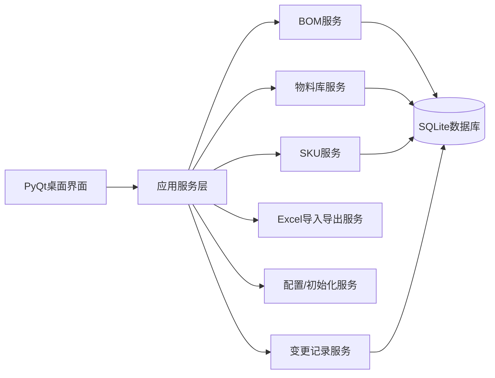
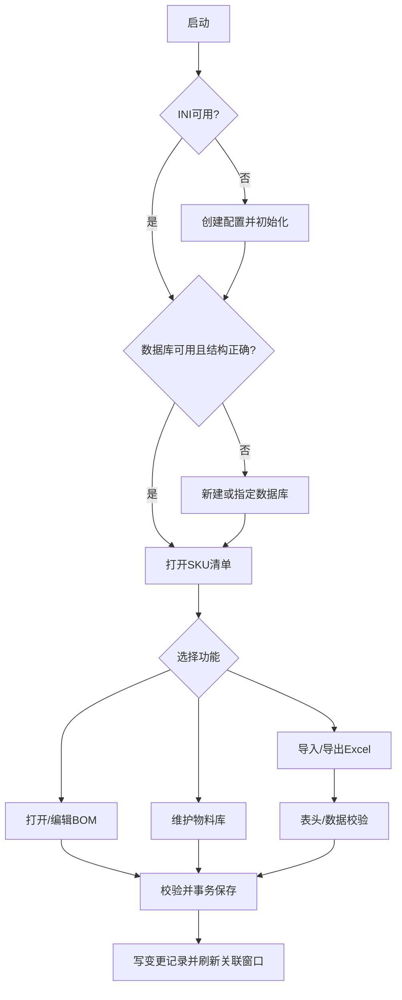
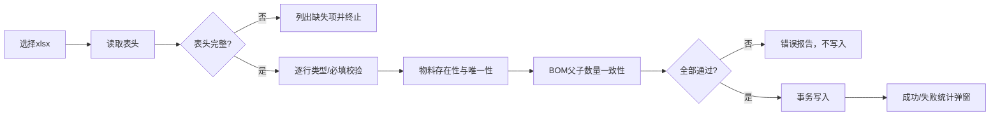

# BOM管理系统软件开发规格书

- 文档版本：1.0
- 编制日期：2026-09-24
- 初始软件版本：0.0.1
- 目标平台：Deepin 25 桌面系统
- 技术栈：Python 3、PyQt5、SQLite、openpyxl、PyInstaller
- 需求基线：`BOM管理系统软件开发需求.emmx`（已解析 137 条需求）及 `BOM管理系统编程指南.txt`

## 1. 建设目标与范围

系统用于管理物料主数据、可多层级复用的 BOM、SKU、替代料、版本变更和 Excel 数据交换。系统为单机桌面应用，启动后通过 INI 配置定位 SQLite 数据库；所有修改形成可追溯变更记录。首版必须覆盖本规格书第 4 节全部功能和第 8 节需求追踪矩阵。

### 1.1 角色

- **普通工程用户**：查看、新建、编辑、导入、导出物料及 BOM。
- **数据库维护用户**：在初始化或数据库不可用时新建/指定/校验数据库。
- 本版本不单独实现登录和权限体系；操作权限由桌面文件和数据库访问权限控制。

## 2. 总体架构



### 2.1 分层与模块

1. **启动与配置模块**：读取/校验同目录 `config.ini`；缺失或不可用时自动进入初始化；维护数据库地址、名称和应用版本。
2. **数据库模块**：连接 SQLite、创建基础表和 BOM 表、校验目录/结构、事务、备份连接状态。
3. **物料库模块**：物料 CRUD、唯一性、单位校验、M/P、呆滞判定、版本变更、引用检查。
4. **SKU 模块**：SKU 清单、创建/删除/版本变更、SKU 与物料映射、顶层 ROOT BOM。
5. **BOM 模块**：多层树、同级/下级新增、编辑、删除、替代料、保存/取消、跨 BOM 同步与刷新提示。
6. **Excel 模块**：模板导出、资料库/物料库/SKU BOM 导入和三类导出；表头、数据、差异和失败清单校验。
7. **项目模块**：项目名称、代码、产品名称、产品型号维护。
8. **变更记录模块**：记录新增、删除、修改物料、SKU、BOM 的时间和详细内容。
9. **界面模块**：主窗口、SKU 清单、BOM 窗口、物料库窗口、各种编辑/确认对话框。

## 3. 数据模型与约束

### 3.1 物料主数据 `materials`

`material_base_code` + `material_version` 为唯一物料 ID；字段：基础编码、版本号、名称、规格描述、单位、制造商、MPN、M/P、创建/修改时间、呆滞标志。基础编码、版本号、名称为新建必填；单位默认 `pcs`，允许：`套、ml、L、mm、cm、m、pcs`。编辑时基础编码和版本号不可改。

### 3.2 SKU `skus`

SKU 是被标记的物料；SKU 编码=基础编码+版本号，名称/描述引用物料；每个 SKU 顶层 BOM 的父项编码和父项版本号为 `ROOT`。只有“新建 SKU”产生的顶层 BOM 出现在 SKU 清单。每个 SKU 占一行。

### 3.3 物料下阶关系 `material_bom_items`

字段：父物料 ID、下阶物料 ID、数量、单位、位置、备注、排序和时间戳。每个物料的下阶关系独立存储；BOM 管理窗口通过递归查询父物料关系形成树状结构，SKU 只作为顶层展示入口。相同父项下子项、数量、位置必须可校验；保存采用事务。旧版 `bom_items` 数据升级时迁移到该关系表。

### 3.4 替代料 `material_alternates`

按 BOM 行维护替代料，字段：基础编码、版本号、名称、描述、制造商、MPN、排序；支持新增、删除和导出，建议每行最多 3 组并可扩展。

### 3.5 变更记录 `change_logs`

字段：序号、变更时间、详细内容、变更日期、变更时间、对象类型、对象 ID。所有物料、SKU、BOM 新增/删除/修改写入记录，并随三类 Excel 导出。

### 3.6 项目与配置

项目字段：项目名称、项目代码、产品名称、产品型号。`config.ini` 与运行文件同目录，至少包含数据库地址、名称和应用版本。数据库默认与软件同目录（部署时由配置决定）。

## 4. 功能规格

### 4.1 主界面与 SKU 清单

- 主窗口居中表格显示所有 SKU，列：序号、SKU 编码、SKU 名称、SKU 描述、修改日期时间；左下角实时显示“共计 X 个 SKU”，右下角显示版本号。
- 菜单提供：物料库、新建 SKU、导入、导出下拉菜单、修改项目信息。
- 每行最左侧提供打开按钮进入对应 BOM；右键 SKU 支持导出 SKU BOM、版本变更、删除 SKU。删除需确认并删除对应 BOM；版本变更输入新版本号并同步 SKU 清单与物料库。
- 新建 SKU：按物料基础编码自动筛选下拉候选（编码、版本、名称），确认后加入 SKU 清单并自动打开 BOM；不能选择已有 BOM 结构的物料；创建后默认数量 1、其余属性引用物料库。
- 项目信息窗口编辑项目名称、项目代码、产品名称、产品型号；项目名称默认“请输入项目名称”，确认保存，取消关闭。

### 4.2 BOM 窗口

- 左树右信息布局。树顶层为 SKU 名称；每行显示“物料编码，物料名称【数量，单位】”；支持展开/收起，默认展开 SKU 和一级、隐藏二级以上。
- 左键选中任何节点，右侧显示物料信息；修改数量、位置、备注后树显示同步更新。
- 右键普通节点：新建同级物料、新建下级物料、删除物料；顶层 SKU 不显示新建同级和删除物料。删除必须二次确认。
- 新建同级/下级通过物料编码输入框和候选下拉选择物料（编码、版本、名称、制造商、MPN），取消/确认；新节点自动选中，默认数量 1。
- 信息字段：基础编码、版本、名称、描述、数量、单位、位置、制造商、MPN、M/P、替代料、备注。只有数量、位置、备注可直接编辑，其余只读。
- 替代料表格列：基础编码、版本、名称、描述、制造商、MPN；底部“增加替代料”；右键删除并确认。增加窗口支持编码筛选、鼠标选择、取消/确认。
- BOM 保存/取消初始禁用；发生修改后启用。保存提交事务并禁用按钮，取消恢复编辑前状态并禁用按钮。
- 保存后若物料有下阶 BOM，更新物料库 BOM 状态；若被其他 BOM 引用，同步下阶结构。新建已有 BOM 的物料时自动复用其结构。
- 允许多个 BOM 窗口并行编辑。一个窗口保存后，其他窗口自动检测；有未保存编辑时顶部红字提示“BOM 有更新”并显示刷新按钮，刷新只合并外部变化且保留未保存编辑。
- 删除节点：若节点不再被任何 BOM 引用，可确认递归删除其 BOM 结构；若仍被引用，仅从当前 BOM 删除节点及其下阶。

### 4.3 物料库窗口

- 表格列：序号、基础编码、版本号、名称、规格描述、单位、制造商、MPN、修改日期时间、呆滞物料；单击选中一行。
- 菜单：导入物料清单、导出模板、新建物料、导出物料库；右键编辑、删除、版本变更。
- 新建/编辑窗口字段一致：基础编码、版本号、名称、规格描述、单位、制造商、MPN；新建前三项必填，编辑基础编码和版本号不可修改；单位默认 pcs 并限制合法值；确认/取消。
- 新建时校验唯一物料 ID，重复项红色高亮且禁止保存。
- 自动按是否被任何 BOM 引用计算呆滞物料：是标记 Y，否则 N。呆滞料确认后可直接删除；非呆滞料删除时列出引用 SKU 编码/名称，要求先从 BOM 删除。
- 版本变更：呆滞料直接更新；非呆滞料列出引用 SKU 并勾选同步范围。全选则更新原物料；部分选择则复制为新版本，原版本和新版本并存。

### 4.4 Excel 导入

- BOM 模板列：父项物料编码、父项版本号、物料基础编码、物料版本号、物料数量、位置。
- 物料模板列：物料基础编码、物料版本号、物料名称、物料规格描述、单位、物料制造商、物料MPN。
- 导入前校验表头；缺列弹窗列出不合格项并禁止整批导入。BOM 还必须校验父/子物料均存在、父项下阶项目/数量与系统一致，否则禁止整批导入。
- 物料导入必填：基础编码、版本号、单位、制造商；缺失禁止整批导入。遇已存在物料时显示具体差异，并提供跳过该物料、取消全部、覆盖导入。
- 导入结束弹窗显示成功数量、失败数量、失败编码与名称；成功或失败均须弹窗。

### 4.5 Excel 导出

所有导出均弹出路径选择窗口，确认后生成 xlsx；日期时间格式统一 `YYYYMMDD_HHMMSS`。

- **整个资料库**：默认名“项目名称_资料库_日期_时间”；Sheet1 SKU 清单，Sheet2 物料库，Sheet3 变更记录（序号、变更时间、变更详细内容、变更日期、变更时间），后续每个 SKU 一个 BOM Sheet。
- **物料库**：默认名“项目名称_物料库_日期_时间”；Sheet1 变更记录，Sheet2 物料库，列为序号、基础编码、版本号、名称、规格描述、单位、制造商、MPN、M/P。
- **SKU BOM**：默认名“SKU编号_SKU名称_日期_时间”；Sheet1 变更记录，Sheet2 SKU BOM，列为序号、层级、父项编码、父项版本、物料基础编码、物料版本号、物料名称、物料规格描述、用量、单位、M/P、制造商、MPN；MPN 后追加替代料1~3的名称、版本号、名称、制造商、MPN（按需求原文保留字段顺序）。

### 4.6 数据库与初始化

- 启动检测 INI；缺失或不可用自动新建并进入初始化。检测数据库丢失或目录结构错误时，提示“新建数据库”或“指定数据库”。
- 新建：文件窗口选择路径并设置数据库名，确认后创建 SQLite 基础结构。指定：选择数据库文件/连接目标，确认后校验；成功提示连接成功，失败提示校验失败并返回选择窗口。
- 物料库与 BOM 独立表管理；每个物料 BOM 独立表/命名空间，SKU 与非 SKU 路径分离；数据库操作具备事务和错误提示。

## 5. 关键业务流程



## 6. 界面与交互约定

使用 PyQt 主窗口 + QTableView/QTreeView + QDialog。所有危险操作采用确认对话框；验证失败以红色高亮字段并列出具体原因；耗时导入导出显示进度；窗口可关闭时提示未保存编辑。界面中文、键盘可操作、表格支持排序和列宽调整。

## 7. 非功能、工程与交付要求

- 代码按功能模块独立文件，模块头部中文注释包含模块描述、输入输出接口、编辑时间，核心代码有中文注释。
- 版本三段式，初始 `0.0.1`，按修复/功能调整自动升版。
- Git 管理；忽略编译、运行临时文件、缓存和本地配置/数据库凭据。
- 项目目录位于 `/home/biong/Documents/code/BOM管理系统`，包含 `src`、`tools`、`package`、`docs`、`tests`、`test_reports`；构建临时文件统一放在 `.tmp`。
- 自动 PyInstaller 打包为 Deepin 25 可运行独立文件，文件名“软件名称_版本号_打包日期和时间”。
- 测试必须覆盖 code review、单元、集成、系统测试；文档包含 AI 编程规范、第三方库许可证、接口文件、使用说明（含界面截图）、项目目录说明、README 构建和继续使用 AI 编程说明。
- 数据安全：关键写操作事务化；导入失败不产生半批数据；导出失败保留原数据；日志记录异常。

## 8. 接口规格（模块输入/输出）

| 接口 | 输入 | 输出/协议 |
|---|---|---|
| `ConfigService.load()` | 配置路径 | `AppConfig`；INI |
| `DatabaseService.connect()` | 主机、端口、库名、凭据 | 连接/校验结果；SQLite |
| `MaterialService.create/update/delete()` | 物料 DTO、版本策略 | 物料 DTO/业务错误；事务 |
| `BomService.load/save/delete_item()` | 父项 ID、BOM 行、替代料 | 树数据/变更结果；事务 |
| `SkuService.create/change_version/delete()` | 物料 ID、版本号 | SKU DTO；事务 |
| `ExcelService.import_materials/import_bom()` | xlsx 路径、冲突策略 | 成功/失败明细；openpyxl |
| `ExcelService.export_*()` | 导出范围、目标路径 | xlsx 文件 |
| `ChangeLogService.record/query()` | 对象、动作、详情 | 记录列表 |
| `WindowRefreshBus.publish()` | BOM/物料变更事件 | 其他窗口刷新事件；Qt signal |

## 9. 需求追踪矩阵（100%覆盖）

下表将需求图 137 条逐条映射到本规格书章节；编号按解析顺序对应原图条目。

| 原需求编号 | 覆盖章节 | 原需求摘要 |
|---:|---|---|
|1-5|4.1、6|系统/UI、SKU清单、物料库/BOM入口、版本与SKU计数|
|6-8|4.1|物料库、新建SKU、导出菜单|
|9-13|4.1、4.5|导出选项、版本号、SKU计数|
|14-16|4.1|项目修改窗口、项目名称默认值|
|17-24|4.2、4.3、4.6|模块分类、BOM左右布局、树和主窗体|
|25-36|4.2|树右键新增、删除SKU、物料信息、替代料、保存取消、联动刷新|
|37-46|4.2、4.4|BOM菜单、Excel导入/模板、候选选择、导入校验、保存取消|
|47-51|4.2、3.2|BOM状态、跨BOM同步、复用结构、多窗口、ROOT规则|
|52-60|4.3、4.4、3.1|物料库表格、M/P、模板、导入校验、唯一ID|
|61-73|4.3、4.1|新建物料、字段/单位/校验、模板、导入结果、新建SKU|
|74-78|4.5、4.1|资料库导出、项目字段|
|79-92|4.3|选中、编辑、删除、呆滞判定、版本变更与引用策略|
|93-98|4.1、4.3|SKU行、SKU版本、删除、版本输入、BOM状态限制、SKU定义|
|99-107|3、4.6、7|SQLite、表分离、BOM命名空间、数据库/INI初始化|
|108-115|4.5|路径选择、默认命名、资料库Sheet结构、SKU BOM Sheet|
|116-121|4.5|物料库导出命名、Sheet和变更记录|
|122-128|4.5|SKU导出命名、变更记录、BOM字段、替代料列|
|129-134|4.2|顶层右键限制、删除确认、递归BOM处理|
|135-137|3.2、4.1、4.6|SKU定义、SKU管理、INI可用性|

> 逐条核查结论：原图 1~137 均已在第 3、4、5、6、7 节给出可实现规格，并在本矩阵中建立映射；实现验收必须以该矩阵逐项勾选。

## 10. 验收标准

1. 在无配置/无数据库、数据库损坏、数据库可用三种启动状态下均能按流程进入系统或得到明确提示。
2. 物料、SKU、BOM、替代料的增删改查和所有唯一性/引用/版本规则通过单元及集成测试。
3. Excel 模板、导入校验、冲突策略、三个导出范围的 Sheet、列和命名完全符合第 4.4/4.5 节。
4. 多窗口更新提示、未保存数据保护、跨 BOM 同步和递归删除通过系统测试。
5. 需求追踪矩阵 137 条全部具备测试用例和通过记录；PyInstaller 包在另一台 Deepin 25 上可启动运行。

## 11. 软件详细设计方案

### 11.1 运行时组件与目录

```text
src/
  main.py                 启动入口、异常捕获、版本读取
  app_context.py          QApplication、服务容器、窗口总线
  config/config_service.py
  database/{connection, schema, repositories}.py
  domain/{models, validators, errors}.py
  services/{material, sku, bom, import_export, change_log, project}.py
  ui/{main_window, bom_window, material_window, dialogs, delegates}.py
  infrastructure/{events, logger, clock}.py
```

服务层只通过 Repository 访问数据库；UI 只调用服务层，不直接执行 SQL。所有服务方法返回 `Result[T]`（成功值或业务错误），数据库异常统一转换为 `DatabaseError`，校验异常转换为 `ValidationError`。

### 11.2 核心类和接口

| 类/接口 | 关键方法 | 责任 |
|---|---|---|
| `ConfigService` | `load()`, `ensure_file()`, `save()` | INI 创建、读取、路径合法性校验 |
| `DatabaseManager` | `connect()`, `create_schema()`, `validate_schema()`, `transaction()` | SQLite 连接、建表、结构校验、事务 |
| `MaterialService` | `list()`, `create(dto)`, `update(id,dto)`, `delete(id)`, `change_version(id,policy)` | 物料主数据和引用规则 |
| `SkuService` | `list()`, `create(material_id)`, `delete(sku_id)`, `change_version(sku_id,version)` | SKU 生命周期及 ROOT BOM |
| `BomService` | `load(root)`, `add_item()`, `update_item()`, `remove_item()`, `save()`, `import_rows()` | BOM 树、递归结构、跨 BOM 同步 |
| `AlternateService` | `list(bom_item)`, `add()`, `remove()` | 替代料维护 |
| `ImportExportService` | `validate_headers()`, `import_materials()`, `import_bom()`, `export_database()`, `export_materials()`, `export_sku()` | openpyxl 文件交换和报告 |
| `ChangeLogService` | `record()`, `query(scope)` | 统一审计记录 |
| `WindowRefreshBus` | `publish(event)`, `subscribe(handler)` | 多 BOM 窗口更新通知 |
| `MainWindow` | `refresh_skus()`, `open_bom()`, `show_materials()` | 主界面和菜单 |
| `BomWindow` | `load_tree()`, `on_select()`, `set_dirty()`, `refresh_external()` | BOM 编辑和未保存保护 |

### 11.3 数据库详细设计

采用统一关系表加 `bom_kind`（`SKU`/`NORMAL`）和 `bom_root_id` 区分路径，逻辑上满足“每个物料独立 BOM、SKU 与非 SKU 分离”；避免动态建表造成迁移困难。建议表如下：

- `app_projects(id, project_name, project_code, product_name, product_model, updated_at)`
- `materials(id, base_code, version, name, description, unit, manufacturer, mpn, mp_flag, has_bom, created_at, updated_at, UNIQUE(base_code,version))`
- `skus(id, material_id, root_code, root_version, created_at, updated_at, UNIQUE(material_id))`
- `material_bom_items(id, parent_material_id, child_material_id, quantity, unit, position, remark, sort_no, created_at, updated_at, UNIQUE(parent_material_id,child_material_id,position))`
- `alternate_items(id, bom_item_id, material_id, sort_no)`
- `change_logs(id, object_type, object_id, action, detail, changed_at)`
- `schema_meta(key_name, value)`

外键使用 `RESTRICT` 防止被引用物料误删；删除 BOM 关系使用事务。`materials.has_bom` 由父物料关系实时判断并在保存事务中刷新；BOM 树通过关系表递归展开，避免为每个物料动态创建数据库表。

### 11.4 BOM 保存事务

1. UI 将编辑缓冲区与数据库版本号提交 `BomService.save()`。
2. 服务校验父子物料存在、数量为正数、单位一致、无循环引用。
3. 开启事务，写入/删除 BOM 行及替代料，更新 `has_bom`，写 `change_logs`。
4. 对相同物料的其他 BOM 执行同步策略，记录受影响根 BOM。
5. 提交事务并发布 `BomChangedEvent`；失败则回滚并恢复 UI 缓冲区。

### 11.5 并发窗口与冲突

每个 BOM 窗口保存 `loaded_revision`。保存前比较数据库 revision：相同则正常提交；不同则发布红色更新提示，禁止静默覆盖。用户点击刷新时取得外部新树，对未保存节点按 `item_id` 合并；同一节点冲突保留本地编辑并标记冲突，提供“采用外部/保留本地”选择。

### 11.6 导入校验管线



物料冲突策略为逐条询问“跳过/取消全部/覆盖”；选择取消全部时回滚整批。BOM 任一行不合规时整批回滚。错误报告包含 Excel 行号、字段、实际值、原因。

### 11.7 UI 状态机

- **编辑对话框**：`CLEAN -> DIRTY -> SAVING -> CLEAN`；取消从 `DIRTY` 回到 `CLEAN` 并恢复快照。
- **BOM 窗口**：`LOADING -> READY -> DIRTY -> EXTERNAL_UPDATE -> READY/DIRTY`；未保存时关闭必须确认。
- **数据库初始化**：`CHECKING -> CHOOSE_NEW/CHOOSE_EXISTING -> VALIDATING -> CONNECTED/ERROR`。
- **导入任务**：`SELECTED -> VALIDATING -> CONFLICT -> WRITING -> REPORT`。

### 11.8 错误、日志与可恢复性

所有异常记录时间、模块、操作、对象 ID 和堆栈到应用日志；UI 显示可读错误和下一步操作。写数据库前建立事务，导入使用临时内存模型，导出写临时文件后原子替换目标文件。启动时若配置不可解析，备份损坏文件并重新初始化。

### 11.9 测试设计

- 单元测试：编码唯一性、单位/M/P、呆滞判定、循环 BOM、递归删除、版本变更分支、表头和字段校验、导出列顺序。
- 集成测试：SQLite schema 创建、物料-SKU-BOM 联动、跨窗口事件、导入事务回滚、三类导出后再读取。
- 系统测试：按主界面、物料库、BOM、初始化、导入导出和异常恢复编写端到端用例。
- 需求验收：第 12 节每个编号至少一个测试用例，测试报告记录“通过/失败/阻塞”和证据路径。

## 12. 逐条软件需求追踪表

状态定义：`已规格化`表示已在本规格书明确实现设计；`待测试`表示编码后必须补充测试证据。

|编号|原始需求（摘要）|规格书设计位置|验证方式|状态|
|---:|---|---|---|---|
|1|BOM管理系统|4、6|单元/集成/系统测试|已规格化，待测试|
|2|界面UI&UX|4、6|单元/集成/系统测试|已规格化，待测试|
|3|特别描述|4、6|单元/集成/系统测试|已规格化，待测试|
|4|窗口居中表格显示目前所有的SKU，按顺序显示序号、SKU编码、SKU名称、SKU描述、修改日期&时间栏位|4.1/4.2|单元/集成/系统测试|已规格化，待测试|
|5|主界面-SKU清单|4、6|单元/集成/系统测试|已规格化，待测试|
|6|菜单栏显示物料库按钮，点击可以打开物料库窗口|4.1/4.2|单元/集成/系统测试|已规格化，待测试|
|7|每一个SKU的行最左边有一个打开按钮，点击可以打开对应SKU的BOM窗口|4.1/4.2|单元/集成/系统测试|已规格化，待测试|
|8|菜单栏显示新建SKU按钮，点击可以打开新建BOM窗口|4.1/4.2|单元/集成/系统测试|已规格化，待测试|
|9|菜单栏显示导出下拉菜单，包含下面选项|4.1/4.2|单元/集成/系统测试|已规格化，待测试|
|10|BOM窗口|4、6|单元/集成/系统测试|已规格化，待测试|
|11|物料库窗口|4、6|单元/集成/系统测试|已规格化，待测试|
|12|窗口右下角显示当前软件的版本号|4.1/4.2|单元/集成/系统测试|已规格化，待测试|
|13|窗口左下角显示“共计X个SKU”，实时显示SKU总数|4.1/4.2|单元/集成/系统测试|已规格化，待测试|
|14|菜单栏显示修改项目信息按钮，单击打开修改项目信息窗口|4.1/4.2|单元/集成/系统测试|已规格化，待测试|
|15|窗口正中间显示项目名称，默认文字“请输入项目名称”|4.1/4.2|单元/集成/系统测试|已规格化，待测试|
|16|BOM管理|4、6|单元/集成/系统测试|已规格化，待测试|
|17|物料库管理|4、6|单元/集成/系统测试|已规格化，待测试|
|18|数据库管理|4、6|单元/集成/系统测试|已规格化，待测试|
|19|初始化管理|4、6|单元/集成/系统测试|已规格化，待测试|
|20|主窗体分为左右两部分，左边树状图根据层级显示当前BOM的物料清单，右边显示当前点选物料的物料信息|4.1/4.2|单元/集成/系统测试|已规格化，待测试|
|21|树状图最顶层为SKU名称，BOM中的所有物料都包含在这个层级之下，每一行显示当前物料的“物料编码，物料名称【物料数量，物料单位】”，若当前物料下阶还有子级…|4.1/4.2|单元/集成/系统测试|已规格化，待测试|
|22|默认打开显示SKU以及下阶一级物料，再往下二阶及更高阶物料默认隐藏|4.1/4.2|单元/集成/系统测试|已规格化，待测试|
|23|主窗体|4、6|单元/集成/系统测试|已规格化，待测试|
|24|菜单栏|4、6|单元/集成/系统测试|已规格化，待测试|
|25|右键树状图的每一个物料，可以新建同级物料、新建下级物料|4.1/4.2|单元/集成/系统测试|已规格化，待测试|
|26|右击每一行SKU，可以删除SKU|4.1/4.2|单元/集成/系统测试|已规格化，待测试|
|27|物料信息窗口包含物料基础编码、物料版本号、物料名称、物料描述、物料数量、物料单位、物料位置、物料制造商、物料MPN、M/P、替代料、备注等栏位|4.1/4.2|单元/集成/系统测试|已规格化，待测试|
|28|物料数量、物料位置、备注栏位可以直接编辑，其他栏位不可以直接编辑|4.1/4.2|单元/集成/系统测试|已规格化，待测试|
|29|替代料栏位表格显示当前物料的替代料，包含替代料基础编码、替代料版本号、替代料名称、替代料描述、替代料制造商、替代料MPN|4.1/4.2|单元/集成/系统测试|已规格化，待测试|
|30|替代料表格最下方有“增加替代料”按钮，点击打开增加替代料窗口|4.1/4.2|单元/集成/系统测试|已规格化，待测试|
|31|窗口为一个输入框，输入物料基础编码自动下拉菜单显示根据物料编码从物料库筛选的对应物料，显示“物料编码 物料版本号 物料名称 制造商 MPN”，通过鼠标点选…|4.1/4.2|单元/集成/系统测试|已规格化，待测试|
|32|窗口包含取消和确认按钮|4.1/4.2|单元/集成/系统测试|已规格化，待测试|
|33|右键替代料表格中的替代料，右键菜单显示“删除替代料”，经过确认后可以删除替代料|4.1/4.2|单元/集成/系统测试|已规格化，待测试|
|34|物料信息窗口右下方包含保存、取消按钮，默认保存按钮&取消按钮不可点选、当信息发生修改后，两个按键可以点选，点击保存可以保存当前修改并重新让按钮不可点选，点…|4.1/4.2|单元/集成/系统测试|已规格化，待测试|
|35|左键点击树状图中的任何一个物料（包括SKU），则物料信息窗口显示点击物料的信息|4.1/4.2|单元/集成/系统测试|已规格化，待测试|
|36|物料信息修改后，同步更新左侧树状图的显示|4.1/4.2|单元/集成/系统测试|已规格化，待测试|
|37|菜单栏|4、6|单元/集成/系统测试|已规格化，待测试|
|38|菜单栏包含导入按钮，点击可以通过选择本地EXCEL文件，导入BOM|4.1/4.2|单元/集成/系统测试|已规格化，待测试|
|39|菜单栏包含导出模板按钮，点击可以向本地另存为一个EXCEL的表头，以便用于导入BOM|4.1/4.2|单元/集成/系统测试|已规格化，待测试|
|40|窗口为一个输入框，输入物料基础编码自动下拉菜单显示根据物料编码从物料库筛选的对应物料，显示“物料编码 物料版本号 物料名称 制造商 MPN”，通过鼠标点选…|4.1/4.2|单元/集成/系统测试|已规格化，待测试|
|41|窗口包含取消和确认按钮|4.1/4.2|单元/集成/系统测试|已规格化，待测试|
|42|新建物料后，默认树状图选中当前新建的物料，物料信息窗口显示当前物料信息，目量数量为1，其他属性从物料库引用，没有的则保持空白|4.1/4.2|单元/集成/系统测试|已规格化，待测试|
|43|导入时检测EXCEL文件表头的合规性，是否包含父项物料编码、父项版本号、物料基础编码、物料版本号、数量、物料位置，若没有则弹出警告，显示不合格项，不允许导…|4.1/4.2|单元/集成/系统测试|已规格化，待测试|
|44|导入检测物料基础编码与物料版本号，父项物料编码与父项版本号对应的物料是否为物料库中的物料，若未查到对应物料编码，则未不合规物料，则弹出警告，显示不合格项，…|4.1/4.2|单元/集成/系统测试|已规格化，待测试|
|45|导入时通过父项编码以及父项版本号，检测对应的子项物料与系统中该物料的下阶BOM物料的项目、数量是否一致，若不一致的，则弹出警告，显示不合格项，不允许导入整…|4.1/4.2|单元/集成/系统测试|已规格化，待测试|
|46|菜单栏包含保存、取消按钮，默认保存按钮&取消按钮不可点选、当BOM发生修改后，两个按键可以点选，点击保存可以保存当前修改并重新让按钮不可点选，点击取消则取…|4.1/4.2|单元/集成/系统测试|已规格化，待测试|
|47|点击保存后，若当前物料存在下阶物料，则在物料库中更新物料状态，标注当前物料存在BOM架构|4.1/4.2|单元/集成/系统测试|已规格化，待测试|
|48|若修改的物料存在BOM结构，同时被其他BOM所引用，则BOM保存后，将变更同步到其他BOM，确保相同物料的下阶物料保持一致|4.1/4.2|单元/集成/系统测试|已规格化，待测试|
|49|新建物料后，若当前物料具备BOM结构，则自动将该物料的BOM结构一并导入，确保相同物料下阶物料保持一致|4.1/4.2|单元/集成/系统测试|已规格化，待测试|
|50|允许同时打开多个BOM窗口，分别独立编辑，当其中一个BOM编辑保存了，自动刷新其他BOM窗口，若其他BOM有相同的物料、下阶物料更新了，则在对应BOM窗口…|4.1/4.2|单元/集成/系统测试|已规格化，待测试|
|51|任何一个物料都可以具备BOM结构，但是只有通过“新增SKU”创建的顶层BOM才会显示在SKU清单中，SKU的父项编码以及父项版本均为ROOT|4.1/4.2|单元/集成/系统测试|已规格化，待测试|
|52|主窗体|4、6|单元/集成/系统测试|已规格化，待测试|
|53|菜单栏|4、6|单元/集成/系统测试|已规格化，待测试|
|54|以表格形式显示物料库的所有物料，包含以下列：序号，物料基础编码，物料版本号，物料名称，物料规格描述，单位，物料制造商，物料MPN，物料修改日期时间，呆滞物…|4.3/4.4|单元/集成/系统测试|已规格化，待测试|
|55|M/P栏位下拉菜单选择M、P|4.3/4.4|单元/集成/系统测试|已规格化，待测试|
|56|BOM导入模板应当包含如下列：父项物料编码、父项版本号、物料基础编码、物料版本号、物料数量、位置|4.3/4.4|单元/集成/系统测试|已规格化，待测试|
|57|菜单栏包含导入按钮，点击可以通过选择本地EXCEL文件，导入物料清单|4.3/4.4|单元/集成/系统测试|已规格化，待测试|
|58|导入时检测EXCEL文件表头的合规性，是否包含物料基础编码、物料版本号、单位、物料制造商、物料MPN、若没有则弹出警告，显示不合格项，不允许导入整个物料清单|4.3/4.4|单元/集成/系统测试|已规格化，待测试|
|59|导入时检测物料基础编码及物料版本号，检测当前物料是否为物料库中的物料，若当前物料已经存在物料库中则比对导入信息与库内信息是否一致，若不一致的，则弹出提示当…|4.3/4.4|单元/集成/系统测试|已规格化，待测试|
|60|物料基础编码加上物料版本号统称为物料编码，为物料的唯一ID，不允许出现相同物料编码的物料，同理父项物料编码加上父项版本号为父项的唯一ID|4.3/4.4|单元/集成/系统测试|已规格化，待测试|
|61|菜单栏包含新建物料按钮，单击后打开新建物料窗口|4.3/4.4|单元/集成/系统测试|已规格化，待测试|
|62|新建物料窗口包含物料的属性：物料基础编码，物料版本号，物料名称，物料规格描述，单位，物料制造商，物料MPN|4.3/4.4|单元/集成/系统测试|已规格化，待测试|
|63|其中物料基础编码、物料版本号、物料名称为必填项，其他默认为空，可编辑|4.3/4.4|单元/集成/系统测试|已规格化，待测试|
|64|单位默认为pcs，合规的单位为：套、ml、L、mm、cm、m，下拉菜单进行选择|4.3/4.4|单元/集成/系统测试|已规格化，待测试|
|65|窗口下方包含确认和取消按钮|4.3/4.4|单元/集成/系统测试|已规格化，待测试|
|66|点击确认按钮后，判断物料编码是否与现有库中的物料重复，若重复则弹出提示，提示问题原因，红色高亮显示不合格项，不允许新建当前物料|4.3/4.4|单元/集成/系统测试|已规格化，待测试|
|67|菜单栏包含导出模板按钮，点击可以向本地另存为一个EXCEL的表头，以便用于导入物料清单|4.3/4.4|单元/集成/系统测试|已规格化，待测试|
|68|物料导入模板应当包含如下列：物料基础编码，物料版本号，物料名称，物料规格描述，单位，物料制造商，物料MPN|4.3/4.4|单元/集成/系统测试|已规格化，待测试|
|69|必填项为物料基础编码、物料版本号、单位、物料制造商，若必填项未填则弹出警告，显示不合格项，不允许导入整个物料清单|4.3/4.4|单元/集成/系统测试|已规格化，待测试|
|70|导入完成后，弹出导入成功提示，显示共有多少个物料导入成功，同时若有导入失败的，则同步显示导入失败的数量，以及导入失败的物料编码与物料名称清单|4.3/4.4|单元/集成/系统测试|已规格化，待测试|
|71|导入成功或者导入失败，都有弹窗进行提示|4.3/4.4|单元/集成/系统测试|已规格化，待测试|
|72|窗口包含一个输入框，输入物料基础编码后下拉菜单自动显示通过物料库筛选的对应物料，下拉菜单中显示物料基础编码、物料版本号、物料名称，可以通过鼠标进行点选|4.3/4.4|单元/集成/系统测试|已规格化，待测试|
|73|窗口下方包含取消和确认按钮，点击确认后将该物料信息添加到SKU清单中，同时自动打开BOM窗口，可以对此物料的BOM进行编辑|4.3/4.4|单元/集成/系统测试|已规格化，待测试|
|74|导出整个资料库|4.1/4.3/4.5|单元/集成/系统测试|已规格化，待测试|
|75|导出物料库|4.1/4.3/4.5|单元/集成/系统测试|已规格化，待测试|
|76|右击每一行SKU，可以导出SKU BOM|4.1/4.3/4.5|单元/集成/系统测试|已规格化，待测试|
|77|包含项目名称、项目代码、产品名称、产品型号选项，每个选项包含一个输入框可以进行编辑|4.1/4.3/4.5|单元/集成/系统测试|已规格化，待测试|
|78|窗口下方包含取消和确认按钮，点击确认按钮后保存更新后的项目信息|4.1/4.3/4.5|单元/集成/系统测试|已规格化，待测试|
|79|鼠标每次点选选中一行物料|4.1/4.3/4.5|单元/集成/系统测试|已规格化，待测试|
|80|右键物料，可以对物料进行编辑，打开物料编辑窗口|4.1/4.3/4.5|单元/集成/系统测试|已规格化，待测试|
|81|物料编辑窗口包含物料的属性：物料基础编码，物料版本号，物料名称，物料规格描述，单位，物料制造商，物料MPN，UI和物料新建窗口保持一致|4.1/4.3/4.5|单元/集成/系统测试|已规格化，待测试|
|82|窗口下方包含确认和取消按钮|4.1/4.3/4.5|单元/集成/系统测试|已规格化，待测试|
|83|其中物料基础编码、物料版本号为不可修改项|4.1/4.3/4.5|单元/集成/系统测试|已规格化，待测试|
|84|自动监控物料是否被任何BOM包含判断该物料是否为呆滞料，若为呆滞物料的，则呆滞物料一栏标记为Y，否则为N|4.1/4.3/4.5|单元/集成/系统测试|已规格化，待测试|
|85|右键物料，可以对物料进行删除|4.1/4.3/4.5|单元/集成/系统测试|已规格化，待测试|
|86|右键物料，可以对物料进行版本变更|4.1/4.3/4.5|单元/集成/系统测试|已规格化，待测试|
|87|若呆滞物料提示确认后直接删除|4.1/4.3/4.5|单元/集成/系统测试|已规格化，待测试|
|88|若为非呆滞物料，则提示当前物料非呆滞物料，并列出使用该物料的SKU编码以及SKU名称，并提示请将物料从以下BOM中删除后再进行物料删除|4.1/4.3/4.5|单元/集成/系统测试|已规格化，待测试|
|89|若该物料为呆滞物料，则直接对物料进行更新|4.1/4.3/4.5|单元/集成/系统测试|已规格化，待测试|
|90|若该物料为非呆滞物料，则提示物料被下列SKU引用（显示SKU编号，SKU名称），请勾选需要同步变更的SKU，然后点击确认|4.1/4.3/4.5|单元/集成/系统测试|已规格化，待测试|
|91|若全部的SKU都被勾选，即变更后原版本物料不再被任何一个SKU包含的，则直接对物料进行更新|4.1/4.3/4.5|单元/集成/系统测试|已规格化，待测试|
|92|若并非全部SKU都被勾选，变更后原版本物料仍被至少一个SKU包含的，则复制新建一个物料，即原版本物料和新版本物料同时存在物料库中，视为两个不同物料|4.1/4.3/4.5|单元/集成/系统测试|已规格化，待测试|
|93|每一个SKU占一行，每次选择选中一行|4.1/4.3/4.5|单元/集成/系统测试|已规格化，待测试|
|94|右击每一行SKU，可以对SKU进行版本变更|4.1/4.3/4.5|单元/集成/系统测试|已规格化，待测试|
|95|提示确认后删除当前SKU以及对应的BOM|4.1/4.3/4.5|单元/集成/系统测试|已规格化，待测试|
|96|弹出一个输入框，输入更新的版本号，点击确认后，更新SKU清单以及物料库|4.1/4.3/4.5|单元/集成/系统测试|已规格化，待测试|
|97|SKU就是物料库中的某个物料，SKU编码就是物料基础编码+物料版本号，SKU名称就是对应的物料名称，SKU描述就是对应的物料描述，每一个SKU都有一个BO…|4.1/4.3/4.5|单元/集成/系统测试|已规格化，待测试|
|98|若当前物料已经包含BOM结构，则灰置不可选中|4.1/4.3/4.5|单元/集成/系统测试|已规格化，待测试|
|99|使用SQLite数据库进行存储和管理，默认数据库文件与软件在同一个目录下|3/4.6/11.3|单元/集成/系统测试|已规格化，待测试|
|100|物料库和BOM使用独立不同的表进行管理|3/4.6/11.3|单元/集成/系统测试|已规格化，待测试|
|101|每个物料的BOM结构均独立一张表，非SKU的BOM以及被标记为SKU的BOM在不同的路径下|3/4.6/11.3|单元/集成/系统测试|已规格化，待测试|
|102|软件每次运行时，检测数据库可用性，若检测到数据库丢失或者数据库目录结构错误，则提示新建数据库或者指定数据库|3/4.6/11.3|单元/集成/系统测试|已规格化，待测试|
|103|新建数据库的，打开文件窗口，选择对应的路径并设置数据库名称后，点击确认并保存，自动完成数据库基础结构的创建|3/4.6/11.3|单元/集成/系统测试|已规格化，待测试|
|104|指定数据库的，打开文件选择窗口，选择对应的数据库文件后，点击确认进行数据库校验，校验通过的提示数据库连接成功提示，若校验不通过的提示数据库校验失败，并回到…|3/4.6/11.3|单元/集成/系统测试|已规格化，待测试|
|105|软件的配置通过ini文件的形式保存在与软件运行文件的相同路径下|3/4.6/11.3|单元/集成/系统测试|已规格化，待测试|
|106|配置文件中包含数据库的地址|3/4.6/11.3|单元/集成/系统测试|已规格化，待测试|
|107|若软件启动检测到配置文件丢失，则自动进行软件初始化，并创建软件配置文件|3/4.6/11.3|单元/集成/系统测试|已规格化，待测试|
|108|弹出文件窗口，选择导出地址并点击确认|4.5|单元/集成/系统测试|已规格化，待测试|
|109|默认名为“项目名称_资料库_日期_时间”|4.5|单元/集成/系统测试|已规格化，待测试|
|110|导出数据库为xlsx格式|4.5|单元/集成/系统测试|已规格化，待测试|
|111|第一个sheet为SKU清单|4.5|单元/集成/系统测试|已规格化，待测试|
|112|第二个sheet为物料库|4.5|单元/集成/系统测试|已规格化，待测试|
|113|第三个sheet为变更记录，表头分别为序号、变更时间、变更详细内容、变更日期、变更时间|4.5|单元/集成/系统测试|已规格化，待测试|
|114|变更详细内容包含每次新增、删除、修改物料或者SKU BOM的记录|4.5|单元/集成/系统测试|已规格化，待测试|
|115|后面每一个sheet为每一个SKU对应的BOM|4.5|单元/集成/系统测试|已规格化，待测试|
|116|弹出文件窗口，选择导出地址并点击确认|4.5|单元/集成/系统测试|已规格化，待测试|
|117|默认名为“项目名称_物料库_日期_时间”|4.5|单元/集成/系统测试|已规格化，待测试|
|118|导出物料库为xlsx格式|4.5|单元/集成/系统测试|已规格化，待测试|
|119|第二个sheet为物料库，表头分别为序号、物料基础编码、物料版本号、物料名称、物料规格描述、单位、制造商、MPN、M/P|4.5|单元/集成/系统测试|已规格化，待测试|
|120|第一个sheet为变更记录，表头分别为序号、变更时间、变更详细内容、变更日期、变更时间|4.5|单元/集成/系统测试|已规格化，待测试|
|121|变更详细内容包含每次新增、删除、修改物料的记录|4.5|单元/集成/系统测试|已规格化，待测试|
|122|弹出文件窗口，选择导出地址并点击确认|4.5|单元/集成/系统测试|已规格化，待测试|
|123|默认名为“SKU编号_SKU名称_日期_时间”|4.5|单元/集成/系统测试|已规格化，待测试|
|124|第一个sheet为变更记录，表头分别为序号、变更时间、变更详细内容、变更日期、变更时间|4.5|单元/集成/系统测试|已规格化，待测试|
|125|导出SKU为xlsx格式|4.5|单元/集成/系统测试|已规格化，待测试|
|126|第二个sheet为SKU对应的BOM，表头分别为序号、层级、父项编码、父项版本、物料基础编码、物料版本号、物料名称、物料规格描述、用量、单位、M/P、制造…|4.5|单元/集成/系统测试|已规格化，待测试|
|127|变更详细内容包含每次新增、删除、修改SKU BOM的记录|4.5|单元/集成/系统测试|已规格化，待测试|
|128|若当前BOM中的物料包含替代料，则MPN后面循环为替代料1的物料名称、替代料1的物料版本号、替代料1的物料名称、替代料1的制造商、替代料1的MPN，然后接…|4.5|单元/集成/系统测试|已规格化，待测试|
|129|若右击的是顶层SKU则不显示“新建同级物料”选项以及不显示“删除物料选项”|4.2/11.4|单元/集成/系统测试|已规格化，待测试|
|130|右键树状图的每一个物料，可以删除物料|4.2/11.4|单元/集成/系统测试|已规格化，待测试|
|131|提示确认后，再对物料进行删除|4.2/11.4|单元/集成/系统测试|已规格化，待测试|
|132|若该物料存在下阶物料|4.2/11.4|单元/集成/系统测试|已规格化，待测试|
|133|若该物料删除后，不被其他BOM包含的，则提示是否将该物料的BOM结构同步删除，若点击确认则同步删除该物料下对应的BOM结构，递归检测该物料下的每一个层级是…|4.2/11.4|单元/集成/系统测试|已规格化，待测试|
|134|若该物料删除后，被其他BOM包含的，仅从当前BOM中删除该物料以及其下阶物料|4.2/11.4|单元/集成/系统测试|已规格化，待测试|
|135|SKU就是被特殊标记的物料，SKU编码就是物料基础编码+物料版本号，SKU名称就是对应的物料名称，SKU描述就是对应的物料描述|4.2/11.4|单元/集成/系统测试|已规格化，待测试|
|136|SKU管理|4、6|单元/集成/系统测试|已规格化，待测试|
|137|软件每次运行时，检测ini配置文件可用性，若文件不存在或者不可用，则自动新建ini配置文件|4.1/6/11.7|单元/集成/系统测试|已规格化，待测试|

### 12.1 追踪表使用规则

开发任务、提交记录和测试用例必须引用需求编号，例如 `REQ-043`。需求变更时不得复用编号；新增需求追加编号并同步更新本表、接口和测试计划。发布前要求 1~137 全部有测试用例、执行结果和证据路径。

## 13. 编码实施状态（0.0.1）

已实现并通过自动化验证的基础能力：配置文件自动创建、数据库基础结构、物料唯一性和 CRUD、SKU 创建/删除、BOM 保存/读取、物料 Excel 导入与模板/物料库/资料库导出、PyQt 主界面、SKU 清单、BOM 树和物料库窗口。测试采用 Python `unittest`，覆盖唯一性、BOM 引用呆滞判定、导入导出和引用删除保护。

后续迭代必须继续完成追踪表中所有 UI 细节（替代料编辑、完整右键菜单、项目窗口、BOM 导入校验、多窗口冲突刷新、版本变更对话框、SQLite 驱动部署）并为每条需求补充测试证据；在这些项目完成前，版本不得标记为最终验收通过。

## 14. 数据库变更记录（2026-09-24）

根据最新变更要求，后端数据库统一改为 SQLite：数据库文件默认为运行目录下的 `bom.db`，通过同目录 `config.ini` 的 `[database] path` 指定；不再使用 MySQL 服务器、网络连接、PyMySQL 或 SQLAlchemy。数据库初始化、结构校验、事务、备份和导出均针对本地 SQLite 文件实现。原需求追踪表中的“使用 MYSQL”条目按变更需求解释为“使用 SQLite 文件数据库”，其余数据模型和业务规则保持不变。


## 15. SQLite结构校验与BOM交互实现记录

当前实现提供 `Database.validate_schema()` 和 `recreate_schema()`，启动或配置变更时可检查 SQLite 必需表；BOM窗口支持右键编辑数量、删除确认、保存重建、导入导出和替代料增加入口。

## 16. BOM交互补充设计

BOM树节点右键菜单包含“新建同级物料”和“新建下级物料”。同级节点沿用当前节点父项，下级节点以当前节点为父项，新增行数量默认为 1；保存时统一事务写入。SQLite连接建立后立即校验必需表集合，缺失时由初始化流程重建结构。

## 17. 替代料和SQLite恢复交互

BOM物料选中后点击“替代料”打开表格对话框，表格展示替代料六项主数据；增加从物料库候选选择，删除必须确认。应用启动完成 SQLite 连接后校验必需表，发现缺失表时提示用户并自动执行幂等结构创建。

## 18. BOM递归删除与窗口事件

BOM删除从目标行开始以队列遍历所有子孙行，事务内删除 BOM 行及替代料并记录变更。保存 BOM 后通过 `WindowRefreshBus` 发布 `bom_changed` 事件，打开的窗口可订阅该事件并执行刷新或显示未保存冲突提示。

## 19. 窗口联动和数据库路径交互

BOM窗口订阅全局变更总线；收到当前根物料事件后显示红色更新提示，点击刷新重新加载树并清除提示。SKU清单提供版本变更入口，版本号由服务层校验唯一性并写入审计记录。文件菜单提供 SQLite 数据库文件路径选择，路径写入配置后重启生效。

## 20. 初版发布物

初版版本号为 0.0.1。发布目录包含源码、测试、文档、SQLite配置说明、运行脚本和 PyInstaller 构建脚本，发布压缩包命名格式为“软件名称_版本号_打包日期和时间”，并提供 SHA256 校验文件。

## 21. PyInstaller初版独立包

已在本机安装 PyInstaller 6.22.3 并生成 x86-64 ELF 独立包，文件名为 `BOM管理系统_0.0.1_20260924_153358`。打包脚本统一使用 `python3 -m PyInstaller`，同时提供 SHA256 校验文件。无图形显示会话时使用 `QT_QPA_PLATFORM=offscreen` 进行加载烟测；完整界面验收应在 Deepin 25 桌面会话执行。

## 物料版本变更补充规则（2026-09-28）

物料库“物料版本变更”入口先查询该物料的全部直接父级BOM引用。无引用时仅输入新版本号并原位修改；存在引用时，显示新版本号输入框与可勾选引用列表，标签为“SKU编码 SKU名称/父级物料编码 父级物料名称”。独立BOM使用“未包含在SKU中”标识。

按现有共享结构，同一父级物料的BOM是一个选择单位；该BOM涉及多个SKU时，同一勾选项列出全部受影响SKU。不同父级BOM可分别选择。全部引用勾选时保留物料ID并修改版本；部分或全部不勾选时复制新版本物料，只替换勾选父级BOM的引用，原物料和未勾选关系保持原样。新版本继承全部物料属性、自身下阶关系及对应替代料；父级引用的数量、位置、备注和排序不改变。

版本不得为空或与已有同基础编码版本重复。弹窗期间引用父级发生变化时拒绝提交并要求重新选择；写入使用事务，失败时不产生半完成的新物料或引用迁移。成功后更新物料库及SKU列表，并提醒受影响的已打开BOM刷新。

## 物料引用显示及呆滞规则修订（2026-09-28）

本节替代此前仅以SKU可达性判断呆滞的规则：物料只要被任意BOM作为下阶引用，即显示非呆滞N，不要求该BOM被SKU包含；SKU根物料继续视为在用。其余为呆滞Y并整行标红。

非呆滞物料的右键“删除物料”禁用，服务层保留引用及SKU检查；增加“物料反查”，每条引用分两行显示“SKU：编码 名称”和“父级物料：编码 名称”。独立BOM以“未包含在SKU中”显示SKU信息，SKU根物料的父级显示“SKU根节点（无父级）”。

版本变更引用列表分为SKU编码名称、父级物料编码名称两列，勾选框置于行最左边；共享父级BOM的多个SKU在第一列换行列出，仍统一勾选，不改变原有版本迁移规则。

## 版本窗口布局与反查跳转修订（2026-09-28）

版本变更引用表改为三列，依次为勾选框（表头空白）、SKU、父项物料。共享BOM与新旧版本处理规则两行说明以小字号、左对齐显示在表格下面。物料反查表双击行使用该行实际SKU ID跳转，统一调用主窗口的BOM窗口注册表；目标已打开时激活并恢复最小化，保留未保存内容。独立BOM无SKU时提示，已删除SKU不创建空窗口。跳转前结束反查模态弹窗，确保目标BOM可以操作。

## 独立物料BOM管理与呆滞边界（2026-09-28）

非SKU物料即使拥有下阶及子孙BOM，只要自身没有被其他BOM引用，仍为呆滞料Y并标红；拥有下阶关系只影响“是否存在BOM结构”，不影响呆滞判断。

有BOM结构的物料在物料库右键提供“编辑物料BOM结构”，以该物料作为根节点打开现有BOM编辑器，递归管理其下阶和子孙，保留原有编辑缓存、保存确认、共享BOM通知规则。SKU入口及物料入口按根物料ID统一复用窗口。数据库切换覆盖全部SKU和独立物料BOM窗口，关闭取消时不切换数据库。

## BOM状态栏、物料库菜单和替代料交互修订（2026-09-28）

BOM更新提示改为窗口左下角状态栏中的红色“BOM有更新，请点击刷新或重新打开窗口”，取消菜单栏右侧提示与旧状态栏文案；刷新或保存成功后清除。物料库新建、导入、导出物料库、导出模板作为菜单栏直接操作项，不设下拉分组或刷新项；自动事件刷新保持启用。SKU物料在物料库中的版本变更菜单禁用，仍从SKU窗口管理版本。

取消独立替代料管理窗口及BOM工具栏替代料入口。BOM树非根物料节点右键提供“增加替代料”，选料后直接在右下角表格展示；替代料表格右键提供“删除替代料”。替代料与BOM一起缓存并提交，切换物料、刷新时保留现有节点替代料缓存，新增未保存BOM节点也可编辑替代料。保存失败保持缓存，数据库事务同时回滚结构和替代料；关闭窗口仍按统一未保存提示处理。

## 替代料作用域及BOM通知规则（2026-09-28）

替代料归属于父物料到子物料的具体BOM关系，不属于子物料的全局属性。SKU A和SKU B都含物料P时，A→P的替代料变更只更新A的BOM，不改变B→P，也不提醒仅共用P的B。若P的下阶C（或更深层子孙）的替代料变化，变更属于对应共享父级BOM，包含该共享父级的所有SKU均提示刷新并读到统一结果。

保存前比较每个父级的子项、顺序、数量、单位、位置、备注及替代料列表，仅发布实际变化父级的bom_changed事件。不因遍历到某父级而发布更新；未修改重复保存以及替代料编辑后恢复原值不产生提醒。当前正在保存的窗口继续屏蔽自身提醒。

## SKU菜单与外部刷新缓存合并修订（2026-09-28）

SKU主窗口菜单栏直接提供“物料库”操作项，取消该下拉菜单和刷新项，仍复用已有物料库窗口。

BOM刷新使用载入基线、本地编辑树、数据库最新树三方合并。数量、位置、备注仅在本地相对基线有变化时覆盖远端；未修改字段采用数据库新值。不使用可编辑的位置作为普通节点身份。保留未保存新增节点及子树、替代料与删除意图，刷新不写数据库，保存按钮保留可用状态。重复刷新继续以新数据库快照为基线。

同一字段同时变化时优先保留本地值；外部删除了本地已修改的物料/子树时保留本地内容，并在状态栏提示冲突、要求核对后保存，避免静默丢失。正常刷新清除原BOM更新红字。

## BOM未保存变更的视觉状态（2026-09-28）

- 新增物料及随其展开的子孙以绿色字体显示。
- 删除操作标记待删除，不立即移除树节点；该物料及子孙显示红色字体和删除线，编辑字段禁用，保存时排除整条分支。共享关系的全部显示副本一致标记。
- 已有物料的数量、位置、备注等编辑后整行黄字，仅修改的字段单元格加粗；恢复原值后取消对应强调。
- 外部刷新实际改变的行使用浅紫色背景，备注单元格附加“由其他BOM更新导入此变更”，已有业务备注仍显示，右侧编辑区只显示真实备注。外部变更包含物料属性、结构和替代料。
- 显示优先级：待删除红字删除线优先，新增为绿字，既有字段修改为黄字；紫色背景可与本地字体状态叠加。多次刷新保留未保存状态。
- 临时提示仅是渲染层文本；快照合并和保存均读取真实备注数据，不将提示持久化。保存成功后从数据库重建树，移除待删除节点，清除颜色、背景和加粗；保存失败保留所有标记。仅有外部高亮时也允许点击保存清除视觉状态，但无需因纯高亮弹出未保存数据警告。

## 未保存新增物料的共享BOM刷新（2026-09-28）

新增物料尚未保存到当前SKU时，编辑器保存新增时的独立基线。刷新除读取当前SKU已保存结构外，还按新增物料ID读取其最新属性、下阶结构及替代料，进行三方合并；新增引用本身的数量、位置、备注及替代料继续属于本地缓存，不从其他父级引用复制。

外部更新行叠加深紫色背景，本地新增绿字、原有物料修改黄字及待删除红字删除线保留。多次刷新使用最新远端基线，不把从共享BOM带入的绿色子孙误当作本地新增关系；未修改的远端删除可以正常导入。本地标删优先，保存时新增父物料的空子树也明确替换，防止最后子项重新出现。保存成功清除新增基线和视觉标记，临时提示不写库。

### 外部子BOM更新提示完整性（2026-09-28）

刷新检测到物料自身字段、替代料或新增/删除关系变化时，仅变化节点及其子孙叠加深紫底色（#4a148c），每个可见副本独立标记；不向父级、祖先及同级其他分支扩散。子项列表增删不视为父物料自身变化。根物料仅在自身属性变化时作为变化起点。外部删除与本地编辑冲突而保留的节点同样标记。备注列统一临时追加“有其他BOM更新导入此变更”，保留真实备注且不将提示写库。本地绿色新增、黄色修改、红色删除线优先保留；连续刷新保留标记，保存成功恢复默认。

### AppImage直接双击启动（2026-09-29）

冻结运行时禁止向AppImage挂载目录写入配置、数据库默认文件和启动错误日志。程序使用用户的 `$XDG_CONFIG_HOME/BOM管理系统`（未设置时为 `~/.config/BOM管理系统`）作为可写运行数据目录；错误日志写入失败时回退至系统临时目录。AppImage桌面入口声明 `TryExec`、`Terminal=false` 和启动通知属性，支持Deepin文件管理器直接双击运行。

### AppImage无FUSE直接启动（2026-09-29）

打包时使用定制的 type2 runtime，将 `APPIMAGE_EXTRACT_AND_RUN` 分支设为默认路径。文件管理器双击启动时即使未继承终端环境变量且系统未提供可用 FUSE，也会自动临时解压并执行 AppRun；仍保留标准 AppImage 参数和运行时行为。

### 文件管理器Qt平台兼容（2026-09-29）

AppRun检测到显示服务时将 `QT_QPA_PLATFORM` 设为冻结包自带的 `xcb` 插件，避免Deepin文件管理器传递宿主专用 `dxcb` 值造成Qt平台插件初始化失败；Wayland环境通过XWayland兼容运行。

### AppImage文件名兼容性（2026-09-29）

最终发布包使用 ASCII 文件名 `BOM_Manager_<版本>_<时间>.AppImage`，避免部分 Deepin 文件管理器在中文可执行文件路径下确认运行后无法正确创建进程。AppImage 内部应用名称、桌面入口显示名称和软件界面仍为“BOM管理系统”。

### AppImage同目录配置兼容（2026-09-29）

冻结模式启动时优先使用 `APPIMAGE` 指向的实际 AppImage 文件所在目录；当该目录可写时自动读取和保存同目录 `config.ini` 及默认数据库。若 AppImage 位于只读介质或运行时未提供实际路径，则回退到 `$XDG_CONFIG_HOME/BOM管理系统`（默认 `~/.config/BOM管理系统`），避免写入只读挂载目录。

### SKU菜单交互布局（2026-09-29）

SKU主窗口菜单栏直接提供“新建SKU”操作；“版本变更”和“删除SKU”属于当前选中SKU的上下文操作，仅在SKU清单对应行的右键菜单中提供，执行时使用右键选中的SKU，不依赖之前的表格选中状态。

### AppImage图标格式（2026-09-29）

打包图标统一由构建脚本生成标准 RGB PNG，输出 ASCII 图标名 `bom_manager.png`，同时保留中文兼容副本 `bom管理系统.png`，并安装至 AppImage 根目录及 `usr/share/icons/hicolor/256x256/apps`。桌面入口使用 ASCII `Icon=bom_manager`，避免中文文件名和RGBA图标在Deepin图标解析器中失效。

### 物料导入表头映射（2026-09-29）

物料 Excel 导入首先按标准表头自动识别。若缺少任一需求表头，打开“物料表头映射”窗口，显示读取到的文件表头、前20行数据预览及每个需求字段的下拉映射。确定时校验所有需求字段均已映射、每个文件列最多映射一次；错误时保留窗口供继续修改。取消映射则提示导入失败及取消原因，不写入任何物料。

### 表头映射读取与排版修正（2026-09-29）

映射下拉框以当前显示文本作为源表头值，避免仅设置显示文本而内部数据为空造成误判。映射表列标题采用两行布局：“需求表头/（系统字段）”与“目标表头/（文件字段）”，居中显示，提升长字段的可读性。

### 物料导入进度与结果明细（2026-09-29）

导入物料时显示模态实时进度条，按已读取行数/总数据行数更新。导入结束弹窗显示成功数量、失败/未导入数量、重复未导入数量，并逐条按“物料编码 物料名称：原因”列出失败和跳过项，同时在详细信息区域显示 Excel 行号及完整原因。

### 导入结果滚动显示与两行映射（2026-09-29，替代此前两列表头布局）

导入结果采用独立弹窗，最大高度为640像素且不超过当前屏幕可用高度的85%。顶部显示数量汇总，底部保留确认按钮；中间明细区自动换行，超出高度时提供垂直滚动条，可选中复制全部信息，逐项显示行号、物料编码、物料名称及完整原因。

映射区为两行多列：第一行“需求表头”逐列显示系统字段，第二行“目标表头”在正下方提供文件字段下拉选择。宽度不足时横向滚动，预览仍位于下方。必需字段及重复映射校验不变。

### 映射列宽与物料库表头筛选（2026-09-29）

上下两行映射的每列宽度同时考虑需求字段文字和下拉选项的完整宽度（含箭头及样式边距）；此处不沿用普通数据列25字上限，宽度超过窗口时提供横向滚动，行高适配控件。

物料库各表头显示下拉标记，点击可筛选此列、清除此列或清除全部筛选。筛选支持不区分大小写的包含文字及值多选（含空白），同列条件和多列条件均按“同时满足”应用。表头标出筛选状态，状态栏显示可见/总物料数量；数据刷新保留条件，筛选仅隐藏不匹配行，不修改数据库或导出范围，双击和右键仍作用于对应物料。

### 映射区域显示后动态尺寸修正（2026-09-29）

映射区域在显示、视口宽度、字体和样式变化后延迟重算尺寸。组合框按当前主题sizeFromContents及实际EditField绘制区域补足文字宽高和边距；需求行与目标行分别计算高度，不再以ResizeToContents覆盖组合框高度。视口足够宽时各列分配剩余宽度，窄窗口保留文字所需列宽并横向滚动；两行及滚动条完整保留。

### 可配置合规物料单位（2026-09-29）

应用启动读取当前config.ini的[materials]节units项（逗号分隔），并将同一份单位列表提供给新建/编辑下拉框、创建/修改校验及Excel导入。默认值为pcs、套、ml、L、mm、cm、m、米、M、克、g，大小写敏感；输入去除首尾空格、重复项并保留顺序，支持中文逗号。

```ini
[materials]
units = pcs, 套, ml, L, mm, cm, m, 米, M, 克, g
```

修改后重启软件生效。旧配置缺少单位节/键、或值为空时自动写回内置默认值。删除units项即可还原默认单位；配置服务也提供restore_material_units用于还原，只修改单位项，保留数据库及其他设置。自定义列表替代默认列表，不强行补回用户删除的单位。已有物料不批量改写；编辑时若原单位不再合规，需选择新单位后保存。

启动所选的同一配置服务传递到主窗口业务服务，切换数据库或记录导入路径也写回该配置文件，避免在数据库所在目录产生另一套单位配置。

### 物料库变更记录导出（2026-09-29）

导出物料库的“变更记录”页表头依次为：序号、变更日期、变更时间、变更物料编码、变更物料名称、变更详细内容。此页记录物料新增、属性编辑（含导入覆盖）、版本变更及删除；项目、SKU和BOM操作日志继续存于数据库及资料库导出。编码采用基础编码-版本号。

日志新增历史物料编码和名称快照列，旧数据库启动时非破坏补列。新建记录初始属性，编辑按字段记录旧值→新值（空值明确标记），删除记录删除前属性，版本变化记录旧/新版本及同步父级BOM编码名称；日志与变更事务一起提交。历史快照不随改名、改版本、删除或ID复用改变。

旧日志未保存的编码名称及字段前后值不伪造，导出明确标记“历史记录未保存”和历史明细限制。Excel提供冻结表头、筛选、列宽和详情自动换行。

### 启动数据库异常恢复（2026-09-29）

启动时检查配置数据库是否存在、是否为空，并通过只读连接执行SQLite完整性和BOM业务表结构检查。不存在、损坏或结构不可用时，不自动创建默认库或重建已有库，而是弹出“新建数据库”“选择数据库”“退出”供选择。

新建打开可自行命名的保存窗口，通过排他创建禁止覆盖同名文件；选择数据库打开已有文件窗口并重新检查可用性。取消文件窗口返回恢复提示，退出则正常终止启动。失败会显示原因并允许继续选择，原配置直到成功才保存新路径；成功打开后进入主窗口。相对数据库路径相对于config.ini目录解析。已有合法旧库仍允许执行已支持的升级迁移。

### 多工作表物料导入（2026-09-29）

XLSX包含多个Sheet时先弹窗选择物料库所在Sheet，工作表列表仅用于选择；单Sheet文件自动使用唯一Sheet。取消选择提示导入失败及取消原因，不写入物料。

表头自动识别从所选Sheet第一行单元格读取，映射下拉选项使用该行字段，前20行数据预览及实际导入（含映射确认重试）始终使用所选Sheet；映射窗口标题显示Sheet名。文件变化导致所选Sheet不存在时明确报错，不自动回退其他Sheet。Excel读取结束或失败均关闭工作簿。

### SKU项目名称位置调整（2026-09-29）

SKU主窗口移除表格上方独立项目名称栏，改在菜单栏右侧显示“项目名称 BOM管理系统”，窗口标题同步使用该文案。修改项目信息或切换数据库后刷新同步；未设置项目名称时显示“BOM管理系统”。

### 导入必填项缺失明细（2026-09-29）

物料导入逐条列出全部缺失必填字段，提示格式为“必填项缺失：物料名称、单位”等。必填规则保持基础编码、版本号、名称、单位、制造商；空白文本同空值处理。自动表头识别及手动映射共用校验，结果窗口保留行号、物料编码、名称和具体字段列表。

### 导入预览滚动、分类结果及空行（2026-09-29）

映射文件预览固定显示横向、纵向滚动条，保持前20行预览规则。结果窗口使用“导入失败”“自动跳过”“其他未导入”独立页签及计数，自动跳过仅含全部信息相同的重复项；手动跳过及取消记录归入其他未导入，各页保留行号、编码、名称和原因以及滚动查看。

当映射后的物料基础编码、物料名称均为空或纯空白时，视为空行，在必填与单位校验前忽略，不计成功、失败或重复；仅其中一项为空仍按必填缺失报错。进度继续反映读取行数，Excel原始行号不变，数字0不视为空值。

### 映射列宽、重复物料对比及结果完整编码（2026-09-29）

映射表固定显示水平滚动条并支持像素滚动。列宽按本列需求字段、当前选中的目标字段和样式边距适配，避免最长候选项撑宽全部列；选项变化时可增宽或缩小，下拉候选列表独立适配全部选项。

重复且信息不同的物料采用只读上下两行对比表：上行为现有数据库，下行为目标导入，列含基础编码、版本号、名称、描述、单位、制造商、MPN。不同字段两行均标黄，长内容换行及滚动查看，提供覆盖、跳过、取消全部；关闭窗口视为取消。完全相同物料继续自动跳过。

导入结果三类明细中的物料编码统一为“基础编码-版本号”，缺少基础编码或版本号时在对应部分明确标空，保留行号、名称和原因。

### 署名及全局主题切换（2026-09-29）

SKU主窗口署名改为“Power by Biong & BrainCo Inc.”。菜单栏最右端在项目名称后增加太阳/月亮图标按钮，图标表示当前主题（太阳浅色、月亮深色），点击切换。首次默认浅色，应用级Fusion调色板覆盖已打开及后续创建的窗口、表格、菜单、输入框和禁用控件；按钮具有操作提示及无障碍名称。主题仅改变显示，不重载业务数据或丢弃未保存编辑。

BOM已有物料编辑状态字体由黄色改为黄棕色#9a6700，保持修改字段加粗、待删红字、新增绿字及外部更新紫色背景优先级。太阳/月亮图标由Qt绘制，不依赖系统表情字体或外部图片。

### 新建SKU搜索及删除结构清理（2026-09-29）

新建SKU使用可输入下拉框，按基础编码、版本号、名称包含匹配实时筛选（不区分大小写）。已有下阶BOM或已经是SKU的物料标明不可用并禁选；任意输入文字不能作为物料提交，确认创建重新校验所选物料是否存在及是否有BOM，避免选择期间结构变化。

删除SKU在事务内清空该根物料的BOM引用、直属替代料、旧格式根BOM记录及SKU记录，更新根物料has_bom状态，通知相关窗口。共享子物料自身的下阶BOM及物料记录保留，避免破坏其他SKU引用。

### BOM多Sheet映射与结构校验（2026-09-29）

BOM导入多Sheet文件先选择工作表；识别所选Sheet首行，缺失标准表头时复用上下两行映射及同Sheet预览。需求字段为父项物料编码、父项版本号、物料基础编码、物料版本号、物料数量、位置（位置允许空值）。重复映射及重复源表头拒绝导入。

父、子物料都按基础编码和版本精确定位，使用显式parent_material_id构建关系，输入行顺序无关。校验物料存在、必填字段、有限且至少0.1数量、自身包含、同父重复子项、根可达性及循环，保存层同时检查与现有共享结构组合后的循环。无指定根时必须可推导唯一根；窗口导入必须属于当前根。全部校验通过后在窗口形成待保存编辑缓存，点击保存才事务写库；失败不改变数据库及原编辑。空数据不清空当前BOM。

当前BOM存在未保存编辑时先确认是否放弃，导入失败保留本地编辑；成功用导入结果替换编辑缓存并显示递归树，启用保存按钮；正式保存后才发送共享结构更新通知。

### BOM导入ROOT根声明（2026-09-29）

父项物料编码、父项版本号同时为ROOT/root（去空格、不区分大小写）表示根声明，该行物料基础编码及版本号必须与当前BOM根物料完全一致，否则提示“BOM选择错误”，显示文件根及当前根编码版本并禁止导入。根声明可位于任意数据行，在验证普通关系前统一核对，不生成自引用，数量和位置不作为根关系导入。

同表仅允许一个根声明；仅一个父项字段为ROOT视为不完整声明并拒绝。兼容此前无ROOT声明文件的根可达性校验；只有匹配ROOT声明且无子项时代表空BOM，导入缓存标记当前根下阶引用待删除，点击保存后才清空数据库引用。未传入根ID的服务调用可以由ROOT声明推导根。

### BOM空表头、编辑缓存及树线框（2026-09-29）

空值或纯空白表头视为无效列，不参与自动识别或映射下拉选项，预览隐藏该列；不因忽略无效列而改变有效列的数据索引。必需字段仍必须映射到非空有效表头。

窗口导入使用只读预演：复用正式保存的关系合并与循环检查，构建含共享子树及替代料的完整递归编辑树，不修改关系、日志、has_bom，不发布更新事件。服务保留持久化入口兼容程序调用。导入新增节点绿字、移除节点红字删除线、属性变化沿用编辑样式。关闭窗口沿用保存/放弃/取消确认；只有用户保存才正式提交，失败保留缓存。

BOM树按实际行高及列宽绘制横竖线框，保留自动换行、树形缩进、展开按钮及编辑着色；线条使用当前主题调色板，随浅深主题切换。

### BOM导入完整扫描及编码展示（2026-10-09）

完成工作表选择和有效表头映射后扫描全部数据行。ROOT不匹配、不完整或重复声明、缺失必填项、父子物料不存在、非法数量、同父重复、自引用等记录问题并继续；同一行的独立问题分别列出。读取结束后检查所有分支的循环和根可达性，并复用只读保存预演检查共享结构。任一问题存在即整体拒绝导入，不部分导入、不修改数据库、不覆盖原编辑缓存。

问题弹窗显示问题总数、Excel行号和具体原因，固定最大高度，长清单支持滚动及复制。无法打开文件或尚未建立合法表头映射时，先处理文件/映射错误，避免错误解释列数据。

所有新生成的组合物料编码显示为基础编码直接拼接版本号，如BC3-0000197与100显示BC3-0000197100。覆盖SKU清单、BOM标题及树节点、选择框、反查/版本引用、重复提示、导入结果及新生成的导出/日志编码；基础编码中原有连字符保留，数据库编码和版本字段仍分开保存，历史审计记录不重写。

### 物料等级与列对齐（2026-10-09）

物料新增grade文本字段（物料等级），默认空字符串；启动时为旧SQLite数据库幂等新增列，不改变原物料、关系或版本。物料库在单位之后展示等级，支持筛选；新建及右键“编辑物料”均可填写。BOM右侧在物料单位下一行用只读标签显示等级，根节点、已有节点及未保存新增子树均携带该属性。修改等级触发已打开引用BOM的刷新提醒，刷新后更新显示。

Excel物料导入支持可选“物料等级”表头及自定义映射，等级不参与必填校验，旧模板仍可使用。新物料无等级列时默认空；已存在物料遇到无等级列的文件保留原等级，显式空等级列可通过覆盖清空。等级差异参与重复对比、覆盖和相同自动跳过；导出模板、物料库及数据库导出物料页同步包含该列。物料版本分支复制保留等级，变更日志记录等级前后值。

物料库版本号、单位、M/P、是否存在BOM结构、是否为呆滞料各列内容水平垂直居中，刷新/筛选后保持；BOM树现有独立单位列居中（版本仍和基础编码同格拼接），保留树形缩进及其他列原对齐。

### 按软件目录限制单实例（2026-10-09）

在读取INI、检查/创建/迁移数据库之前获取目录独占锁。AppImage使用APPIMAGE指向的原始文件的实际父目录，普通冻结程序使用可执行文件父目录，源码运行使用项目根目录；路径解析符号链接，不以版本号、文件名、工作目录或临时挂载目录作为标识。同目录不同版本的软件共用一把锁，不同目录可以独立运行。

使用Linux flock非阻塞排他锁，持有至数据库连接关闭；重复启动不进入数据库流程，通知现有实例激活主窗口/当前模态窗口，然后退出。已有实例正在启动而尚无窗口时记录激活请求；通信暂不可用时提示软件已在运行。锁或通信端点初始化异常时拒绝启动，不绕过互斥。

内核在进程正常或异常退出时自动释放锁，后续持锁者清理遗留QLocalServer端点。锁文件位于/tmp，名称由软件目录SHA256生成；不删除锁文件，避免unlink引起不同inode同时持锁。启动取消、启动异常和正常关闭均执行资源释放。

此规则按软件目录隔离，不等价于跨不同软件目录的数据库独占锁；不同目录显式配置到同一数据库不在本规则范围内。

### SKU BOM导出排版（2026-10-09）

SKU独立导出及整库导出的SKU BOM页使用同一生成逻辑。列依次为序号、层级、父项编码、父项版本、物料基础编码、物料版本号、物料名称、物料规格描述、物料位置、用量、单位、物料等级、M/P、制造商、MPN、备注。

序号以文本存储，按递归路径和兄弟排序生成1、1.1、1.1.1等，根的直属项从1开始；共享子BOM每条显示路径独立编号。父项编码/版本对应实际直属父物料。位置、等级、备注读取已保存数据，用量保持一位小数。

所有表头及数据单元格四周黑色细边框、自动换行，表头加粗。列宽根据内容估算（中文按双宽），最大60个Excel字符单位，最小5；根据换行估算行高（不超过Excel行高限制）。层级、父项版本、物料版本号、用量、单位、物料等级、M/P水平垂直居中，其余列左对齐并垂直居中；冻结首行。空BOM仍输出已格式化表头。

### 导出物料库及变更明细排版（2026-10-09）

BOM及物料库导出共用格式化函数，自动估算内容列宽，上限60字符，自动换行、黑色四边细框、表头加粗并估算行高。物料库Sheet最左增加序号，从1开始；序号、单位、物料等级、M/P、是否存在BOM结构、是否为呆滞料居中。独立物料库导出与整库导出行为一致。

变更记录统一六列表头（序号、日期、时间、变更物料编码、名称、详细内容）。详细内容按中文/英文分号分隔的条目转为单元格内换行；不修改数据库日志原文。SKU BOM导出包含当前根及其当前子树物料/BOM和本SKU的相关日志。历史组合编码仅根据日志明确的基础编码/版本快照去除额外连接符，避免损坏基础编码本身；无法确定的历史文本保留，不猜测身份。

### 变更类型、筛选选择与替代料导出（2026-10-09）

导出变更记录在详细内容前新增变更类型，以object_type/action生成中文类型；详细内容开头独立的“新建物料、修改物料、删除物料、创建SKU”等类型行移入类型列，字段差异及换行保留，数据库日志原文不修改。

BOM新增同级/子级/替代料使用可输入组合框，补全结果按包含匹配、不区分大小写实时筛选。输入必须精确对应候选项才可确定，仍沿用同父去重、祖先循环检查及自身替代排除规则。取消不修改缓存。

SKU BOM导出默认文件名为“基础编码版本号 SKU名称.xlsx”，物料库为“项目名称 物料库.xlsx”；文件名中的路径分隔符等无效字符替换为下划线，文件对话框允许用户改名。

SKU BOM及整库BOM页根据每条关系的替代料最大数量生成n组列，位于备注前；每组依次为替代料n物料编码（基础编码）、版本号、名称、供应商、MPN。供应商使用当前制造商字段；按替代料sort_no排序，不足组数补空，不存在替代料时不生成额外列。沿用边框、60字符限宽、换行样式，版本号居中。

### BOM导入替代料动态映射（2026-10-09）

选择BOM工作表后始终显示映射确认窗口，标准字段自动选中同名表头。点击“增加替代料”新增一组“替代料n编码/替代料n版本号”，两项均须映射到有效且不重复的源列。右键该组任一需求字段或目标下拉框可“删除替代料”，整组移除。动态字段不改变服务共享的标准BOM表头。

每行按替代料基础编码及版本号精确匹配物料库，按映射组顺序存入当前父子关系。两格全空表示该组无替代料；仅一格为空、不存在、自身替代或重复替代料均汇总行号错误并整体拒绝导入。无替代料映射的导入行明确使用空替代料列表，不保留原关系替代料。

替代料预演进入编辑缓存，右侧立即显示；保存前不写库，放弃导入编辑不影响原关系。保存时按关系更新替代料并沿用共享BOM通知规则；映射取消和校验失败保持已有编辑。

### 新建日志显示与删除分支清理（2026-10-09）

导出新建物料日志的详细内容为空，变更类型仍为新建物料；历史原文保留。新BOM/SKU日志保存对应物料编码名称快照。旧BOM/SKU日志缺快照时显示仍可定位对象的当前编码名称，已删除对象明确标注；旧物料历史无法确定身份时不猜测。

BOM保存删除分支时，在同一事务递归检查原分支候选物料：保留仍有外部父项或SKU引用的物料及其全部可达子树，清除其他候选物料的下阶关系和替代料，数量/位置/备注随关系删除，更新has_bom并通知受影响窗口。清除相关旧bom_items根记录，避免重开后旧结构回灌；清除无父关系的替代料孤儿记录。物料库属性及审计历史保留，未保存的删除不操作数据库；任何清理失败整体回滚。

### 替代料引用纳入呆滞判断（2026-10-09）

物料只要是SKU、被任意BOM作为主物料引用，或被任意有效BOM父子关系作为替代料引用，即为非呆滞料N。替代料引用通过alternates关联material_bom_items确认有效关系，不要求其同时为主物料；多处替代引用只有全部移除后才可恢复呆滞。无所属关系的历史孤儿替代记录不计入引用。物料库颜色、删除禁用与Excel导出统一使用该结果；服务层额外拒绝删除仍被用作替代料的物料。

### BOM树展开记忆与实际变更日志（2026-10-09）

树节点展开/折叠状态通过QSettings持久化，按规范化数据库路径、根物料ID和祖先物料ID路径隔离。保存、刷新、重新打开重建树时恢复已有路径状态，不依赖会改变的父子关系ID。新路径沿用默认显示，展开状态不标记BOM业务脏编辑。

保存比较数据库前后关系及替代料，记录实际新增、删除、数量、单位、备注、排序、替代料变化，位置变化以旧位置删除及新位置新增记录。按实际受影响父项记录日志，只有子BOM变化时根节点追加摘要；共享SKU可导出共享父项日志。无实际变更不产生BOM修改记录；日志与结构写入同事务，失败回滚。导出读取已保存数据库内容，未保存编辑不产生持久化日志。

### 单变更点单记录（2026-10-09）

每次保存中，同一父项/子物料关系的属性和替代料变化合并为一条记录，明细明确父项编码名称、物料编码名称、原位置及各变化前后值。可唯一配对的位置变化合并显示旧位置→新位置，不拆为删增两条。多个同物料不同位置无法唯一配对时仍按实际关系分别记录。

取消根节点重复摘要，新增bom_log_roots关联表保存日志与受影响SKU/操作根的归属，共享SKU导出同一日志只出现一次，子树删除后仍能追溯。旧版以“父项 ”开头的重复摘要不再导出，原始数据库审计文本保留。

### 排序排除与替代料增删明细（2026-10-09）

BOM和替代料排序仍正常保存，但不计入业务属性变更日志。关系替代料按身份集合比较，新增逐条显示“增加替代料：编码版本 名称”，移除逐条显示“删除替代料：编码版本 名称”；同一关系仍合并为一条记录，保留父项、当前物料与位置。删除整个关系时也列出随之删除的替代料。历史结构化排序行在导出时隐藏，仅包含排序变化的记录不显示，原始审计数据保留。

### SKU历史生命周期与细分变更类型（2026-10-09）

删除SKU在同一事务删除其SKU日志和根日志关联，专属BOM日志无其他根归属时一并删除，共享日志保留给其他根。记录该根的历史重置标记，重建时以新建日志ID为起点，导出不再按当前子树重新带入旧生命周期日志。物料库自身的独立物料历史不随SKU删除。

BOM日志导出类型按实际内容区分新增物料、删除物料、修改物料、新增替代料、删除替代料；同一关系同时发生多类变化时类型用顿号连接，明细仍保持单记录，避免重复。历史无法细分的BOM修改归类修改物料，不显示笼统修改BOM。

### 变更物料身份修正（2026-10-09）

BOM日志object_id继续使用父项用于共享归属，但material_code/material_name快照明确使用实际变更子物料。新增、修改、删除关系均遵循此规则；父项编码名称只在详细内容中定位。旧版结构化日志有“物料：”行时，导出按该历史明细提取实际物料身份，保留名称中的空格，不依赖当前物料名称，不重写原始日志。

### 主窗口菜单栏文字移除（2026-10-09）

菜单栏最右侧仅保留主题切换按钮，删除“项目名称 BOM管理系统”标签；项目名称继续显示在系统窗口标题中，启动、刷新项目或切换主题都不在菜单栏重复显示。

### BOM导入入口与导出状态（2026-10-10）

SKU主窗口底部居中显示“Powered by Biong & BrainCo Inc.”，版本号保持右下角。BOM窗口工具栏删除导入按钮，导出按钮名称为“导出BOM”；BOM存在未保存编辑时禁用，保存成功或无编辑时启用。

结构树任意物料右键提供“导入BOM”。导入窗口以当前节点物料作为根校验ROOT声明，并将文件中的子孙关系放入该节点的编辑缓存；导入前保留原缓存确认，失败不写库，点击保存才写入数据库。根节点必须与选中节点基础编码和版本号一致，不一致禁止导入。根节点右键仍提供新增子级物料和导入BOM。

### 导出路径记忆与SKU右键导出（2026-10-10）

所有界面导出功能（资料库、物料库、物料模板、BOM）共享QSettings中的export_directory。成功选择并完成导出后记录文件所在目录；下次所有导出对话框默认打开该目录。首次无记录或目录不存在时，冻结包使用AppImage/可执行文件父目录，源码使用项目根目录。取消导出不更新路径。

SKU主窗口表格右键新增“导出BOM”，按所选SKU导出，使用与BOM窗口一致的默认命名和路径记忆。BOM窗口底部署名与版本号位于同一行，署名居中、版本号靠右。

### SKU底部固定统计栏（2026-10-10）

SKU主窗口底部使用固定footer布局，左侧显示“共计X个SKU”，中部显示“Powered by Biong & BrainCo Inc.”，右侧显示版本号。统计文字不再写入QStatusBar，鼠标移动、临时状态提示、菜单操作不会覆盖或清除；刷新SKU列表时仅更新统计标签文本，三项始终同一行。

### 下阶非空时禁用BOM导入（2026-10-10）

结构树节点右键的“导入BOM”仅在当前物料没有下阶关系时启用。判断同时覆盖已保存的material_bom_items和当前树中未保存的子节点：任一存在即禁用，菜单提示“当前物料已有下阶物料，不能重复导入”。根节点和普通子节点统一执行，避免导入覆盖既有结构；删除未保存子节点后重新右键即可恢复可用。

### SKU修改时间、项目命名与底部布局（2026-10-10）

SKU列表的修改日期时间读取根物料updated_at，SKU属性修改后立即刷新列表。BOM保存时在同一事务中更新受影响SKU的时间：以实际变更的父物料与保存前后SKU包含的物料集合求交集，覆盖共享子BOM新增、删除、数量属性和替代料变化。仅某SKU直属关系修改不更新其他共享子物料的SKU；无实际变化的保存和导入预览不更新时间。保存提交后通过变更事件实时刷新SKU列表。

窗口标题为“项目代码 项目名称 BOM管理系统”；资料库和物料库默认导出名分别为“项目代码 项目名称 资料库.xlsx”和“项目代码 项目名称 物料库.xlsx”，保留导出路径记忆。主窗口隐藏空状态栏，仅保留统计、开发署名、版本号所在的一行固定底栏。

### 联动导出状态、反查定位与资料库导出（2026-10-10）

BOM编辑窗口收到联动更新提醒立即禁用“导出BOM”；刷新导入外部变更后仍禁用并启用保存，只有保存成功后恢复导出，保存失败保持禁用。导出入口同时校验按钮状态，避免绕过禁用。原有本地未保存编辑在刷新合并时继续保留。

物料反查双击所选SKU/父项行时复用或打开对应SKU BOM窗口，按目标物料及父物料ID定位，展开其祖先路径、滚动到目标并选中，同步右侧信息。保持其他展开状态与编辑缓存；同一关系存在多条路径时选择首个有效匹配。

资料库的SKU清单使用黑色细边框、自动列宽（最多60字符）、换行与自适应行高，序号居中，表头加粗；资料库变更记录仅输出object_type=material记录。单独导出BOM的结构工作表使用SKU物料名称；按Excel限制替换非法字符、截断至31字符，重名时自动添加数字后缀。

### BOM导出包含SKU根节点（2026-10-10）

单独导出BOM以及资料库中的BOM工作表均在表头后的第一条数据输出SKU本身：序号为文本“1”、层级为0、父项编码及父项版本均为ROOT；物料信息取SKU根物料，用量为1.0，位置、备注及替代料列留空。直属子项序号为1.1、1.2，孙项为1.1.1等；原层级从1递增保持不变。无下阶的SKU仍输出根节点，所有数据统一应用边框、列宽和换行格式。ROOT行支持导入时校验目标SKU身份。

### BOM物料复制粘贴（2026-10-10）

BOM树及物料库右键增加“复制物料”。使用系统剪贴板中的专用物料格式共享数据库路径、物料ID、基础编码和版本；普通文本、其他数据库或失效身份不显示粘贴入口。同一数据库的同窗口、跨BOM窗口均可使用。

复制对象为物料身份；粘贴复用新增逻辑，数量1.0、位置备注为空，自动载入物料已保存的下阶BOM，不复制源关系的未保存编辑。全部新增节点使用绿色标识，进入编辑缓存，保存前不写库，并自动选中新节点及显示物料信息。

可识别剪贴板时右键显示“粘贴为同级物料”“粘贴为子级物料”。同级紧跟右键节点，子级追加到末尾；SKU根节点同级粘贴禁用。目标层已存在相同物料（包括待删除尚未保存的节点）、粘贴自身/祖先或通过数据库及当前编辑树关系形成循环时，禁用对应按钮并显示原因；执行时再次验证。剪贴板辅助逻辑放在src/ui/material_clipboard.py。

### BOM同级上下移动（2026-10-10）

普通BOM节点右键提供“物料上移”“物料下移”，每次在同一父节点内移动一行，携带完整子树，保留焦点和展开状态。首行禁用上移，末行禁用下移，SKU根节点及待删除节点不可移动。同一共享父物料的其他显示副本同步排序。

被主动移动的物料整行背景标记为淡粉色（#f8d7e3），优先于外部变更紫色，原有新增/修改/删除字体规则保留；默认字体使用深色保证可读。进入未保存状态，保存后排序写库并清除标识；刷新合并保留本地排序及标识，外部新增节点追加在本地排序之后。纯排序不生成变更明细。

### 物料库组合查找（2026-10-10）

物料库菜单栏增加“查找物料”按钮，打开独立对话框，提供物料编码、物料名称、物料规格、制造商、MPN五个输入框。至少输入一个条件，非空条件按AND组合，忽略首尾空格、大小写，进行部分文字匹配。物料编码按基础编码与版本直接拼接匹配。

结果区显示完整物料库清单的1起始行号、物料编码、物料名称、物料规格，支持换行和双向滚动。查找覆盖全部物料，不受原表头筛选限制。双击结果按稳定物料ID刷新定位原物料库、选中整行并滚动到目标，关闭查找窗；若目标被筛选隐藏则清除筛选，若目标已删除则提示重新查找。对话框实现独立放置于src/ui/material_search.py。

### 查找窗口保留与表格响应式列宽（2026-10-10）

查找窗口以非模态方式打开并复用，双击结果仅定位和激活物料库，不关闭查找窗口，保留输入及结果供再次操作。结果新增物料制造商和MPN两列。

通用表格及BOM树默认列宽按内容计算，范围为5至25个中文字符。视口宽度大于默认列宽总和时，按默认列宽比例扩展填满；缩小时不低于默认宽度，使用按需横向滚动条。隐藏列不参与比例计算，版本选择勾选列保持固定宽度，行高随换行重新计算。映射表继续保证文字和下拉框完整显示，额外空间按列宽比例分配。公共实现位于src/ui/table_layout.py。

### 关于窗口与构建提交信息（2026-10-10）

SKU菜单栏增加“关于”按钮，显示软件名称、当前运行版本、可点击Git网址、完整提交编号、作者、带时区提交时间、完整提交说明以及版权声明。采用只读标签和滚动区域，支持复制文字。版权署名沿用Biong & BrainCo Inc.，第三方组件归各自权利人所有。

源码运行读取当前仓库元数据；AppImage构建在Git提交完成后生成.tmp/build_info.json并嵌入程序，运行时读取随包信息，无需Git和网络，也不读取用户机器的其他仓库。缺失或损坏元数据时显示未提供信息，不影响窗口打开。

### 开发交接与独立构建（2026-10-10）

README作为跨机安装、运行、测试、AppImage构建及Codex接续开发入口；docs/CODEX_MEMORY.md存储可共享项目事实和约定，不保存认证或内部会话。依赖必须包含图标生成所需Pillow；打包创建被Git忽略的package目录；测试不得依赖旧机器绝对源码路径。

### 0.5.0跨平台构建与验证

目标发布平台为deepin25/Ubuntu24.04及以上x86_64 AppImage，以及Windows10/11 x64单文件EXE。Linux以目录模式构建进AppImage，检查ELF架构、glibc<=2.38及动态库；Windows必须原生构建onefile/windowed EXE并嵌入ICO、版本和Git信息。两种发布均执行临时数据Qt/SQLite/Excel/单实例自检和SHA256。

Windows使用msvcrt文件锁，配置按可写exe目录/LOCALAPPDATA回退；Linux保持fcntl和现有AppImage路径规则。日志使用系统临时目录，不依赖/tmp。跨平台测试入口tools/run_tests.py、Windows构建tools/build_windows.py、CI工作流在.github/workflows。最终兼容性结论必须按目标系统实际运行记录，未执行的平台标记待验收。

### Windows开发环境初始化（2026-10-10）

提供tools/windows.ps1作为init/run/test/build/finish统一入口。初始化发现Git及Python3.12+ x64，复用或创建项目虚拟环境，安装并校验依赖、启用本仓库提交钩子并运行需求审计、回归和编译；不启动常驻监控，不修改全局PATH。运行使用PyQt5和SQLite；构建生成原生单文件EXE，收尾仍通过tools/finish_ai_change.sh升版、详细提交及post-commit打包，核对当前提交成功标记。

Shell脚本与钩子检出固定LF；测试、收尾和Windows钩子共用解释器选择，优先BOM_PYTHON及项目.venv，避免Windows的python3商店别名。测试报告记录解释器、平台和各步骤退出码。Windows单实例通知回归允许Qt异步投递，在有限时间内仍必须恰好激活一次。Qt用户设置权限不足必须与业务失败区分，按权限流程验证。

本轮按用户选择完成Windows环境和EXE；本机未安装WSL/Linux，AppImage构建及SHA256留待Linux环境。原有BOM未保存缓存和数据库持久化规则不变。

### 长共享路径启动及只读目录恢复（2026-10-12）

Deepin将直接执行文件的完整路径转为systemd服务名，包含多字节字符的长共享路径可能超过255字节，在程序运行前被拒绝。提供tools/install_desktop_launcher.py安装短名bom-manager.desktop入口，Exec引用真实软件路径，避免路径派生超长单元名；不更改系统挂载权限。

配置路径探测使用普通命名临时文件而非可能不被SMB支持的O_TMPFILE；只读AppImage目录回退本地配置时明确显示位置。新建数据库优先选择可写目录，拒绝只读目标并提示，下次对话框自动回到可写配置目录。数据库选择使用Qt非原生对话框避免宿主文件选择器干扰，继续排他创建保护已有文件。

### SMB锁失败恢复与启动验证边界（2026-10-12）

SQLite不直接接受smb://URI。选择此类地址时解释要求本地或支持SQLite锁的挂载路径；database is locked/busy区分其他程序占用及SMB/GVFS锁能力，下一次新建回退用户本地数据目录，不禁用SQLite锁。runtime使用等长无条件跳转保证环境变量存在与否均解压运行。Deepin长路径启动前的systemd名称限制仍须短名桌面入口解决，不承诺仅更换二进制即可绕过。


## 2026-10-12 撤回快捷方式，修复 Deepin 原生启动

此前短名 desktop 入口方案已按用户要求撤回；桌面和应用菜单的 bom-manager.desktop 均已清理，安装器删除。历史章节提及的快捷方式方案不再适用。

直接启动失败定位在 dde-application-manager 1.2.59：路径派生单元名称过长，以及 systemd 异步错误未返回。补丁在名称超过255字节时采用SHA256摘要，并返回systemd错误；原执行路径不变。使用相同上游版本构建，通过用户级90-bom-long-path.conf覆盖启用，不改系统原二进制、不使用MIME关联、不改变文件管理器安全确认。系统包升级后需要撤销/重新评估覆盖；其他电脑需要单独修复桌面环境，AppImage本身不会安装系统补丁。

复现构建：tools/build_deepin_launch_fix.sh；原生启动验证：tools/verify_deepin_launch.py；报告：test_reports/deepin_direct_launch.json。SMB写配置成功不等同SQLite锁支持，此次不声称共享数据库锁问题已解决。原共享目录0.5.2安装包复测时已不存在，改用本地更长中文路径进行回归，须区分接口自检与人工双击验收。

验证结果：原生executeCommand接口六项检查通过（长中文路径AppImage真实xcb窗口自检、短标识、255字节边界及超界、长Unicode标识、systemd错误返回）。报告test_reports/deepin_direct_launch.json。人工文件管理器双击验收尚未完成，不据此宣称共享目录双击已完全验收。


## 物料导入单位大小写归一化（2026-10-12）

物料Excel导入忽略单位大小写，按当前config.ini的materials.units标准写法保存；未配置时沿用内置默认单位。配置中同一单位存在多个大小写写法时，以首次出现的写法为准（默认m/M统一为m）。归一化在重复物料比较、覆盖提示与入库前执行，因此与现有标准单位仅大小写不同的相同物料自动跳过。未知单位仍失败，空单位仍明确报必填项缺失。不批量修改已有物料。

回归：tests/test_material_units.py新增默认大小写/空白、相同重复自动跳过/覆盖入库、自定义单位优先/无效及空单位三项测试；完整验证与发布记录由收尾脚本生成至test_reports。


## config.ini跨平台相对路径（2026-10-12）

数据库path及last_import_dir保存为相对config.ini所在目录的路径，统一`/`；默认bom.db。解析独立于工作目录，兼容反斜杠，支持中文/空格/百分号。旧本机绝对路径自动迁移；异系统绝对路径保留供数据库恢复流程提示，不尝试同名文件猜测。整套文件跨系统复制时须保持目录相对布局。

选择数据库先验证相对路径可表示并成功保存配置，再切换连接，失败关闭候选连接并保留旧连接。Windows跨盘符或UNC不同共享根无法表示相对路径，提示用户调整数据库位置；不可迁移的导入历史目录清除并回退桌面。该限制不是SQLite共享锁的修复。

tests/test_config_paths.py覆盖默认/绝对路径迁移、复制项目后打开正确数据库、Windows/POSIX/UNC语义和分隔符、非法/跨盘符/异系统路径、异系统旧配置不误选本地同名数据库。已有启动选择测试更新为验证相对保存；全量报告在test_reports。Windows路径语义在Linux验证，未宣称完成Windows GUI实机测试。


## 采购BOM导出（2026-10-12）

SKU窗口右键菜单、BOM编辑窗口工具栏新增“采购BOM导出”，入口及导出路径记忆遵循现有导出BOM功能。BOM编辑窗口未保存、收到外部更新、刷新后待保存及保存失败时禁用；保存成功后启用，避免导出编辑缓存。SKU窗口沿用原有导出BOM的已保存数据库导出逻辑。默认文件名“物料编码 SKU名称 采购BOM.xlsx”，物料编码直接拼接基础编码与版本。

用户已确认统计所有下阶物料，包含中间组件、不含根SKU。以根数量1递归展开，每条路径逐层相乘，同一物料版本跨路径累加，不同版本分别统计。使用Decimal完成乘算汇总，仅最终总量四舍五入到小数点后一位。替代料不作为额外采购数量。

列依次为：序号、物料编码、物料名称、规格、用量、单位、物料等级、M/P、制造商、MPN；按最大替代料数量动态增加替代料n物料编码、替代料n物料名称、替代料n规格、替代料n制造商、替代料nMPN；最后备注。替代料按身份去重、原备注去重换行合并；不同位置替代关系不同时，备注说明各位置适用的替代料（包含无替代料的位置）。

沿用BOM表格格式：黑色细边框、表头加粗、自适应列宽最大60字符、自动换行、冻结表头，用量一位小数；序号、用量、单位、物料等级、M/P居中。空BOM输出表头；物料BOM编辑窗口也可导出该物料的全部下阶采购清单。

验证：tests/test_purchase_export.py五项回归覆盖真实Excel读回、三层共享物料及版本隔离、Decimal累加后舍入、动态替代料/备注/格式/M/P、空BOM/非SKU根、窗口保存与联动刷新状态、SKU右键入口及取消。报告存放test_reports/purchase_export.txt，全量验证与版本提交打包由收尾脚本执行。


## 物料等级与M/P可选导入（2026-10-12）

物料导入统一字段定义，模板和表头映射均包含“物料等级”“M/P”，二者为可选字段，不参与必需表头校验。自动识别同名列；手动映射可明确选择未映射，不因Excel存在同名列而重新启用。新建未映射或映射单元格为空时，等级默认为空、M/P默认为M。覆盖已有物料时未映射字段不导入，保持原值；已映射空值使用默认值。

M/P去除两端空白并转大写，仅允许M/P；非法值在导入结果中明确说明失败，继续扫描其他行。物料等级及M/P共同参与重复物料比较、差异表展示及覆盖保存。导出模板两处入口共用相同表头定义，避免模板与导入字段不一致。

验证：tests/test_material_optional_import.py五项回归覆盖自动/自定义映射、未映射/缺列/空单元格默认值、覆盖保留未映射字段、M/P单独变化识别及差异展示、非法M/P和错误映射、两个模板导出入口。test_reports/material_optional_import.txt记录专项测试，全量测试及新版本打包由收尾脚本执行。


## BOM导入子结构差异确认（2026-10-12）

BOM文件完成全表扫描和基础合法性校验后，按父物料身份比较所有明确提供子项且系统也已有子项的BOM，包含导入根物料。按子物料编码及版本比较子项增删、数量、位置、备注及替代关系；顺序变化不单独视为结构冲突。未提供下阶定义的物料延用已有系统结构。

发现不一致弹出可滚动的五列表：父项物料、子项物料、不一致项、系统子BOM、新导入子BOM。一次列全差异，用户选择“停止导入”“继续导入并以系统子BOM为准”“继续导入并以新导入子BOM为准”，窗口关闭默认停止。无差异不弹窗。

以系统为准保留冲突物料的完整系统子树（包括备注、替代关系和叶子定义），排除被替换分支留下的孤立导入定义；以导入为准采用文件中明确提供的子项定义。由于下阶定义由同一父物料共享，同一物料在不同位置统一处理。选择完成后再次检查最终组合结构的循环引用；非法组合禁止导入。

UI两种继续方案均只更新编辑缓存，不写库，不发送联动刷新；点击保存后由既有保存机制写库并通知所有受影响SKU。停止/校验失败保留原缓存及数据库。直接调用服务存在差异且未提供conflict_resolver时默认停止，不能静默覆盖。

验证：tests/test_bom_import_conflicts.py覆盖一致免提示、差异列表、停止不写、系统完整子树及孤立数据排除、导入缓存及保存后共享SKU通知、关闭弹窗、替代料/备注、组合循环、导入根冲突；既有BOM导入测试中的主动替换场景更新为显式选择新导入结构。专项及全量报告存放test_reports。


## 导入映射记忆（2026-10-12）

config.ini的import_mappings节分别以materials和bom保存已确认的需求字段→源列名JSON，随配置跨平台携带。映射通过校验并点击确定后保存；取消或校验失败不覆盖历史。无历史时沿用同名表头自动匹配。

物料两处导入入口优先使用记忆映射，避免标准同名列覆盖用户选择；历史源列不存在时进入映射对话框，该项恢复未映射，不能按位置或自动同名猜测。其他仍存在的列保留选择，主动未映射的可选字段也保持未映射。

BOM窗口自动恢复基本字段及动态替代料映射组（含非连续编号），源列缺失时置空让用户补选或删除该组；组的删除在确认后更新记忆。物料与BOM记录隔离，取消不写入，损坏JSON忽略并恢复初始匹配。

验证：tests/test_import_mapping_memory.py覆盖重新实例化/列重排恢复、缺列不回退同名、取消/校验失败不保存、BOM替代料组恢复删除与类型隔离、两个物料UI入口优先记忆、损坏配置容错。专项报告test_reports/import_mapping_memory.txt，全量报告和发布由收尾流程生成。
